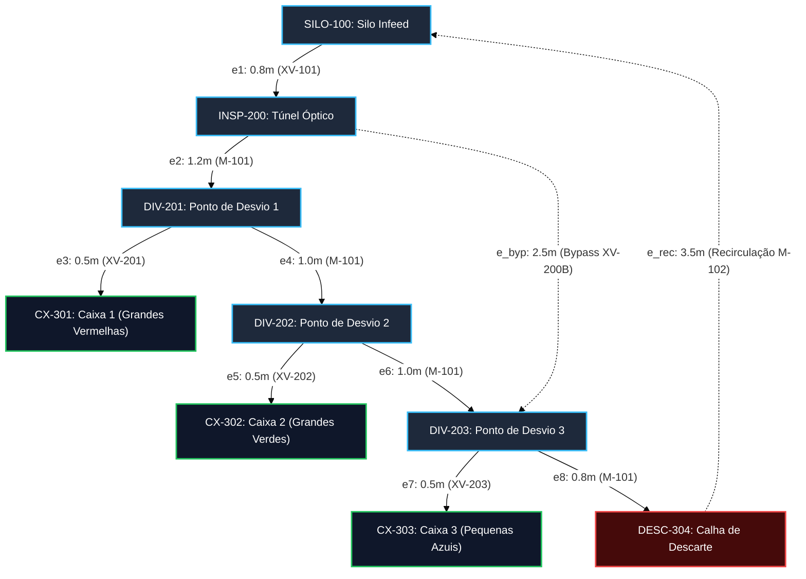

# Aula 13: Algoritmos de Busca (BFS e DFS) em Malhas de Esteiras e Postos de Triagem

## 1. Fundamentos Matemáticos: Travessia e Conectividade em Dígrafos de Manufatura

Em uma Célula de Manufatura Flexível (*Flexible Manufacturing System – FMS*), o fluxo contínuo de materiais sólidos sobre esteiras transportadoras e transferências pneumáticas é modelado através de um **Grafo Dirigido e Ponderado (Dígrafo)**:

$$G = (V, E, W)$$

Onde $V$ representa os postos de trabalho e pontos de desvio ($|V| = n$), $E$ representa os segmentos orientados de esteira e rampas de triagem ($|E| = m$), e $W$ associa grandezas físicas (comprimento em metros ou tempos de trânsito) a cada trecho.

Para a operação autônoma da planta pelo sistema supervisório (SCADA), a identificação de caminhos viáveis de transporte, a prevenção de perdas de material e a resposta dinâmica a falhas operacionais dependem diretamente dos algoritmos clássicos de **travessia em grafos**:

1. **Busca em Largura (BFS — *Breadth-First Search*):** Opera via estrutura de fila FIFO (*First-In, First-Out*). Encontra de forma determinística o caminho com o **menor número de arestas (estágios de transferência e atuadores)** entre o posto de alimentação e o destino de triagem, com complexidade assintótica linear $O(|V| + |E|)$.
2. **Busca em Profundidade (DFS — *Depth-First Search*):** Opera via recursão ou pilha LIFO (*Last-In, First-Out*) com retrocesso (*backtracking*). Permite **enumerar todas as rotas alternativas de contingência**, verificar conectividade global e **detectar ciclos estruturais** através da classificação formal de arestas ($O(|V| + |E|)$).

---

## 2. Aprofundamento Teórico

### 2.1. Busca em Largura (BFS) — Definição Formal e Invariante de Camadas

A Busca em Largura expande a fronteira de exploração sistematicamente em **camadas concêntricas de distância topológica**. Seja $s \in V$ o nó de partida (por exemplo, `SILO-100`), e $d(s, v)$ a distância mínima medida estritamente em **número de arestas (saltos)** entre $s$ e qualquer vértice $v \in V$.

O algoritmo mantém uma fila $Q$ de nós descobertos e um conjunto de vértices já visitados. A execução preserva a seguinte **invariante fundamental da fila FIFO**:

$$\text{Se o vértice } v \text{ é desenfileirado antes do vértice } u, \text{ então } d(s, v) \leq d(s, u).$$

**Demonstração do Caminho Mínimo em Arestas:**
Suponha, por absurdo, que exista um caminho direcionado de $s$ até $v$ com comprimento em arestas $k < d(s, v)$. Como a fila $Q$ visita todos os vértices de camada $0, 1, 2, \dots, k$ antes de inspecionar qualquer nó de camada $k+1$, o vértice $v$ teria sido necessariamente descoberto e rotulado no estágio $k$. Logo, a primeira vez que $v$ é retirado de $Q$, o caminho reconstruído através dos ponteiros de predecessores possui exatamente o menor número possível de arestas. $\blacksquare$

#### Interpretação Física na Manufatura Flexível:
Na automação de esteiras e células robotizadas, cada aresta percorrida corresponde a uma **transferência mecânica de peça** (passagem por roletes, correias ou rampas) ou à **comutação de um atuador pneumático** (acionamento de cilindros de alimentação ou desvio). Minimizar o número de arestas na BFS significa:
1. **Minimização de Pontos de Falha:** Cada atuador comutado introduz risco de atolamento mecânico, falha de fim de curso (`FC_p1..p3`) ou desvio incompleto.
2. **Redução do Desgaste Pneumático:** Menor consumo de ar comprimido por ciclo de triagem.
3. **Decisão Determinística em Tempo de Varredura:** O algoritmo roda em tempo $O(|V| + |E|)$, perfeitamente compatível com o tempo de ciclo (*scan time*) de Controladores Lógicos Programáveis (CLPs) e IHMs supervisórias.

---

### 2.2. Busca em Profundidade (DFS) — Definição Formal e Classificação de Arestas

A Busca em Profundidade avança continuamente ao longo de um ramo direcionado, aprofundando-se até atingir um posto terminal (caixa ou descarte) ou um nó sem sucessores não visitados, momento em que realiza o retrocesso (*backtracking*) para explorar ramificações pendentes.

Durante a execução da DFS em um dígrafo com tempos de descoberta $d[u]$ e de finalização $f[u]$ (de acordo com o Teorema dos Parênteses de Cormen-Leiserson-Rivest-Stein), cada aresta orientada $(u, v) \in E$ é formalmente classificada em uma de quatro categorias:

| Tipo de Aresta | Condição Algorítmica | Interpretação Física na Planta FMS |
| :--- | :--- | :--- |
| **Aresta de Árvore** (*Tree Edge*) | $v$ é descoberto pela primeira vez a partir de $u$ (estado BRANCO $\rightarrow$ CINZA). | **Segmento Principal de Transporte:** rota ativa de movimentação da peça pela esteira ou desvio selecionado. |
| **Aresta de Retorno** (*Back Edge*) | $v$ é um ancestral de $u$ na árvore de busca (estado CINZA, ainda ativo na pilha). | **Malha Fechada / Recirculação:** indica que o dígrafo possui um **ciclo direcionado**. Representa fisicamente uma esteira de recirculação de peças (`DESC-304` $\rightarrow$ `SILO-100`). |
| **Aresta de Avanço** (*Forward Edge*) | $v$ é um descendente não-imediato de $u$ já finalizado (estado PRETO, $d[u] < d[v]$). | **Bypass Direto:** atalho físico de esteira que salta postos intermediários (ex: bypass da inspeção ou de postos inoperantes). |
| **Aresta de Cruzamento** (*Cross Edge*) | Conecta ramos disjuntos onde $v$ já foi finalizado sem relação de ancestralidade ($d[v] < d[u]$). | **Transferência Entre Linhas:** conector entre células de produção paralelas independentes. |

* **Topologia Nominal da FMS:** A malha padrão ($9$ nós e $8$ arestas) é estritamente um DAG. Isso garante matematicamente que peças industriais nunca entrarão em *deadlock* ou rota infinita descontrolada.
* **Topologia com Recirculação:** Ao instalar a esteira de reaproveitamento de refugos `DESC-304` $\rightarrow$ `SILO-100`, a DFS classifica esta conexão instantaneamente como **aresta de retorno**, detectando a formação do ciclo $C = (\text{SILO-100} \rightarrow \text{INSP-200} \rightarrow \text{DIV-201} \dots \rightarrow \text{DESC-304} \rightarrow \text{SILO-100})$. Isso sinaliza ao SCADA a obrigatoriedade de habilitar contadores de passagem para evitar acúmulo excessivo no silo.

---

### 2.3. Comparativo Técnico: BFS vs. DFS na Automação Industrial

| Critério de Engenharia | Busca em Largura (BFS) | Busca em Profundidade (DFS) |
| :--- | :--- | :--- |
| **Garantia de Menor Número de Arestas** | **Sim (Ótimo global em saltos)** | Não (depende da ordem de visita dos vizinhos) |
| **Consumo de Memória no Pior Caso** | $O(|V|)$ (fronteira de busca na fila $Q$) | $O(\text{profundidade máxima})$, ideal para grafos profundos |
| **Enumeração de Todas as Rotas Viáveis** | Custosa (requer rastreamento de caminhos paralelos) | **Natural e Eficiente** (via retrocesso na árvore de recursão) |
| **Detecção Estrutural de Ciclos** | Indireta (via contagem de visitas em fila) | **Direta e Formal** (identificação imediata de *back edges*) |
| **Aplicação Típica no SCADA da FMS** | **Roteamento de Menor Comutação:** define a rota nominal de menor esforço mecânico para cada peça classificada. | **Engenharia de Contingência:** enumera todas as rotas secundárias e audita a existência de loops de recirculação. |

---

### 2.4. Bloqueio Dinâmico de Nós como Simulação de Falhas e Intertravamentos

Em sistemas industriais com supervisão em tempo real, as condições físicas da planta alteram dinamicamente a disponibilidade dos postos. No SCADA da Célula de Manufatura, o motor de busca recebe um conjunto de nós inoperantes:

$$\text{nos\_bloqueados} \subseteq V$$

Esse conjunto é alimentado diretamente pelos sinais dos sensores discretos e permissivos de intertravamento:

1. **Alarme de Caixa Cheia:** Quando o sensor ultrassônico/óptico de contagem (`US-301`, `US-302` ou `US-303`) atinge a capacidade máxima de $10$ peças do lote, o nó da respectiva caixa é adicionado a `nos_bloqueados`, impedindo novos encaminhamentos até que o operador realize a troca do lote.
2. **Falha de Atuador / Desvio Travado:** Caso o sensor de fim de curso do pistão (`FC_p1..p3`) acuse falha de posicionamento ou o relé térmico do motor acuse sobrecarga (`S_sobrecarga = 1`), o posto de desvio correspondente (`DIV-201`, `DIV-202` ou `DIV-203`) é bloqueado.
3. **Parada de Emergência Regional:** Acionamento do botão `HS-301` bloqueia seções inteiras da linha.

A verificação `if v_nome not in nos_bloqueados` opera em tempo amortizado $O(1)$ utilizando tabelas de dispersão (*hash sets*). Se a BFS retornar `None` para determinado destino:
* O SCADA dispara imediatamente a **inibição de infeed** (bloqueio do atuador de alimentação `XV-101`), impedindo que novas peças entrem na esteira;
* Se existirem caminhos alternativos identificados previamente pela DFS (como uma linha de *bypass* auxiliar), o sistema efetua a comutação dinâmica sem interrupção de produção.

---

## 3. Exemplo Resolvido

**Cenário:** Considere a Célula de Manufatura Flexível operando em regime de produção contínua. As peças brutas são liberadas pelo alimentador `SILO-100` e inspecionadas no túnel óptico `INSP-200`.

**Pergunta:** 
1. Determine analiticamente a sequência de nós e o número de arestas que a BFS retorna para encaminhar uma peça Grande Vermelha até a caixa de destino `CX-301`.
2. Suponha que o desvio `DIV-202` sofra um emperramento mecânico no pistão `XV-202`, sendo inserido em `nos_bloqueados`. Como o motor de busca reage às requisições de roteamento para as caixas `CX-301`, `CX-302` e `CX-303`?

**Resolução Detalhada:**

1. **Roteamento Nominal para CX-301 via BFS:**
   - **Fila inicial:** $Q = [(\text{SILO-100}, [\text{SILO-100}])]$, Visitados = $\{\text{SILO-100}\}$.
   - **Passo 1:** Desenfileira `SILO-100`. Vizinho acessível: `INSP-200`. Fila: $[(\text{INSP-200}, [\text{SILO}, \text{INSP}])]$.
   - **Passo 2:** Desenfileira `INSP-200`. Vizinho acessível: `DIV-201`. Fila: $[(\text{DIV-201}, [\text{SILO}, \text{INSP}, \text{DIV1}])]$.
   - **Passo 3:** Desenfileira `DIV-201`. Vizinhos acessíveis: `CX-301` e `DIV-202`. Ambos são adicionados à fila.
   - **Passo 4:** Desenfileira `CX-301`. Como `CX-301 == destino`, a busca encerra imediatamente.
   - **Resultado:** Rota `SILO-100 -> INSP-200 -> DIV-201 -> CX-301`, perfazendo exatamente **$3$ arestas** (alimentador $XV\text{-}101$, esteira $M\text{-}101$, pistão $XV\text{-}201$).

2. **Comportamento sob Falha em DIV-202 (`DIV-202` $\in$ `nos_bloqueados`):**
   - **Para `CX-301`:** A busca BFS atinge `CX-301` a partir de `DIV-201` antes de qualquer visita a `DIV-202`. A rota permanece íntegra: **Caminho ativo mantido**.
   - **Para `CX-302`:** A única aresta de entrada em `CX-302` provém de `DIV-202`. Como `DIV-202` está bloqueado, o algoritmo esgota a fila sem encontrar o destino e retorna `None`.
   - **Para `CX-303`:** Todo fluxo para a caixa 3 depende do trecho `DIV-201 -> DIV-202 -> DIV-203`. Com `DIV-202` fora de serviço, o corte topológico isola os nós a jusante: a BFS retorna `None`.
   - **Ação do SCADA:** O supervisório autoriza a continuação da triagem de peças vermelhas (`CX-301`), mas bloqueia a liberação de peças verdes (`CX-302`) e azuis (`CX-303`) no silo, evitando descarte involuntário ou atolamento na esteira principal.

---

## 4. Atividades de Investigação

1. **Rastreamento Manual de BFS:** Execute manualmente a BFS a partir de `SILO-100` até o terminal de refugo `DESC-304`. Liste ordenadamente o conteúdo da fila $Q$ a cada iteração e comprove que a distância calculada é de $5$ arestas.
2. **Auditoria de DAG e Detecção de Ciclos:** Na malha ampliada da fábrica contendo a esteira de retorno `DESC-304 -> SILO-100`, execute mentalmente o algoritmo DFS e indique os vértices cujos intervalos de descoberta $[d[u], f[u]]$ comprovam a existência da aresta de retorno (*back edge*).
3. **Intertravamento com Redundância:** Considere uma célula equipada com esteira auxiliar de bypass `INSP-200 -> DIV-203`. Se o nó `DIV-201` falhar, demonstre analiticamente se a caixa `CX-303` continuará acessível e descreva a nova rota gerada pelo motor de busca.
4. **Análise de Escalabilidade de Memória:** Em uma fábrica automotiva de grande porte com centenas de postos interconectados por veículos autônomos guiados (AGVs), analise o comportamento da pegada de memória ($O(|V|)$ na BFS vs. $O(h)$ na DFS, onde $h$ é a profundidade máxima) e discuta qual algoritmo é mais vantajoso para auditoria de rotas longas em controladores com memória RAM restrita.
