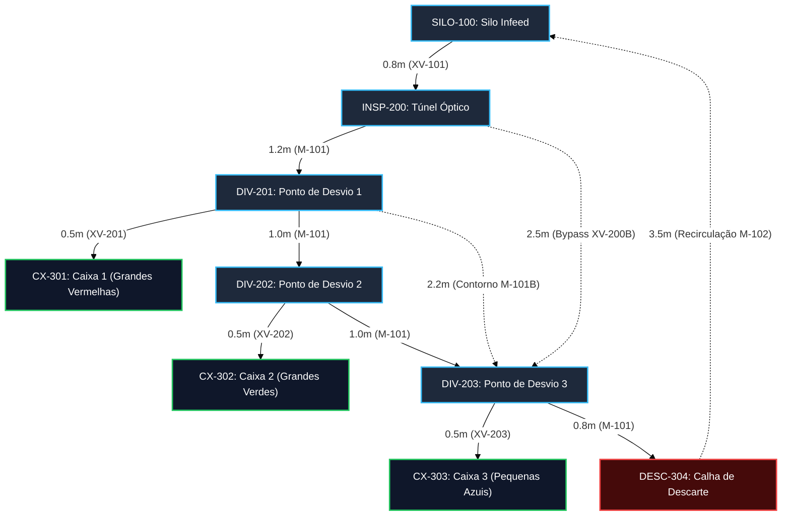

# Aula 14: Menor Caminho — Algoritmo de Dijkstra e Roteamento Dinâmico em Células de Manufatura

## 1. Fundamentos Matemáticos: Algoritmo Guloso de Dijkstra em Malhas Industriais

Em uma Célula de Manufatura Flexível (*Flexible Manufacturing System – FMS*), a movimentação física de peças sólidas através de esteiras transportadoras, mesas de roletes e desvios pneumáticos é formalmente modelada por um **Grafo Dirigido e Ponderado (Dígrafo)**:

$$G = (V, E, W)$$

Onde:
1. **$V$** é o conjunto finito de vértices ($|V| = n$), representando os postos de alimentação (`SILO-100`), estações de inspeção (`INSP-200`), pontos de desvio pneumático (`DIV-201..203`) e caixas de loteamento/descarte (`CX-301..303`, `DESC-304`).
2. **$E \subseteq V \times V$** é o conjunto de arestas direcionadas ($|E| = m$), correspondendo aos segmentos de esteira com sentido unívoco de translação mecânica.
3. **$W: E \rightarrow \mathbb{R}^+$** é a função de ponderação estritamente positiva, associando a cada trecho $e = (u, v)$ o seu comprimento físico $L\text{ [m]}$ (ou o tempo nominal de trânsito sob velocidade $v_0$ dos motores elétricos).

Enquanto a **Busca em Largura (BFS, Aula 13)** minimiza o **número de arestas/atuadores comutados** (métrica ótima para confiabilidade mecânica e redução do risco de falhas de pistões), o **Algoritmo de Dijkstra (Aula 14)** resolve o problema do **Caminho Mínimo Ponderado de Fonte Única (*Single-Source Shortest Path – SSSP*)**:

$$\delta(s, v) = \min \left\{ \sum_{e \in p} w(e) \;\middle|\; p \text{ é um caminho direcionado de } s \text{ até } v \right\}$$

Utilizando uma fila de prioridade binária (*Min-Heap* via `heapq`), o algoritmo determina de forma ótima e determinística a rota de menor custo métrico em complexidade assintótica $O((|V| + |E|) \log |V|)$.

---

## 2. Aprofundamento Teórico

### 2.1. O Princípio de Relaxação de Arestas

O núcleo algorítmico de Dijkstra repousa sobre a **operação de relaxação** (*edge relaxation*). Para cada aresta direcionada $(u, v) \in E$ com peso físico $w(u, v) > 0$, se a distância provisória acumulada até $u$, somada ao comprimento do segmento $(u, v)$, for estritamente menor do que a melhor distância conhecida até $v$, o estimador de distância e o predecessor de $v$ são atualizados:

$$\text{se } d[u] + w(u, v) < d[v] \implies \begin{cases} d[v] \leftarrow d[u] + w(u, v) \\ \text{pred}[v] \leftarrow u \end{cases}$$

#### Fundamento Matemático (Subestrutura Ótima):
A relaxação fundamenta-se no **Princípio de Otimalidade de Bellman**: se um caminho ótimo $p = \langle v_1, v_2, \dots, v_k \rangle$ conecta $v_1$ a $v_k$, qualquer subcaminho $p_{ij} = \langle v_i, \dots, v_j \rangle$ (com $1 \leq i \leq j \leq k$) é necessariamente o caminho de menor custo entre $v_i$ e $v_j$. 

No sistema supervisório (SCADA), a operação de relaxação é executada continuamente durante a simulação de tráfego, garantindo que o reencaminhamento de lotes em esteiras sempre convirja para a menor latência métrica.

---

### 2.2. Por Que a Estratégia Gulosa Funciona: Demonstração e Teorema de Corretude

Dijkstra pertence à classe dos **algoritmos gulosos** (*greedy algorithms*): a cada passo, seleciona o vértice $u \notin S$ com o menor estimador provisório de distância $d[u]$ e o insere no conjunto de vértices finalizados $S$.

#### Esboço Formal de Prova (Indução e Contradição):
* **Hipótese de Indução:** Para todo vértice $v \in S$, $d[v] = \delta(s, v)$ (o valor no vetor de distâncias é exatamente a distância mínima real).
* **Base:** Inicialmente, $S = \{s\}$ e $d[s] = \delta(s, s) = 0$. Válido.
* **Passo Indutivo:** Seja $u$ o próximo vértice retirado do Min-Heap com menor $d[u]$ entre os vértices em $V \setminus S$. Suponha, por absurdo, que $d[u] > \delta(s, u)$.
  - Então, deve existir um caminho ótimo real $p$ de $s$ até $u$. Como $s \in S$ e $u \notin S$, o caminho $p$ deve cruzar a fronteira de corte $(S, V \setminus S)$ através de uma aresta direcionada $(x, y)$, onde $x \in S$ e $y \notin S$.
  - Como $x \in S$, pela hipótese de indução temos $d[x] = \delta(s, x)$. Quando $x$ foi finalizado, a aresta $(x, y)$ foi relaxada, impondo:
    $$d[y] \leq d[x] + w(x, y) = \delta(s, x) + w(x, y) = \delta(s, y)$$
  - Como os pesos de todos os trechos de esteiras e rampas são **não-negativos** ($w(e) \geq 0, \forall e \in E$), a distância até qualquer ponto posterior no caminho $p$ não pode decrescer:
    $$\delta(s, y) \leq \delta(s, u)$$
  - Combinando as desigualdades:
    $$d[y] \leq \delta(s, y) \leq \delta(s, u) < d[u]$$
  - Portanto, $d[y] < d[u]$. Porém, o Min-Heap selecionou $u$ como o vértice de menor estimador fora de $S$, o que exige $d[u] \leq d[y]$. Estabelece-se uma contradição lógica intransponível.
  - Conclui-se que $d[u] = \delta(s, u)$. $\blacksquare$

#### Por Que Pesos Negativos Quebram o Algoritmo:
A prova acima falha categoricamente se existirem arestas com pesos negativos ($w(e) < 0$), pois a monotonicidade $\delta(s, y) \leq \delta(s, u)$ deixa de ser válida: um trecho negativo posterior poderia "compensar" uma distância inicial maior, invalidando a finalização gulosa de $u$. Nesses cenários, seria obrigatório utilizar o **Algoritmo de Bellman-Ford** ($O(|V| \cdot |E|)$). No entanto, na física da automação industrial, grandezas como comprimento de esteira ($L > 0$), tempo de transporte ($t > 0$) e consumo elétrico de motores ($P > 0$) são estritamente positivas, assegurando a aplicabilidade perfeita de Dijkstra.

---

### 2.3. Análise de Complexidade Computacional e Estruturas de Dados

A eficiência do algoritmo depende diretamente da estrutura utilizada para implementar a fila de prioridades:

| Estrutura da Fila de Prioridades | Extração do Mínimo (`heappop`) | Atualização/Relaxação (`decrease-key`) | Complexidade Total | Viabilidade em CLPs / Edge IPCs |
| :--- | :--- | :--- | :--- | :--- |
| **Busca Linear (Array)** | $O(|V|)$ | $O(1)$ | $O(|V|^2)$ | Ruim para plantas com alta expansão. |
| **Min-Heap Binário (`heapq`)** | $O(\log |V|)$ | $O(\log |V|)$ | **$O((|V| + |E|) \log |V|)$** | **Padrão ótimo industrial (adotado no SCADA).** |
| **Heap de Fibonacci** | $O(\log |V|)$ amortizado | $O(1)$ amortizado | $O(|E| + |V| \log |V|)$ | Teórica; alto overhead de memória para malhas industriais. |

Para a nossa célula de manufatura ($|V| = 9$, $|E| = 11$), o Min-Heap binário executa o cálculo de menor caminho em menos de $0.1\,\text{ms}$, permitindo reencaminhamento dinâmico dentro de um único ciclo de varredura (*scan cycle*) do controlador industrial.

---

### 2.4. Reconstrução do Caminho via Vetor de Predecessores

O algoritmo não armazena a lista de caminhos durante as iterações (o que degradaria a complexidade de memória). Em vez disso, mantém um vetor de predecessores $\text{pred}[v]$, atualizado a cada relaxação válida.

Ao atingir o destino, a reconstrução é realizada por **retropropagação** (*backtracking*):
1. Inicia em $v = \text{destino}$;
2. Concatena $v$ na lista de trajetória e faz $v \leftarrow \text{pred}[v]$;
3. Repete até alcançar a origem ($v = \text{origem}$);
4. Inverte a lista resultante para obter a sequência temporal correta.

No sistema SCADA da FMS, essa lista de vértices é mapeada instantaneamente para a **sequência de atuadores ISA-5.1** correspondentes (`XV-101`, `M-101`, `XV-201..203`), gerando a tabela de acionamentos pneumáticos e elétricos necessária para conduzir o lote de peças com segurança.

---

### 2.5. Corretude sob Bloqueios Dinâmicos e Reencaminhamento em Tempo Real

No ambiente industrial supervisionado, ocorrências operacionais exigem bloqueios imediatos:
* **Alarme de Sobrecarga Térmica no Motor:** Sensor de corrente acusa falha na esteira principal $\implies$ nó de desvio intermediário bloqueado.
* **Emperramento de Pistão de Triagem:** Chave fim de curso acusa ausência de avanço/retorno $\implies$ posto de triagem bloqueado.
* **Caixa de Loteamento Cheia:** Sensor de contagem `US-301..303` atinge limite de 10 peças $\implies$ caixa bloqueada para troca de lote.

No algoritmo `RoteadorDijkstraFMS`, a inclusão de um posto no conjunto `bloqueios` equivale matematicamente a definir:

$$w(u, v) = \infty, \quad \forall u \text{ tal que } v \in \text{bloqueios}$$

Como $\infty \geq 0$, a hipótese fundamental de pesos não-negativos permanece satisfeita, assegurando a **corretude matemática irrestrita do algoritmo**. Se nenhum caminho viável for encontrado ($d[\text{destino}] = \infty$), o SCADA inibe a partida de novas peças no `SILO-100` (`XV-101 = 0`), acionando o alarme de segurança da planta. Havendo rota de contingência (como o bypass `INSP-200 -> DIV-203`), Dijkstra recalcula o trajeto ótimo em tempo de execução sem interromper a produção.

---

## 3. Exemplo Resolvido

**Cenário:** Peças brutas do silo de alimentação `SILO-100` devem ser roteadas até a Caixa 3 (`CX-303`, peças pequenas azuis) na malha expandida da FMS (com esteira nominal e bypass).

**Topologia Relevante e Pesos:**
* $e_1$: `SILO-100` $\rightarrow$ `INSP-200` ($0.8\,\text{m}$, `XV-101`)
* $e_2$: `INSP-200` $\rightarrow$ `DIV-201` ($1.2\,\text{m}$, `M-101`)
* $e_4$: `DIV-201` $\rightarrow$ `DIV-202` ($1.0\,\text{m}$, `M-101`)
* $e_6$: `DIV-202` $\rightarrow$ `DIV-203` ($1.0\,\text{m}$, `M-101`)
* $e_7$: `DIV-203` $\rightarrow$ `CX-303` ($0.5\,\text{m}$, `XV-203`)
* $e_{\text{byp}}$: `INSP-200` $\rightarrow$ `DIV-203` ($2.5\,\text{m}$, `XV-200B`)

**Pergunta:** Execute passo a passo o Algoritmo de Dijkstra para determinar a rota métrica ótima de `SILO-100` até `CX-303`. Mostre o estado do Min-Heap e as relaxações em cada iteração.

**Resolução Detalhada:**

1. **Inicialização:**
   - $d[\text{SILO-100}] = 0.0$; todos os demais $= \infty$.
   - $\text{pred}[v] = \text{None}, \forall v \in V$.
   - $\text{Heap} = \{(0.0, \text{SILO-100})\}$, $S = \emptyset$.

2. **Iteração 1:**
   - Extrai $\text{SILO-100}$ ($d = 0.0$). $S = \{\text{SILO-100}\}$.
   - Relaxa aresta para `INSP-200`: $d = 0.0 + 0.8 = 0.8\,\text{m}$. $\text{pred}[\text{INSP}] = \text{SILO}$.
   - $\text{Heap} = \{(0.8, \text{INSP-200})\}$.

3. **Iteração 2:**
   - Extrai $\text{INSP-200}$ ($d = 0.8$). $S = \{\text{SILO}, \text{INSP}\}$.
   - Relaxa aresta para `DIV-201`: $d = 0.8 + 1.2 = 2.0\,\text{m}$. $\text{pred}[\text{DIV-201}] = \text{INSP}$.
   - Relaxa aresta de bypass para `DIV-203`: $d = 0.8 + 2.5 = 3.3\,\text{m}$. $\text{pred}[\text{DIV-203}] = \text{INSP}$.
   - $\text{Heap} = \{(2.0, \text{DIV-201}), (3.3, \text{DIV-203})\}$.

4. **Iteração 3:**
   - Extrai `DIV-201` ($d = 2.0$, menor do heap). $S = \{\text{SILO}, \text{INSP}, \text{DIV-201}\}$.
   - Relaxa para `CX-301`: $d = 2.0 + 0.5 = 2.5\,\text{m}$.
   - Relaxa para `DIV-202`: $d = 2.0 + 1.0 = 3.0\,\text{m}$. $\text{pred}[\text{DIV-202}] = \text{DIV-201}$.
   - $\text{Heap} = \{(2.5, \text{CX-301}), (3.0, \text{DIV-202}), (3.3, \text{DIV-203})\}$.

5. **Iteração 4:**
   - Extrai `CX-301` ($d = 2.5$). Não possui arestas de saída.
   - $\text{Heap} = \{(3.0, \text{DIV-202}), (3.3, \text{DIV-203})\}$.

6. **Iteração 5:**
   - Extrai `DIV-202` ($d = 3.0$).
   - Relaxa para `CX-302`: $d = 3.0 + 0.5 = 3.5\,\text{m}$.
   - Tenta relaxar para `DIV-203`: nova distância via linha principal seria $3.0 + 1.0 = 4.0\,\text{m}$. Como $4.0 > 3.3$ (distância já garantida pelo bypass), **não relaxa**. $\text{pred}[\text{DIV-203}]$ permanece apontando para `INSP-200`.
   - $\text{Heap} = \{(3.3, \text{DIV-203}), (3.5, \text{CX-302})\}$.

7. **Iteração 6:**
   - Extrai `DIV-203` ($d = 3.3$, via bypass).
   - Relaxa para `CX-303`: $d = 3.3 + 0.5 = 3.8\,\text{m}$. $\text{pred}[\text{CX-303}] = \text{DIV-203}$.
   - Relaxa para `DESC-304`: $d = 3.3 + 0.8 = 4.1\,\text{m}$.

8. **Iteração 7:**
   - Extrai `CX-302` ($d = 3.5$).

9. **Iteração 8:**
   - Extrai `CX-303` ($d = 3.8$). Como `CX-303 == destino`, a busca encerra com o ótimo global encontrado.

**Reconstrução por Predecessores:**
`CX-303` $\leftarrow$ `DIV-203` $\leftarrow$ `INSP-200` $\leftarrow$ `SILO-100`. Invertendo a sequência:

$$\text{Rota Ótima: } \text{SILO-100} \rightarrow \text{INSP-200} \rightarrow \text{DIV-203} \rightarrow \text{CX-303} \quad (L_{\min} = 3.8\,\text{m})$$

Note que, enquanto a rota nominal através de todos os desvios totalizaria $4.5\,\text{m}$ ($0.8 + 1.2 + 1.0 + 1.0 + 0.5$), a estratégia gulosa de Dijkstra comprovou analiticamente que o bypass gera uma economia de $0.7\,\text{m}$ ($15.5\%$ de redução de percurso e tempo de trânsito).

---

## 4. Atividades de Investigação

1. **Roteamento Ótimo de Refugo:** Trace manualmente o Algoritmo de Dijkstra para encontrar o menor caminho até a calha de descarte `DESC-304`. Compare o custo da rota nominal ($4.8\,\text{m}$) com a rota via bypass rápido ($4.1\,\text{m}$) e indique a sequência exata de comutação dos atuadores ISA.
2. **Sensibilidade a Custos Dinâmicos de Congestionamento:** Suponha que o segmento `INSP-200 -> DIV-201` sofra lentidão operacional devido ao acúmulo de peças, adicionando uma penalidade dinâmica de tempo/distância equivalente a $+1.5\,\text{m}$. Mostre formalmente como o estimador $d$ é afetado e qual é o limiar de penalidade no qual a linha de contorno `DIV-201 -> DIV-203` se torna mais cara do que o bypass direto.
3. **Equivalência entre BFS e Dijkstra:** Demonstre analiticamente que, se todas as arestas do dígrafo da planta possuírem pesos uniformes idênticos ($w(e) = c > 0, \forall e \in E$), a árvore de predecessores gerada por Dijkstra é formalmente idêntica à árvore de busca gerada pela BFS da Aula 13.
4. **Isolamento de Falha Dupla e Segurança Funcional:** Simule uma falha mecânica simultânea no desvio `DIV-202` e no atuador de bypass `XV-200B`. Execute mentalmente o algoritmo para a Caixa 3 (`CX-303`). O que o retorno $d = \infty$ representa fisicamente para a operação da planta e qual intertravamento de segurança o CLP deve executar imediatamente no `SILO-100`?

---

## 5. Entregável da Aula 14

* **Módulo de Roteamento Dinâmico em Python (`14 - Menor Caminho Dijkstra e Roteamento Dinamico.ipynb`):**
  - Implementação da classe `RoteadorDijkstraFMS` equipada com Min-Heap binário (`heapq`);
  - Algoritmo de relaxação sistemática com suporte a bloqueio dinâmico de nós em tempo real (`bloqueios`);
  - Suporte a penalidades dinâmicas de arestas (`penalidades`) para simulação de congestionamento e atrito;
  - Reconstituição determinística de rota com extração de tags ISA de atuadores;
  - Diagnóstico integrado para IHM SCADA com relatórios formatados em ASCII e validação por asserções de engenharia (`assert`).
