# Aula 17: Problemas Hamiltonianos e Roteamento Logístico de AGVs em Células de Manufatura (TSP)

## 1. Fundamentos Matemáticos: Ciclos Hamiltonianos e o Caixeiro-Viajante (TSP)

Em uma Célula de Manufatura Flexível (*Flexible Manufacturing System – FMS*), a movimentação física de peças contínuas sobre esteiras transportadoras foi modelada nas aulas anteriores através de um Dígrafo Acíclico Ponderado ($G_{\text{esteiras}} = (V, E, W)$). No entanto, o transporte logístico de apoio, o abastecimento de matéria-prima, o recolhimento de lotes acabados e a amostragem metrológica de qualidade são realizados no piso fabril por um **Veículo Autônomo Guiado (AGV — *Automated Guided Vehicle*)**.

A malha de circulação do AGV pelos corredores da célula de manufatura é formalmente modelada por um **Grafo Métrico Completo Não-Dirigido**:

$$G_{\text{AGV}} = (V, E, W)$$

Onde:
1. **$V = \{v_0, v_1, \dots, v_{n-1}\}$** é o conjunto finito de **postos de parada do AGV** ($|V| = n = 7$):
   - $v_0 = \text{DOCA-00}$: Doca Central de Recarga, Estacionamento e Despacho do AGV;
   - $v_1 = \text{SILO-100}$: Posto de Abastecimento do Silo de Infeed (alimentação de tarugos brutos);
   - $v_2 = \text{INSP-200}$: Posto de Calibração e Amostragem Metrológica do Túnel Óptico;
   - $v_3 = \text{CX-301}$: Baia de Coleta do Lote 1 (Peças Grandes Vermelhas);
   - $v_4 = \text{CX-302}$: Baia de Coleta do Lote 2 (Peças Grandes Verdes);
   - $v_5 = \text{CX-303}$: Baia de Coleta do Lote 3 (Peças Pequenas Azuis);
   - $v_6 = \text{DESC-304}$: Caçamba de Sucata / Coleta de Refugos da Triagem.
2. **$E = \{\{u, v\} \mid u, v \in V, u \neq v\}$** é o conjunto de conexões viárias bidirecionais entre todos os pares de postos ($|E| = \binom{n}{2} = \frac{n(n-1)}{2} = 21$ arestas na malha completa $K_7$).
3. **$W: E \rightarrow \mathbb{R}^+$** é a **função métrica de custo**, associando a cada par de postos $\{u, v\}$ a distância euclidiana ou de corredor industrial $d(u, v)$ em metros, satisfazendo as propriedades de métrica (não-negatividade, simetria e desigualdade triangular).

O **Problema do Caixeiro-Viajante (TSP — *Travelling Salesperson Problem*)** consiste em determinar um **Ciclo Hamiltoniano** de custo métrico mínimo que parta da base (`DOCA-00`), visite cada um dos demais postos da célula exatamente uma vez e retorne à base:

$$\min_{\pi \in S_n} C(\pi) = \sum_{i=0}^{n-2} d(v_{\pi(i)}, v_{\pi(i+1)}) + d(v_{\pi(n-1)}, v_{\pi(0)})$$

Onde $S_n$ é o conjunto de todas as permutações dos vértices de $V$.

```mermaid
%%{init: {
  'theme': 'base',
  'themeVariables': {
    'fontSize': '14px',
    'fontFamily': 'arial',
    'edgeLabelBackground':'#ffffff',
    'tertiaryColor': '#ffffff'
  }
}}%%
flowchart TD
    subgraph LAYOUT ["Célula de Manufatura Flexível (FMS) — Postos de Parada do AGV"]
        direction LR
        DOCA["DOCA-00 (0.0, 0.0)<br/>Doca de Recarga"]
        SILO["SILO-100 (6.0, 8.0)<br/>Alimentador Infeed"]
        INSP["INSP-200 (12.0, 14.0)<br/>Túnel Óptico / Inspeção"]
        CX1["CX-301 (20.0, 16.0)<br/>Lote Vermelho"]
        CX2["CX-302 (28.0, 16.0)<br/>Lote Verde"]
        CX3["CX-303 (38.0, 14.0)<br/>Lote Azul"]
        DESC["DESC-304 (28.0, 6.0)<br/>Caçamba de Refugo"]
    end

    DOCA ==>|"10.0m"| SILO
    SILO ==>|"8.5m"| INSP
    INSP ==>|"8.2m"| CX1
    CX1 ==>|"8.0m"| CX2

    %% Comparação visual de rotas:
    CX2 -.->|"NN Guloso: 10.0m"| DESC
    DESC -.->|"NN Obrigatório: 12.8m"| CX3
    CX3 -.->|"Salto Longo NN: 40.5m"| DOCA

    CX2 ==>|"2-Opt Ótimo: 10.2m"| CX3
    CX3 ==>|"2-Opt Ótimo: 12.8m"| DESC
    DESC ==>|"Retorno Curto: 28.6m"| DOCA

    classDef base fill:#1e293b,stroke:#38bdf8,stroke-width:2px,color:#ffffff;
    classDef estacao fill:#0f172a,stroke:#22c55e,stroke-width:2px,color:#ffffff;
    classDef descarte fill:#450a0a,stroke:#ef4444,stroke-width:2px,color:#ffffff;

    class DOCA base;
    class SILO,INSP,CX1,CX2,CX3 estacao;
    class DESC descarte;
```

---

## 2. Aprofundamento Teórico

### 2.1. Ciclo Hamiltoniano vs. Circuito Euleriano — Contraste Fundamental

Na automação de plantas industriais, é indispensável não confundir os problemas Eulerianos com os Hamiltonianos, pois suas naturezas físicas e complexidades computacionais são radicalmente distintas:

| Propriedade de Engenharia | Circuito Euleriano (Aula 16) | Ciclo Hamiltoniano / TSP (Aula 17) |
| :--- | :--- | :--- |
| **Elemento Visitado** | Cada **aresta** do grafo exatamente uma vez. | Cada **vértice** do grafo exatamente uma vez. |
| **Repetição de Vértices** | **Permitida** (o robô pode cruzar cruzamentos múltiplas vezes). | **Proibida** (exceto o posto inicial/final de recarga). |
| **Critério de Existência** | Teorema de Euler: todos os vértices devem ter grau par (ou $\text{grau}_{\text{in}} = \text{grau}_{\text{out}}$). | **Não existe critério analítico local simples**; o problema de decisão é NP-completo. |
| **Complexidade de Decisão** | Linear: $O(\|V\| + \|E\|)$ via Algoritmo de Hierholzer. | **NP-difícil** (exige tempo exponencial no caso geral para solução exata). |
| **Aplicação Típica na Manufatura** | Robô de manutenção inspecionando toda a estrutura física de esteiras e cabos elétricos. | AGV logístico recolhendo caixas de lotes cheios e abastecendo silos sem percorrer trajetos desnecessários. |

A nomenclatura homenageia Sir William Rowan Hamilton, que em 1857 formulou o *Icosian Game*, um enigma matemático que consistia em encontrar um circuito fechado ao longo das 20 arestas de um dodecaedro regular visitando cada um dos 20 vértices uma única vez.

---

### 2.2. Por que o TSP é Computacionalmente Difícil (NP-Hardness)

O Problema do Caixeiro-Viajante pertence à classe dos problemas **NP-difíceis** (*NP-hard*). A sua versão de decisão ("existe um ciclo hamiltoniano com custo total $\leq k$?") é um dos 21 problemas **NP-completos** clássicos demonstrados por Richard Karp em 1972.

#### 1. Explosão Combinatória da Força Bruta:
Se tentarmos resolver o TSP enumerando todas as rotas possíveis partindo de um nó fixo ($v_0 = \text{DOCA-00}$), o número de permutações distintas é dado por:

$$|S_n^{\text{fixo}}| = (n - 1)!$$

Se o grafo for não-dirigido (arestas simétricas), cada ciclo percorrido no sentido horário tem o mesmo custo do sentido anti-horário, totalizando $\frac{(n-1)!}{2}$ ciclos únicos:

* Para a nossa célula compacta ($n = 7$ postos): $(7 - 1)! = 6! = 720$ permutações (tratável em menos de $2\,\text{ms}$ em Python);
* Para uma linha de montagem com $n = 15$ postos: $14! \approx 8{,}71 \times 10^{10}$ rotas (levaria horas em uma CPU industrial);
* Para um centro logístico integrado com $n = 25$ postos: $24! \approx 6{,}20 \times 10^{23}$ rotas (inviável mesmo em supercomputadores).

#### 2. Programação Dinâmica Exata (Algoritmo de Held-Karp):
O algoritmo exato de Bellman-Held-Karp (1962) utiliza o princípio de subestrutura ótima para reduzir a complexidade fatorial para assintótica exponencial:

$$O(n^2 \cdot 2^n)$$

Embora muito superior à força bruta para $n \leq 20$, Held-Karp ainda se torna intratável em controladores industriais e computadores de borda (*Edge IPCs*) quando o número de postos cresce. Por essa razão, a engenharia de automação adota **métodos heurísticos de aproximação** compostos por duas fases:
1. **Fase Construtiva:** Heurística Gulosa do Vizinho Mais Próximo (*Nearest Neighbor*);
2. **Fase de Refinamento:** Busca Local por Troca de Arestas (*2-Opt*).

---

### 2.3. Heurística do Vizinho Mais Próximo (*Nearest Neighbor* — NN)

A heurística construtiva `vizinho_mais_proximo` adota uma política puramente míope (gulosa): a partir do nó de partida $u$, o AGV seleciona iterativamente o vértice não visitado $v \in V \setminus \text{Visitados}$ que possui a menor distância $d(u, v)$.

#### Análise Algorítmica:
* **Complexidade de Tempo:** A cada passo $k \in \{1, \dots, n-1\}$, o algoritmo varre até $n - k$ candidatos restantes. O número total de comparações é:
  $$\sum_{k=1}^{n-1} (n - k) = \frac{n(n - 1)}{2} = O(n^2)$$
* **Complexidade de Espaço:** $O(n)$ para armazenar o conjunto de visitados e a rota sequencial.

#### A Falha Estrutural da Estratégia Gulosa (A "Armadilha do Salto Longo"):
Por tomar decisões baseadas exclusivamente no ganho imediato local, o Vizinho Mais Próximo frequentemente "consome" vértices intermediários que serviriam de ponte suave para o retorno à base. Como resultado:
1. O último vértice restante na lista de não visitados geralmente fica isolado no extremo oposto da planta fabril;
2. O AGV é obrigado a executar um **salto longo final** de altíssimo custo para retornar à `DOCA-00`, degradando a eficiência do percurso.
3. No pior caso teórico, a rota gerada pelo Vizinho Mais Próximo pode ser $\Theta(\log n)$ vezes pior do que a rota ótima global.

---

### 2.4. Refinamento por Busca Local 2-Opt (*Edge Swapping*)

A heurística de busca local **2-Opt** (proposta por Georges Croes em 1958) corrige a deficiência do Vizinho Mais Próximo eliminando ineficiências e cruzamentos de rota.

#### Princípio Operacional do 2-Opt:
Dada uma rota hamiltoniana válida $R = \langle v_0, \dots, v_i, v_{i+1}, \dots, v_j, v_{j+1}, \dots, v_0 \rangle$:
1. Seleciona duas arestas **não-adjacentes** da rota: $(v_i, v_{i+1})$ e $(v_j, v_{j+1})$;
2. Remove ambas as arestas, particionando o ciclo em dois caminhos desconectados;
3. Reconecta os dois segmentos invertendo a ordem da subsequência intermediária $\langle v_{i+1}, \dots, v_j \rangle$, gerando a nova rota:
   $$R' = \langle v_0, \dots, v_i, \mathbf{v_j, v_{j-1}, \dots, v_{i+1}}, v_{j+1}, \dots, v_0 \rangle$$
4. A variação no custo métrico da rota ($\Delta C$) é dada por:
   $$\Delta C = \left[ d(v_i, v_j) + d(v_{i+1}, v_{j+1}) \right] - \left[ d(v_i, v_{i+1}) + d(v_j, v_{j+1}) \right]$$
5. Se $\Delta C < 0$, a troca reduz a distância total: a nova rota $R'$ é aceita imediatamente e o processo continua iterativamente até atingir um **mínimo local** ($\Delta C \geq 0$ para todos os pares $(i, j)$).

#### Interpretação Geométrica no Piso Fabril (Descruzamento Planar):
Pela **Desigualdade Triangular** em espaços métricos euclidianos, a soma dos comprimentos de dois lados opostos de um quadrilátero convexo é estritamente menor do que a soma dos comprimentos de suas duas diagonais que se cruzam:

$$\overline{AC} + \overline{BD} > \overline{AB} + \overline{CD}$$

Portanto, em um chão de fábrica plano, **qualquer par de trajetórias de AGV que se cruzam no plano é subótimo**. O 2-Opt identifica esse cruzamento e inverte a sequência intermediária, desfazendo o nó geométrico e encurtando o percurso do robô.

---

### 2.5. Cota Inferior via Árvore Geradora Mínima (MST) e Algoritmo de Christofides

Para avaliar o quão próxima a solução heurística (NN + 2-Opt) está da solução ótima global sem precisar rodar uma busca exaustiva exponencial, utiliza-se a técnica de **relaxação por Árvore Geradora Mínima (MST — *Minimum Spanning Tree*)**.

#### Teorema da Cota Inferior via MST:
Seja $C(T^*_{\text{TSP}})$ o custo do ciclo hamiltoniano ótimo. Se removermos qualquer aresta desse ciclo ótimo, os vértices continuam conectados, formando um caminho simples gerador. Como qualquer caminho simples gerador é uma árvore geradora, e a MST é, por definição, a árvore geradora de menor custo métrico em $G$:

$$C(\text{MST}) \leq C(T^*_{\text{TSP}})$$

Além disso, adicionando ao custo da MST sobre $V \setminus \{v_0\}$ as duas menores arestas incidentes em $v_0$, obtém-se a cota ainda mais justa conhecida como **1-Tree Lower Bound de Held-Karp**.

#### Garantias de Aproximação (Christofides, 1976):
Para instâncias métricas que obedecem à desigualdade triangular, o clássico **Algoritmo de Christofides** combina a Árvore Geradora Mínima com um Emparelhamento Perfeito de Custo Mínimo (*Minimum-Weight Perfect Matching*) sobre os vértices de grau ímpar da MST e atalhos triangulares (*Eulerian Tour Shortcutting*), garantindo formalmente uma solução que nunca excede $\frac{3}{2} \times$ o ótimo ($1{,}5\text{-aproximação}$).

---

### 2.6. Integração com a Célula de Manufatura Flexível (FMS) e Supervisório SCADA

Na arquitetura da nossa Célula de Manufatura Flexível, o algoritmo de roteamento TSP não roda isolado; ele é acionado pelo motor de eventos do SCADA sob três condições industriais:

1. **Gatilho por Limite de Loteamento (Full Batch Trigger):**
   - Os sensores de contagem nas esteiras (`US-301`, `US-302`, `US-303`) monitoram o empacotamento nas caixas `CX-301`, `CX-302` e `CX-303`. Ao atingir a capacidade de $10$ peças em qualquer caixa, o CLP bloqueia temporariamente a alimentação (`XV-101 = 0`) para evitar transbordo e emite a ordem de recolhimento logístico.
2. **Gatilho de Amostragem Periódica de Qualidade:**
   - A cada $50$ ciclos de triagem, o AGV é despachado para coletar peças-padrão no túnel óptico `INSP-200` para ensaios metrológicos externos de rugosidade e espectrometria.
3. **Gatilho de Esvaziamento de Caçamba de Refugo (`DESC-304`):**
   - Sensores de barreira óptica detectam nível crítico na calha de descarte de peças defeituosas, integrando a coleta de sucata à rota do AGV.

O roteador recebe a matriz de distâncias atualizada via SLAM (*Simultaneous Localization and Mapping*) e computa a rota ótima `DOCA-00 -> SILO-100 -> INSP-200 -> CX-301 -> CX-302 -> CX-303 -> DESC-304 -> DOCA-00` em menos de $1\,\text{ms}$, despachando os comandos de navegação ao controlador de tração do robô via protocolo industrial OPC UA / MQTT.

---

## 3. Exemplo Resolvido

**Cenário:** O AGV da Célula de Manufatura Flexível deve cumprir uma missão logística completa, partindo da `DOCA-00` para alimentar o silo, auditar a inspeção, recolher os lotes prontos das três caixas e a caçamba de descarte, retornando à base.

**Coordenadas Cartesianas dos Postos no Chão de Fábrica (metros):**
* $v_0 = \text{DOCA-00}: (0.0, 0.0)$
* $v_1 = \text{SILO-100}: (6.0, 8.0)$
* $v_2 = \text{INSP-200}: (12.0, 14.0)$
* $v_3 = \text{CX-301}: (20.0, 16.0)$
* $v_4 = \text{CX-302}: (28.0, 16.0)$
* $v_5 = \text{CX-303}: (38.0, 14.0)$
* $v_6 = \text{DESC-304}: (28.0, 6.0)$

**Matriz de Distâncias Euclidianas $d(u, v) = \sqrt{(x_u - x_v)^2 + (y_u - y_v)^2}$ [m]:**

| Posto | DOCA-00 | SILO-100 | INSP-200 | CX-301 | CX-302 | CX-303 | DESC-304 |
| :--- | :---: | :---: | :---: | :---: | :---: | :---: | :---: |
| **DOCA-00** | 0.0 | 10.0 | 18.4 | 25.6 | 32.2 | 40.5 | 28.6 |
| **SILO-100** | 10.0 | 0.0 | 8.5 | 16.1 | 23.4 | 32.6 | 22.1 |
| **INSP-200** | 18.4 | 8.5 | 0.0 | 8.2 | 16.1 | 26.0 | 17.9 |
| **CX-301** | 25.6 | 16.1 | 8.2 | 0.0 | 8.0 | 18.1 | 12.8 |
| **CX-302** | 32.2 | 23.4 | 16.1 | 8.0 | 0.0 | 10.2 | 10.0 |
| **CX-303** | 40.5 | 32.6 | 26.0 | 18.1 | 10.2 | 0.0 | 12.8 |
| **DESC-304** | 28.6 | 22.1 | 17.9 | 12.8 | 10.0 | 12.8 | 0.0 |

---

**Pergunta:** Execute passo a passo a heurística do Vizinho Mais Próximo partindo de `DOCA-00` e determine por que a busca local 2-Opt reduz o custo total em $11{,}7\,\text{m}$, explicando a mecânica do descruzamento.

---

**Resolução Detalhada:**

### 1. Construção Gulosa via Vizinho Mais Próximo (NN):
* **Início:** Parte de $v_0 = \text{DOCA-00}$. Não visitados: $\{1, 2, 3, 4, 5, 6\}$.
* **Passo 1:** Menor distância a partir de `DOCA-00` é para `SILO-100` ($d = 10.0\,\text{m}$). Rota: `[DOCA-00, SILO-100]`.
* **Passo 2:** A partir de `SILO-100`, o mais próximo é `INSP-200` ($d = 8.5\,\text{m}$). Rota: `[..., INSP-200]`.
* **Passo 3:** A partir de `INSP-200`, o mais próximo é `CX-301` ($d = 8.2\,\text{m}$). Rota: `[..., CX-301]`.
* **Passo 4:** A partir de `CX-301`, o mais próximo é `CX-302` ($d = 8.0\,\text{m}$). Rota: `[..., CX-302]`.
* **Passo 5 (A Decisão Míope):** Em `CX-302`, os vértices restantes são `CX-303` ($d = 10.2\,\text{m}$) e `DESC-304` ($d = 10.0\,\text{m}$).
  - Como $10.0 < 10.2$, o algoritmo guloso salta imediatamente para `DESC-304`!
  - Rota: `[..., CX-302, DESC-304]`.
* **Passo 6 (O Salto Obrigatório):** O único vértice remanescente é `CX-303`. O AGV deve ir de `DESC-304` para `CX-303` ($d = 12.8\,\text{m}$).
* **Passo 7 (Retorno à Base):** Estando em `CX-303`, o robô é forçado a percorrer a distância de retorno mais longa da fábrica até `DOCA-00` ($d = 40.5\,\text{m}$).

**Custo Total da Rota NN:**
$$C(\text{NN}) = 10.0 + 8.5 + 8.2 + 8.0 + 10.0 + 12.8 + 40.5 = \mathbf{98{,}0\,\text{m}}$$

---

### 2. Refinamento por Busca Local 2-Opt:
O 2-Opt avalia a inversão da subsequência terminal `[DESC-304, CX-303]`:
* Rota Inicial: `... -> CX-302 -> DESC-304 -> CX-303 -> DOCA-00`
* Rota com Inversão: `... -> CX-302 -> CX-303 -> DESC-304 -> DOCA-00`

**Comparativo das Arestas Modificadas:**
* Arestas Removidas: $(\text{CX-302}, \text{DESC-304})$ com peso $10.0$ e $(\text{CX-303}, \text{DOCA-00})$ com peso $40.5$.
  $$C_{\text{antigo}} = 10.0 + 12.8 + 40.5 = 63.3\,\text{m}$$
* Novas Arestas Inseridas: $(\text{CX-302}, \text{CX-303})$ com peso $10.2$ e $(\text{DESC-304}, \text{DOCA-00})$ com peso $28.6$.
  $$C_{\text{novo}} = 10.2 + 12.8 + 28.6 = 51.6\,\text{m}$$

**Ganho Líquido:**
$$\Delta C = 51.6 - 63.3 = \mathbf{-11{,}7\,\text{m}}$$

**Custo Final da Rota 2-Opt:**
$$C(\text{2-Opt}) = 98.0 - 11.7 = \mathbf{86{,}3\,\text{m}}$$

A rota otimizada é:
$$\text{DOCA-00} \rightarrow \text{SILO-100} \rightarrow \text{INSP-200} \rightarrow \text{CX-301} \rightarrow \text{CX-302} \rightarrow \text{CX-303} \rightarrow \text{DESC-304} \rightarrow \text{DOCA-00}$$

**Conclusão Física:** A busca local evitou que o AGV fizesse um "ziguezague" entre `CX-302` e `DESC-304` e eliminou o retorno custoso a partir de `CX-303`, substituindo-o pelo trajeto perimetral suave que contorna o final da linha de produção e retorna rapidamente pela via lateral inferior. A busca exaustiva por força bruta ($720$ rotas) comprova que $86{,}3\,\text{m}$ é de fato o **Ótimo Global**.

---

## 4. Atividades de Investigação

1. **Auditoria de Força Bruta e Espaço de Busca:** No notebook da aula, execute o método `resolver_forca_bruta` para avaliar todas as $(7 - 1)! = 720$ permutações fixando a `DOCA-00`. Confirme se existe alguma outra rota com custo $< 86{,}3\,\text{m}$ e registre o tempo computacional de execução.
2. **Sensibilidade ao Ponto de Partida do AGV:** Execute a heurística do Vizinho Mais Próximo iniciando a partir de postos diferentes (por exemplo, `INSP-200` e `CX-301`). Compare os custos das rotas iniciais de NN com a rota obtida a partir da `DOCA-00` e comprove se o refinamento 2-Opt sempre converge para o mesmo ciclo ótimo fundamental de $86{,}3\,\text{m}$.
3. **Validação da Cota Inferior via MST:** Calcule a Árvore Geradora Mínima (MST) da matriz métrica da FMS. Comprove analiticamente que $C(\text{MST}) \leq C(T^*_{\text{TSP}})$, explicando por que o valor de $54{,}9\,\text{m}$ confirma que a solução encontrada pelo 2-Opt está matematicamente dentro da faixa de otimalidade teórica.
4. **Impacto da Desigualdade Triangular:** Suponha que um obstáculo físico temporário (uma empilhadeira parada no corredor entre `DESC-304` e `DOCA-00`) aumente a distância desse trecho de $28{,}6\,\text{m}$ para $55{,}0\,\text{m}$. Como a matriz de distâncias deve ser recalculada via Dijkstra (Aula 14) antes de alimentar o TSP para manter a validade da métrica?
5. **Integração de Sinais Discretos no SCADA:** Descreva as regras lógicas proposicionais e de predicados que o CLP da célula deve executar para despachar o AGV automaticamente apenas quando pelo menos uma das caixas `CX-301..303` atingir contagem cheia ($10$ peças) ou a caçamba `DESC-304` estiver preenchida.

---

## 5. Entregável da Aula 17

* **Otimizador Logístico de AGV em Python (`17 - Problemas Hamiltonianos e Roteamento de AGV.ipynb`):**
  - Implementação da classe `RoteadorAGV_TSP_FMS` com tipagem estática e suporte a coordenadas 2D e matrizes métricas;
  - Algoritmo construtivo do Vizinho Mais Próximo (*Nearest Neighbor*) com complexidade $O(n^2)$;
  - Algoritmo de busca local *2-Opt* para descruzamento planar e remoção de saltos longos ($O(n^3)$);
  - Solver exato por Força Bruta para auditoria e comprovação do ótimo global ($O((n-1)!)$);
  - Algoritmo de Prim para cálculo da cota inferior teórica via Árvore Geradora Mínima (MST);
  - Módulo de auditoria para o sistema supervisório SCADA com tabelas ASCII formatadas;
  - Bateria de asserções determinísticas de engenharia (`assert`) validando propriedades métricas, corretude de ciclo e convergência ótima.
