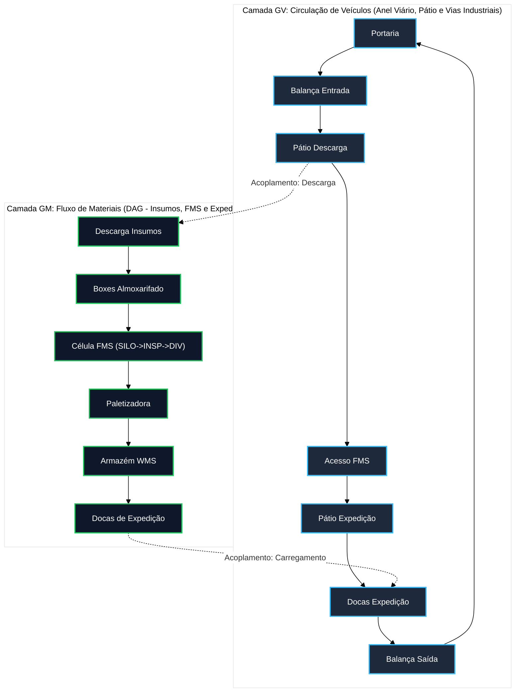
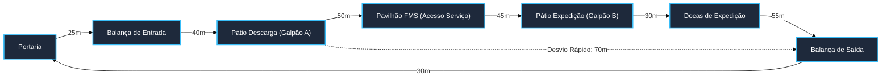

# Aula 18: Grafos de Logística de Insumos, Processo e Produtos Acabados na Manufatura Flexível

## 1. Situação-Problema

Nas aulas anteriores (Aulas 11 a 15), a Célula de Manufatura Flexível (*Flexible Manufacturing System – FMS*) foi modelada com foco estrito na dinâmica interna da bancada de esteiras: alimentação pelo silo, transporte motorizado `M-101`, inspeção óptica dimensional e de cor no `INSP-200`, triagem pneumática nos desvios `DIV-201..203` e loteamento nas caixas `CX-301..303` e descarte `DESC-304`. Na Aula 17, otimizamos o percurso do AGV para amostragem e coleta de caixas no piso da célula.

No entanto, a operação de uma planta industrial completa exige integrar a célula ao ecossistema fabril e à cadeia de suprimentos (*supply chain*):
* **Como a matéria-prima bruta chega à célula?** (Entrada rodoviária de fornecedores, pesagem na balança, descarga em docas, segregação em almoxarifados de tarugos e preparação de carga);
* **Como os insumos secundários são alimentados?** (Insumos de acabamento óptico/corantes e suprimentos de empacotamento, caixas e paletes);
* **Como os produtos acabados chegam ao cliente final?** (Paletização automática de batches de 10 peças, endereçamento inteligente em armazém vertical WMS do Galpão B e expedição nas docas rodoviárias).

O objetivo desta aula é construir **modelos de grafos multicamada** que conectem todos esses setores sem confundir fluxos físicos distintos (fluxo de material sobre transportadores vs. circulação de caminhões e empilhadeiras nas vias industriais).

---

## 2. Fundamentos Teóricos: Redes Multicamada e Grafos Acíclicos Dirigidos (DAG)

### 2.1. Por Que o Fluxo de Materiais é um Grafo Acíclico Dirigido (DAG)

Diferente da malha de tráfego de veículos (que possui ciclos viários de retorno), o grafo de fluxo de materiais $G_M = (V_M, E_M, W_M)$ é, por imposição física de processo, um **Grafo Acíclico Dirigido (DAG — *Directed Acyclic Graph*)**: não existe nenhum ciclo direcionado na linha normal de produção, pois cada etapa de transformação física (usinagem, corte, acabamento, inspeção, triagem, empacotamento e paletização) é irreversível.

#### Definição Formal de DAG:
Um dígrafo $G = (V, E)$ é acíclico se e somente se não existe nenhuma sequência finita de vértices $\langle v_0, v_1, \dots, v_k \rangle$ tal que $(v_{i-1}, v_i) \in E$ para todo $i \in \{1, \dots, k\}$ com $v_0 = v_k$.

#### Propriedade Fundamental (Ordenação Topológica):
Todo DAG admite pelo menos uma **Ordenação Topológica**, isto é, uma bijeção linear dos vértices:

$$\text{ord}: V \rightarrow \{1, 2, \dots, |V|\}$$

tal que, para toda aresta direcionada $(u, v) \in E$, tem-se rigorosamente:

$$\text{ord}(u) < \text{ord}(v)$$

Essa propriedade matemática confere **auditabilidade total ao sistema supervisório (SCADA / MES)**: qualquer ordem de fabricação pode ser validada em tempo polinomial. O modelo proíbe formalmente que a etapa de `Paletizadora Automática` seja executada antes do `SILO-100: Silo Infeed` ou da `INSP-200: Túnel Óptico`, pois não existe ordenação topológica compatível com tal inversão temporal.

#### Algoritmo de Kahn (1962) para Verificação e Ordenação:
O algoritmo processa iterativamente vértices com **grau de entrada nulo** ($\text{grau}_{\text{in}}(v) = 0$):
1. Inicializa uma fila $Q$ com todos os vértices que não possuem arestas incidentes (fontes primárias, como `Portaria`);
2. Enquanto $Q$ não estiver vazia, desenfileira $u$, insere $u$ na lista de ordenação topológica e, para cada sucessor $v$ de $u$, remove virtualmente a aresta $(u, v)$, decrementando $\text{grau}_{\text{in}}(v)$;
3. Se $\text{grau}_{\text{in}}(v)$ atinge $0$, insere $v$ em $Q$;
4. Ao final, se o número de vértices ordenados for estritamente igual a $|V|$, o grafo é comprovadamente um **DAG**. Caso contrário, o grafo contém ciclos direcionados (*deadlocks* ou laços de recirculação não controlados).
* **Complexidade Assintótica:** $O(|V| + |E|)$, linear e ótima.

---

### 2.2. Redes Multicamada (*Multilayer Networks*)

Modelar toda a fábrica através de um único grafo unificado colapsando pedestres, esteiras e veículos é um grave erro conceitual de engenharia. A abordagem formal correta utiliza a teoria de **Redes Multicamada**:

$$\mathcal{M} = \left( \{G_\alpha\}_{\alpha \in L}, \{V_\alpha\}, \{E_{\alpha\beta}\} \right)$$

Onde $L = \{M, V, E\}$ é o conjunto de camadas industriais:
1. **$G_M$ (Camada de Materiais):** Mapeia o trânsito físico dos insumos e peças por esteiras, roletes e rampas. Arestas representam transferências irreversíveis de material. É um **DAG**.
2. **$G_V$ (Camada de Veículos):** Mapeia a malha viária do pátio, balanças e corredores industriais para empilhadeiras e caminhões. Arestas representam trechos autorizados de rodagem (mão única ou dupla). **Contém ciclos**.
3. **$G_E$ (Camada de Armazenamento WMS):** Mapeia a hierarquia de posições em porta-paletes verticais, pulmões de peças e docas de carregamento.

#### O Erro Clássico de Acoplamento:
Se colapsássemos $G_M$ e $G_V$ em um único grafo, o Algoritmo de Dijkstra poderia sugerir que uma empilhadeira trafegasse por cima da esteira transportadora `M-101`, ou que peças sólidas recém-saídas da paletizadora fossem "sugadas" em marcha a ré pela balança rodoviária de entrada. Separar as camadas preserva as restrições físicas de cada domínio.

---

### 2.3. Cadeia de Suprimentos como Composição de Grafos

A Etapa 02 do projeto consolida uma caixa de ferramentas unificada da Teoria dos Grafos aplicada a sistemas automatizados. A tabela abaixo demonstra como cada subproblema da fábrica é solucionado pelos algoritmos desenvolvidos:

| Desafio Logístico / Operacional | Algoritmo Aplicável | Complexidade | Aula de Referência |
| :--- | :--- | :--- | :--- |
| **Menor caminho entre insumo e doca de expedição** | Algoritmo de Dijkstra com Min-Heap | $O((|V|+|E|) \log |V|)$ | Aula 14 / Aula 18 |
| **Auditoria de consistência e aciclicidade da produção** | Algoritmo de Kahn (Ordenação Topológica) | $O(|V|+|E|)$ | Aula 18 (Seção 2.1) |
| **Rota ótima de amostragem e coleta de caixas pelo AGV** | TSP via Heurística NN + Refinamento 2-Opt | $O(n^2) + O(n^3)$ | Aula 17 |
| **Reencaminhamento dinâmico sob bloqueio de via/esteira** | Reponderação dinâmica com pesos infinitos | $O((|V|+|E|) \log |V|)$ | Aula 14 / Aula 15 |
| **Identificação de gargalos estruturais e pontes críticas** | Detecção de Pontes e Articulações via DFS | $O(|V|+|E|)$ | Aula 13 / Aula 15 |
| **Roteamento de menor número de comutações mecânicas** | Busca em Largura (BFS) | $O(|V|+|E|)$ | Aula 13 |

---

### 2.4. Limitações do Modelo com Peso Único e Otimização Multiobjetivo

Nesta etapa, os arcos carregam um escalar escalar unificado de peso físico ($L\text{ [m]}$). Na prática da automação logística avançada, cada trecho $(u, v)$ é governado por um **vetor de custos**:

$$\vec{w}(u, v) = \begin{bmatrix} L(u, v) & \text{[distância em metros]} \\ t(u, v) & \text{[tempo de trânsito considerando tráfego e velocidade]} \\ C(u, v) & \text{[custo energético/operacional em R\$]} \\ R(u, v) & \text{[risco de avaria mecânica ou perda de qualidade]} \end{bmatrix}$$

A determinação da rota ótima transforma-se em um **Problema de Otimização Multiobjetivo**, cuja solução não é um único caminho escalar, mas uma **Fronteira de Pareto** de rotas não-dominadas, permitindo ao operador do SCADA arbitrar entre a rota mais rápida, a mais econômica ou a mais confiável.

---

## 3. Três Grafos para a Célula de Manufatura Flexível Integrada

| Camada | Grafo | Vértices ($V$) | Arestas Dirigidas ($E$) | Peso Padrão | Questão Industrial Respondida |
| :--- | :---: | :--- | :--- | :--- | :--- |
| **Fluxo de Materiais** | $G_M$ | Portaria, balança, almoxarifado de insumos, setores da FMS, paletizadora, armazém WMS e docas ($25$ nós). | Transferências mecânicas unidirecionais de material por esteiras, calhas e empilhadeiras. | Distância física percorrida pelo material ($m$). | Qual o trajeto métrico de cada matéria-prima até a expedição como lote acabado? |
| **Circulação de Veículos** | $G_V$ | Portaria, balança de entrada/saída, pátios de manobra, vias perimetrais e docas. | Vias rodoviárias e corredores de tráfego de caminhões e empilhadeiras pesadas. | Distância métrica viária ($m$). | Qual rota interna um caminhão de fornecedor ou cliente pode percorrer no pátio? |
| **Alocação de Estoque** | $G_E$ | Saídas das caixas `CX-301..303`, posições verticais de porta-paletes e docas. | Endereçamento WMS e operações de *picking/put-away*. | Número de movimentações de elevação ou latência. | Em qual baia do armazém cada lote de cor e dimensão deve ser estocado? |

---

## 4. Grafo Dirigido do Fluxo de Materiais ($G_M$)

O dígrafo $G_M = (V_M, E_M, W_M)$ integra toda a cadeia física interna da fábrica:

```mermaid
%%{init: {
  'theme': 'base',
  'themeVariables': {
    'fontSize': '13px',
    'fontFamily': 'arial',
    'edgeLabelBackground':'#ffffff',
    'tertiaryColor': '#ffffff'
  }
}}%%
flowchart LR
    P["Portaria"] -->|"25m"| BE["Balança de Entrada"]
    BE -->|"45m"| DA["Doca Descarga Galpão A"]

    DA -->|"15m"| B1["Box: Tarugos Grandes (Vermelho/Verde)"]
    DA -->|"18m"| B2["Box: Tarugos Pequenos (Azul)"]
    DA -->|"20m"| B3["Box: Pigmentos Industriais (RGB)"]
    DA -->|"22m"| B4["Box: Embalagens e Caixas de Lote"]

    B1 -->|"25m"| PREP["Posto Preparação / Carga"]
    B2 -->|"22m"| PREP
    B3 -->|"24m"| PIGM["Estação Dosagem Pigmento"]
    PREP -->|"18m"| SILO["SILO-100: Silo Infeed"]
    PIGM -->|"20m"| INSP["INSP-200: Túnel Óptico"]

    SILO -->|"12m"| INSP
    INSP -->|"10m"| DIV1["DIV-201: Desvio 1"]

    DIV1 -->|"5m"| CX1["CX-301: Grandes Vermelhas"]
    DIV1 -->|"8m"| DIV2["DIV-202: Desvio 2"]

    DIV2 -->|"5m"| CX2["CX-302: Grandes Verdes"]
    DIV2 -->|"8m"| DIV3["DIV-203: Desvio 3"]

    DIV3 -->|"5m"| CX3["CX-303: Pequenas Azuis"]
    DIV3 -->|"8m"| DESC["DESC-304: Calha Descarte"]

    CX1 -->|"20m"| PALET["Paletizadora Automática"]
    CX2 -->|"22m"| PALET
    CX3 -->|"25m"| PALET
    B4 -->|"30m"| PALET

    PALET -->|"20m"| EST1["Estoque: Grandes Vermelhas"]
    PALET -->|"22m"| EST2["Estoque: Grandes Verdes"]
    PALET -->|"25m"| EST3["Estoque: Pequenas Azuis"]

    DESC -->|"18m"| SUCATA["Área Sucata / Reciclagem"]

    EST1 -->|"25m"| DOCA["Docas de Expedição"]
    EST2 -->|"22m"| DOCA
    EST3 -->|"28m"| DOCA
    SUCATA -->|"15m"| DOCASUC["Doca de Resíduos"]

    classDef default fill:#1e293b,stroke:#38bdf8,stroke-width:1px,color:#ffffff;
    classDef entrada fill:#0f172a,stroke:#38bdf8,stroke-width:2px,color:#ffffff;
    classDef fms fill:#1e1b4b,stroke:#a855f7,stroke-width:2px,color:#ffffff;
    classDef saida fill:#064e3b,stroke:#22c55e,stroke-width:2px,color:#ffffff;
    classDef refugo fill:#450a0a,stroke:#ef4444,stroke-width:2px,color:#ffffff;

    class P,BE,DA,B1,B2,B3,B4 entrada;
    class SILO,INSP,DIV1,DIV2,DIV3,CX1,CX2,CX3 fms;
    class PALET,EST1,EST2,EST3,DOCA saida;
    class DESC,SUCATA,DOCASUC refugo;
```

### 4.1. Rastreabilidade com os Insumos e Produtos Acabados

| Insumo de Entrada | Vértice de Entrada em $G_M$ | Destino no Processo FMS | Produto Acabado Resultante | Estoque Final |
| :--- | :--- | :--- | :--- | :--- |
| **Tarugos Cilíndricos Grandes** | `Box: Tarugos Grandes` | `SILO-100` $\rightarrow$ `INSP-200` $\rightarrow$ `DIV-201` | Lote de Peças Grandes Vermelhas | `Estoque: Grandes Vermelhas` |
| **Tarugos Cilíndricos Grandes** | `Box: Tarugos Grandes` | `SILO-100` $\rightarrow$ `INSP-200` $\rightarrow$ `DIV-202` | Lote de Peças Grandes Verdes | `Estoque: Grandes Verdes` |
| **Tarugos Cilíndricos Pequenos** | `Box: Tarugos Pequenos` | `SILO-100` $\rightarrow$ `INSP-200` $\rightarrow$ `DIV-203` | Lote de Peças Pequenas Azuis | `Estoque: Pequenas Azuis` |
| **Corantes e Tintas RGB** | `Box: Pigmentos Industriais` | `Estação de Dosagem` $\rightarrow$ `INSP-200` | Acabamento e pigmentação superficial | Incorporado nas peças |
| **Caixas de Lote e Paletes** | `Box: Embalagens` | `Paletizadora Automática` | Batches empacotados de 10 peças | Paletes prontos para expedição |
| **Peças Fora de Especificação** | Qualquer tarugo defeituoso | `INSP-200` $\rightarrow$ `DIV-203` $\rightarrow$ `DESC-304` | Sucata segregada para reprocessamento | `Área de Sucata e Reciclagem` |

---

## 5. Grafo de Circulação de Veículos ($G_V$)

O anel viário externo atende ao fluxo rodoviário de transporte pesado:

### 5.1. Análise Topológica do Anel Viário
Ao contrário de $G_M$, o grafo $G_V$ **não é um DAG**: ele contém o ciclo fechado $\text{Portaria} \rightarrow \dots \rightarrow \text{Docas} \rightarrow \text{Balança Saída} \rightarrow \text{Portaria}$. Isso reflete a realidade operacional de que veículos externos entram, descarregam/carregam e saem da fábrica pela mesma portaria de controle fiscal.

---

## 6. Exemplo Resolvido

**Cenário:** O sistema supervisório executa o algoritmo de Dijkstra sobre o grafo $G_M$ para determinar a rota métrica de menor custo entre a `Portaria` e as `Docas de Expedição`.

**Pergunta:** Por que a rota de menor custo global em $G_M$ reportada pelo algoritmo passa pelo `Box: Embalagens e Caixas de Lote` ($166{,}0\,\text{m}$), e não pelos boxes de matéria-prima de tarugos (`Tarugos Grandes`: $205{,}0\,\text{m}$ ou `Tarugos Pequenos`: $231{,}0\,\text{m}$)? O que isso ensina sobre a interpretação de grafos industriais?

**Resolução Detalhada:**
1. **Trajeto via Box de Embalagens:**
   $$\text{Portaria} \xrightarrow{25} \text{Balança IN} \xrightarrow{45} \text{Doca Descarga} \xrightarrow{22} \text{Box Embalagens} \xrightarrow{30} \text{Paletizadora} \xrightarrow{22} \text{Estoque Verdes} \xrightarrow{22} \text{Docas Expedição}$$
   $$\text{Custo Total} = 25 + 45 + 22 + 30 + 22 + 22 = \mathbf{166{,}0\,\text{m}}$$

2. **Trajeto via Tarugos Grandes (Peças Vermelhas):**
   $$\text{Portaria} \xrightarrow{25} \text{Balança IN} \xrightarrow{45} \text{Descarga} \xrightarrow{15} \text{Box Tarugos} \xrightarrow{25} \text{Preparação} \xrightarrow{18} \text{SILO-100} \xrightarrow{12} \text{INSP-200} \xrightarrow{10} \text{DIV-201} \xrightarrow{5} \text{CX-301} \xrightarrow{20} \text{Paletizadora} \xrightarrow{20} \text{Estoque Vermelho} \xrightarrow{25} \text{Docas}$$
   $$\text{Custo Total} = 70 + 15 + 25 + 18 + 12 + 10 + 5 + 20 + 20 + 25 = \mathbf{220{,}0\,\text{m}}$$

3. **Lição de Engenharia e Interpretação:**
   Dijkstra encontra o caminho de menor somatório acumulado. As caixas e paletes são insumos secundários de consumo que entram direto na fase de embalagem no Galpão B, sem passar pelo processo de usinagem, transporte de esteiras e triagem pneumática da FMS.
   
   Portanto, se o engenheiro deseja avaliar o trajeto das **peças manufaturadas**, ele não deve consultar genericamente a rota de menor caminho de `Portaria` até `Docas`, mas sim a rota originada especificamente no vértice do insumo correspondente (`Box: Tarugos Grandes`) ou na estação de infeed (`SILO-100: Silo Infeed`).

---

## 7. Atividades de Investigação

1. **Auditoria de Aciclicidade via Algoritmo de Kahn:** No notebook da aula, execute o método `ordenacao_topologica_kahn` sobre $G_M$ e $G_V$. Comprove que $G_M$ retorna `True` com todos os 25 vértices linearizados e que $G_V$ retorna `False` devido à presença do ciclo de saída de veículos.
2. **Injeção de Ciclo Indevido no Fluxo de Materiais:** Adicione temporariamente em $G_M$ uma aresta de retrabalho `Estoque: Lote Grandes Vermelhas -> SILO-100: Silo Infeed`. Execute novamente o teste de Kahn. Quantos vértices o algoritmo consegue ordenar antes de travar? Explique por que essa esteira de retrabalho invalida a propriedade de DAG e como o SCADA deve tratar esse laço fechado.
3. **Análise de Rota Crítica de Contingência Viária:** No grafo $G_V$, simule um bloqueio total na via `Pavilhão FMS -> Pátio Expedição` devido a obras no pavimento. Calcule a rota de contingência para um caminhão descarregado no pátio do Galpão A sair da fábrica. Qual é o aumento percentual de distância em relação ao trajeto nominal?
4. **Impacto de Políticas WMS de Endereçamento:** Na camada $G_M$, compare as distâncias de expedição para os três estoques de produto acabado (`Grandes Vermelhas`: $25\,\text{m}$, `Grandes Verdes`: $22\,\text{m}$, `Pequenas Azuis`: $28\,\text{m}$). Se a demanda de mercado por peças verdes for 4 vezes maior do que pelas demais, justifique por que o estoque verde foi alocado fisicamente mais próximo da doca de expedição.
5. **Transição para Otimização Multiobjetivo:** Considere que a esteira entre `Paletizadora` e `Estoque Pequenas Azuis` possui velocidade reduzida ($0{,}2\,\text{m/s}$ vs. $0{,}5\,\text{m/s}$ das demais) para evitar tombamento de caixas menores. Demonstre que, ao converter os pesos de distância ($L$) para tempo de trânsito ($t$), a rota mais curta em metros pode deixar de ser a mais rápida.

---

## 8. Entregável da Aula 18 (Avaliação do Módulo 2)

* **Módulo Logístico Integrado em Python (`18 - Grafos de Logistica de Insumos e Produtos Acabados.ipynb`):**
  - Implementação da classe `GrafoLogistico` com Min-Heap Dijkstra ($O((|V|+|E|) \log |V|)$) e rastreamento de descrições de processo;
  - Algoritmo de Kahn para ordenação topológica e auditoria estrutural de aciclicidade em grafos industriais ($O(|V|+|E|)$);
  - Instanciação completa e coerente dos modelos multicamada:
    1. $G_M$: Grafo Dirigido e Acíclico (DAG) com $25$ postos mapeando insumos, preparação, FMS, loteamento, paletização, armazenagem WMS e expedição;
    2. $G_V$: Grafo de Circulação Viária com anel fechado e rotas de contingência para veículos pesados e empilhadeiras;
  - Relatórios de auditoria formatados em ASCII alinhado para integração com IHM supervisória SCADA;
  - Bateria de asserções de engenharia (`assert`) comprovando a aciclicidade de $G_M$, a ciclicidade de $G_V$, os menores caminhos calculados e a consistência das rotas de suprimentos.
