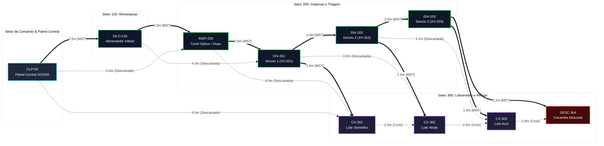

# Relatório Técnico: Otimização Topológica de Célula de Manufatura Flexível (FMS)

**Dimensionamento Mínimo de Malha de Cabeamento SCADA, Barramento Industrial e Infraestrutura Pneumática com Algoritmos de Kruskal e Prim**

### Informações do Projeto

| Parâmetro | Detalhe |
| :--- | :--- |
| **Unidade Industrial** | Célula de Manufatura Flexível e Triagem Automática de Peças (FMS) |
| **Setores Abrangidos** | Setor 100 (Alimentação), Setor 200 (Inspeção/Triagem) e Setor 300 (Loteamento/Descarte) |
| **Aplicação** | Otimização de Eletrocalhas SCADA (PROFINET / Fieldbus) e Malha Pneumática de Distribuição |
| **Método Formulado** | Árvore Geradora Mínima (MST — *Minimum Spanning Tree*) |
| **Algoritmos Avaliados** | Kruskal (baseado em arestas / DSU) e Prim (baseado em vértices / Min-Heap) |
| **Código do Projeto** | `ECAA08-MANUFATURA-FLEXIVEL` (SCADA-Core Manufatura Flexível) |

---

## 1. Contextualização e Objetivo de Engenharia de Automação

Nas etapas anteriores do projeto (Aulas 11 a 14), o fluxo de transporte contínuo de peças ao longo da bancada foi modelado como um **Grafo Acíclico Dirigido (DAG)**, no qual as peças sólidas se deslocam em sentido unidirecional a partir do alimentador (`SILO-100`), passando pelo túnel óptico de inspeção (`INSP-200`) e pelos pontos de desvio pneumático (`DIV-201`, `DIV-202`, `DIV-203`), até atingirem as caixas de loteamento (`CX-301`, `CX-302`, `CX-303`) ou a caçamba de refugo (`DESC-304`). O algoritmo de Dijkstra (Aula 14) foi empregado para solucionar o problema de caminho mínimo direcionado de fonte única (*SSSP*) para o reencaminhamento dinâmico de produtos.

Entretanto, a **infraestrutura eletromecânica, pneumática e de comunicação de dados** que viabiliza a supervisão e o acionamento em tempo real da célula possui natureza física e topológica fundamentalmente distinta:
1. **Rede de Comunicação Industrial e Supervisório SCADA (PROFINET / Industrial Ethernet):**
   Todos os nós de I/O distribuído (remotas de campo e caixas de terminação) dos sensores (`LS-101`, `ZS-101`, `ZS-201/202`, `AS-201..203`, `US-301..303`) e atuadores (`M-101`, `XV-101`, `XV-201..203`, `HS-302`) necessitam estar interconectados ao Painel Central de Controle e CLP Principal (`CLP-00`). Em redes industriais sem protocolos de redundância em anel ativos (como MRP/STP, que serão abordados na Aula 23), a existência de laços fechados físicos provoca **tempestades de broadcast (*broadcast storms*)**, duplicação de pacotes e travamento da tabela CAM dos switches. Além disso, a instalação de cabos blindados industriais (Cat6A / Fibra Óptica) e de eletrocalhas perfuradas exige a minimização estrita da metragem total para conter o **CAPEX (*Capital Expenditure*)**.
2. **Malha de Distribuição de Ar Comprimido (Tubulação de Utilidades):**
   Os atuadores pneumáticos (pistão alimentador `XV-101` e desviadores de triagem `XV-201`, `XV-202`, `XV-203`) são supridos por uma linha de ar comprimido a $6\text{ bar}$ a partir do manifold de distribuição localizado junto ao painel central. A conexão em árvore acíclica elimina recirculações indesejadas, minimiza perdas de carga localizadas e reduz o investimento em tubulações de alta pressão e conexões engate rápido.

O objetivo deste trabalho é formular a malha de infraestrutura física da Célula de Manufatura Flexível como um grafo não-direcionado ponderado $G = (V, E, w)$ e sintetizar a topologia de **Árvore Geradora Mínima (MST — *Minimum Spanning Tree*)** com o menor comprimento linear possível, comparando analiticamente e computacionalmente as abordagens de **Kruskal** e **Prim**.

---

## 2. Formulação Matemática da Rede de Automação da FMS

A infraestrutura física da célula é modelada por um grafo não direcionado e valorado:

$$G = (V, E, w)$$

Onde:
* **$V$** é o conjunto de $n = |V| = 10$ postos de trabalho, ilhas de I/O e painéis dos Setores 100, 200 e 300:
  * $v_0$: `CLP-00` — Painel Central SCADA & CLP Siemens S7-1500 (Setor 300 / Sala de Controle)
  * $v_1$: `SILO-100` — Posto de Infeed: Sensor $LS\text{-}101$, $ZS\text{-}101$ e Pistão $XV\text{-}101$ (Setor 100)
  * $v_2$: `INSP-200` — Túnel Óptico: Sensores $ZS\text{-}201/202$ e Cor RGB $AS\text{-}201..203$ (Setor 200)
  * $v_3$: `DIV-201` — Ilha de Triagem 1: Válvula Solenoide $XV\text{-}201$ (Setor 200)
  * $v_4$: `DIV-202` — Ilha de Triagem 2: Válvula Solenoide $XV\text{-}202$ (Setor 200)
  * $v_5$: `DIV-203` — Ilha de Triagem 3: Válvula Solenoide $XV\text{-}203$ (Setor 200)
  * $v_6$: `CX-301` — Baia de Loteamento 1: Peças Grandes Vermelhas & Sensor $US\text{-}301$ (Setor 300)
  * $v_7$: `CX-302` — Baia de Loteamento 2: Peças Grandes Verdes & Sensor $US\text{-}302$ (Setor 300)
  * $v_8$: `CX-303` — Baia de Loteamento 3: Peças Pequenas Azuis & Sensor $US\text{-}303$ (Setor 300)
  * $v_9$: `DESC-304` — Caçamba de Descarte / Sucata da Manufatura (Setor 300)
* **$E$** é o conjunto de $m = |E| = 18$ rotas físicas viáveis para instalação de leitos de cabos e tubulações industriais.
* **$w: E \rightarrow \mathbb{R}^+$** é a função de ponderação métrica que associa a cada segmento viável $e = (u, v)$ o seu comprimento físico real $w(e)$ em metros.

Uma Árvore Geradora $T = (V, E_T)$ é um subgrafo conexo e acíclico contendo todos os $n$ vértices de $V$, possuindo rigorosamente $|E_T| = |V| - 1 = 9$ arestas. A MST minimiza o custo total de infraestrutura:

$$W(T) = \sum_{e \in E_T} w(e)$$

---

## 3. Algoritmo de Kruskal (Abordagem Centrada em Arestas)

O algoritmo de **Kruskal** adota uma estratégia gulosa (*greedy*) global:
1. Todas as arestas viáveis do grafo $E$ são ordenadas em ordem monótona crescente de peso: $w(e_1) \le w(e_2) \le \dots \le w(e_m)$.
2. Inicializa-se uma floresta trivial onde cada vértice pertence ao seu próprio conjunto disjunto.
3. Itera-se sobre a lista ordenada, inserindo a aresta $e = (u, v)$ na solução se e somente se $u$ e $v$ residirem em componentes conexas distintas. Caso contrário, a aresta é sumariamente rejeitada por fechar um ciclo.
4. Para a verificação e mesclagem em tempo quase linear, emprega-se a estrutura de dados **Conjuntos Disjuntos (*Disjoint Set Union — DSU / Union-Find*)** com as otimizações de **Compressão de Caminho (*Path Compression*)** e **União por Rank (*Union by Rank*)**, garantindo complexidade assintótica $\mathcal{O}(|E| \log |E|)$.

Para os $|V| = 10$ equipamentos da manufatura flexível, a árvore requer exatamente $|V| - 1 = 9$ arestas.

### Tabela de Rastreamento Passo a Passo de Kruskal

| Ordem | Aresta $e$ | Segmento de Infraestrutura | Comprimento $w(e)$ | Ciclo Detectado? | Decisão de Engenharia | Componente Conectada Resultante |
| :---: | :---: | :--- | :---: | :---: | :---: | :--- |
| **1** | `(DIV-201, CX-301)` | Ramal Desvio 1 $\leftrightarrow$ Baia Vermelha | $1.5\text{ m}$ | Não | **INCLUÍDA** | $\{DIV\text{-}201, CX\text{-}301\}$ |
| **2** | `(DIV-202, CX-302)` | Ramal Desvio 2 $\leftrightarrow$ Baia Verde | $1.5\text{ m}$ | Não | **INCLUÍDA** | $\{DIV\text{-}202, CX\text{-}302\}$ |
| **3** | `(DIV-203, CX-303)` | Ramal Desvio 3 $\leftrightarrow$ Baia Azul | $1.5\text{ m}$ | Não | **INCLUÍDA** | $\{DIV\text{-}203, CX\text{-}303\}$ |
| **4** | `(INSP-200, DIV-201)` | Eletrocalha Túnel Óptico $\leftrightarrow$ Desvio 1 | $2.0\text{ m}$ | Não | **INCLUÍDA** | $\{INSP\text{-}200, DIV\text{-}201, CX\text{-}301\}$ |
| **5** | `(DIV-201, DIV-202)` | Eletrocalha Desvio 1 $\leftrightarrow$ Desvio 2 | $2.0\text{ m}$ | Não | **INCLUÍDA** | $\{INSP, DIV1, CX1, DIV2, CX2\}$ |
| **6** | `(DIV-202, DIV-203)` | Eletrocalha Desvio 2 $\leftrightarrow$ Desvio 3 | $2.0\text{ m}$ | Não | **INCLUÍDA** | $\{INSP, DIV1, CX1, DIV2, CX2, DIV3, CX3\}$ |
| **7** | `(CX-301, CX-302)` | Duto Inter-baias Caixa 1 $\leftrightarrow$ Caixa 2 | $2.0\text{ m}$ | **Sim** | **REJEITADA** | Ciclo: $CX1 - DIV1 - DIV2 - CX2 - CX1$ |
| **8** | `(CX-302, CX-303)` | Duto Inter-baias Caixa 2 $\leftrightarrow$ Caixa 3 | $2.0\text{ m}$ | **Sim** | **REJEITADA** | Ciclo: $CX2 - DIV2 - DIV3 - CX3 - CX2$ |
| **9** | `(DIV-203, DESC-304)` | Canaleta Desvio 3 $\leftrightarrow$ Caçamba Sucata | $2.2\text{ m}$ | Não | **INCLUÍDA** | Agrega $\{DESC\text{-}304\}$ ao bloco principal |
| **10** | `(CLP-00, SILO-100)` | Leito Principal Painel Central $\leftrightarrow$ Silo | $2.5\text{ m}$ | Não | **INCLUÍDA** | Cria $\{CLP\text{-}00, SILO\text{-}100\}$ |
| **11** | `(CX-303, DESC-304)` | Duto Baia 3 $\leftrightarrow$ Caçamba Sucata | $2.8\text{ m}$ | **Sim** | **REJEITADA** | Ciclo: $DESC - DIV3 - CX3 - DESC$ |
| **12** | `(SILO-100, INSP-200)` | Eletrocalha Silo $\leftrightarrow$ Túnel Óptico | $3.0\text{ m}$ | Não | **INCLUÍDA** | Unifica $\{CLP, SILO\}$ a $\{INSP, \dots, DESC\}$ (**9ª Aresta**) |
| 13 | `(DIV-201, CX-302)` | Conduíte Diagonal DIV-201 $\leftrightarrow$ CX-302 | $3.2\text{ m}$ | **Sim** | **REJEITADA** | Já conectados via $DIV1 - DIV2 - CX2$ |
| 14 | `(DIV-202, CX-303)` | Conduíte Diagonal DIV-202 $\leftrightarrow$ CX-303 | $3.2\text{ m}$ | **Sim** | **REJEITADA** | Já conectados via $DIV2 - DIV3 - CX3$ |
| 15 | `(INSP-200, CX-301)` | Cabo Direto Túnel $\leftrightarrow$ Caixa 1 | $4.0\text{ m}$ | **Sim** | **REJEITADA** | Já conectados via $INSP - DIV1 - CX1$ |
| 16 | `(SILO-100, DIV-201)` | Leito Diagonal Silo $\leftrightarrow$ Desvio 1 | $4.5\text{ m}$ | **Sim** | **REJEITADA** | Já conectados via $SILO - INSP - DIV1$ |
| 17 | `(CLP-00, INSP-200)` | Leito Direto Painel $\leftrightarrow$ Túnel Óptico | $5.0\text{ m}$ | **Sim** | **REJEITADA** | Já conectados via $CLP - SILO - INSP$ |
| 18 | `(CLP-00, CX-301)` | Leito Direto Painel $\leftrightarrow$ Caixa 1 | $6.0\text{ m}$ | **Sim** | **REJEITADA** | Já conectados via $CLP - SILO - \dots - CX1$ |

**Comprimento total linear da infraestrutura via Kruskal:**

$$W_{\text{Kruskal}} = 1.5 + 1.5 + 1.5 + 2.0 + 2.0 + 2.0 + 2.2 + 2.5 + 3.0 = \mathbf{18.2\text{ metros}}$$

---

## 4. Algoritmo de Prim (Abordagem Centrada em Vértices)

O algoritmo de **Prim** adota uma estratégia de expansão local a partir de um vértice de referência (raiz). Na prática industrial, a raiz natural é o nó $v_0 = \text{CLP-00}$ (Painel Central de Automação), pois é a partir da sala de comando que as equipes eletromecânicas iniciam o lançamento dos cabos e tubulações:
1. Mantém-se um conjunto de vértices já visitados $S$, inicializado com $S = \{\text{CLP-00}\}$.
2. Emprega-se uma **Fila de Prioridades (*Min-Heap*)** contendo todas as arestas de corte $(u, v)$ tais que $u \in S$ e $v \notin S$.
3. A cada iteração, extrai-se a aresta de corte de menor peso. Se o nó de destino $v$ ainda não estiver em $S$, a aresta é incorporada à MST, $v$ é adicionado a $S$ e todas as novas arestas incidentes em $v$ que apontam para nós externos são inseridas no heap.
4. O processo encerra quando $|S| = |V|$, alcançando complexidade $\mathcal{O}(|E| \log |V|)$ com *Binary Heap*.

### Tabela de Rastreamento Passo a Passo de Prim (Raiz: `CLP-00`)

| Iteração | Vértices Conectados na Árvore ($S$) | Arestas de Corte na Fronteira (Min-Heap) | Aresta Escolhida | Vértice Incorporado | Custo do Segmento | Custo Acumulado |
| :---: | :--- | :--- | :---: | :---: | :---: | :---: |
| **Inicial** | $\{\text{CLP-00}\}$ | `(CLP, SILO): 2.5`, `(CLP, INSP): 5.0`, `(CLP, CX1): 6.0` | `(CLP-00, SILO-100)` | `SILO-100` | $2.5\text{ m}$ | $2.5\text{ m}$ |
| **1** | $\{\text{CLP}, \text{SILO}\}$ | `(SILO, INSP): 3.0`, `(SILO, DIV1): 4.5`, `(CLP, INSP): 5.0`, `(CLP, CX1): 6.0` | `(SILO-100, INSP-200)` | `INSP-200` | $3.0\text{ m}$ | $5.5\text{ m}$ |
| **2** | $\{\text{CLP}, \text{SILO}, \text{INSP}\}$ | `(INSP, DIV1): 2.0`, `(INSP, CX1): 4.0`, `(SILO, DIV1): 4.5`, `(CLP, CX1): 6.0` | `(INSP-200, DIV-201)` | `DIV-201` | $2.0\text{ m}$ | $7.5\text{ m}$ |
| **3** | $\{\text{CLP}, \dots, \text{DIV1}\}$ | `(DIV1, CX1): 1.5`, `(DIV1, DIV2): 2.0`, `(DIV1, CX2): 3.2`, `(INSP, CX1): 4.0` | `(DIV-201, CX-301)` | `CX-301` | $1.5\text{ m}$ | $9.0\text{ m}$ |
| **4** | $\{\text{CLP}, \dots, \text{CX1}\}$ | `(DIV1, DIV2): 2.0`, `(CX1, CX2): 2.0`, `(DIV1, CX2): 3.2` | `(DIV-201, DIV-202)` | `DIV-202` | $2.0\text{ m}$ | $11.0\text{ m}$ |
| **5** | $\{\text{CLP}, \dots, \text{DIV2}\}$ | `(DIV2, CX2): 1.5`, `(DIV2, DIV3): 2.0`, `(CX1, CX2): 2.0`, `(DIV2, CX3): 3.2` | `(DIV-202, CX-302)` | `CX-302` | $1.5\text{ m}$ | $12.5\text{ m}$ |
| **6** | $\{\text{CLP}, \dots, \text{CX2}\}$ | `(DIV2, DIV3): 2.0`, `(CX2, CX3): 2.0` | `(DIV-202, DIV-203)` | `DIV-203` | $2.0\text{ m}$ | $14.5\text{ m}$ |
| **7** | $\{\text{CLP}, \dots, \text{DIV3}\}$ | `(DIV3, CX3): 1.5`, `(DIV3, DESC): 2.2`, `(CX2, CX3): 2.0` | `(DIV-203, CX-303)` | `CX-303` | $1.5\text{ m}$ | $16.0\text{ m}$ |
| **8** | $\{\text{CLP}, \dots, \text{CX3}\}$ | `(DIV3, DESC): 2.2`, `(CX3, DESC): 2.8` | `(DIV-203, DESC-304)` | `DESC-304` | $2.2\text{ m}$ | $18.2\text{ m}$ |

**Comprimento total linear da infraestrutura via Prim:**

$$W_{\text{Prim}} = 2.5 + 3.0 + 2.0 + 1.5 + 2.0 + 1.5 + 2.0 + 1.5 + 2.2 = \mathbf{18.2\text{ metros}}$$

---

## 5. Representação Esquemática da Rede e Otimização MST

O diagrama Mermaid abaixo ilustra a topologia física da planta. As **arestas contínuas em destaque** representam os leitos ativos da Árvore Geradora Mínima selecionada por Kruskal e Prim, enquanto as **linhas tracejadas** indicam rotas candidatas descartadas por redundância ou custo superior:

---

## 6. Análise Comparativa e Decisão de Engenharia de Automação

### 6.1. Redução de CAPEX e Economia de Materiais de Campo

A soma do comprimento de todas as $18$ rotas de eletrocalha viáveis no projeto original totalizava:

$$W_{\text{Completo}} = 48.9\text{ metros}$$

A topologia otimizada via Árvore Geradora Mínima conecta perfeitamente os $10$ postos de trabalho através de apenas $9$ trechos, totalizando:

$$W_{\text{MST}} = 18.2\text{ metros}$$

Essa otimização matemática acarreta:
* **Economia direta de metragem:** $\Delta W = 48.9 - 18.2 = \mathbf{30.7\text{ metros de eletrocalhas e cabos}}$.
* **Taxa de redução de CAPEX:** $\frac{30.7}{48.9} \times 100\% = \mathbf{62.8\%}$.
* **Impacto Operacional:** Além do corte de custos em cabos de par trançado blindados (SF/UTP Cat6A) e tubos de poliuretano para pneumática, a redução do comprimento físico diminui a atenuação de sinal em alta frequência, previne quedas de pressão dinâmica na linha pneumática e simplifica drasticamente a manutenção preventiva e inspeção visual da bancada.

### 6.2. Comparação Técnica: Kruskal vs. Prim no Ciclo de Vida da FMS

Ambos os algoritmos convergem de maneira estrita para a mesma solução ótima ($18.2\text{ m}$). Contudo, a dinâmica operacional de cada método atende a fases distintas da engenharia:

| Critério de Engenharia | Algoritmo de Kruskal | Algoritmo de Prim |
| :--- | :--- | :--- |
| **Estratégia Operacional** | Orientada a Arestas (*Edge-centric* global) | Orientada a Vértices (*Vertex-centric* incremental) |
| **Estrutura de Dados Principal** | Conjuntos Disjuntos (*Union-Find* com Rank/Path Comp.) | Fila de Prioridades (*Min-Heap* binário via `heapq`) |
| **Complexidade Assintótica** | $\mathcal{O}(\vert{}E\vert{} \log \vert{}E\vert{})$ | $\mathcal{O}(\vert{}E\vert{} \log \vert{}V\vert{})$ ou $\mathcal{O}(\vert{}E\vert{} + \vert{}V\vert{} \log \vert{}V\vert{})$ |
| **Melhor Desempenho** | Grafos esparsos ($\vert{}E\vert{} \ll \vert{}V\vert{}^2$) | Grafos densos ($\vert{}E\vert{} \approx \vert{}V\vert{}^2$) |
| **Fase Recomendada no Projeto** | **Projeto Conceitual e Detalhado (FEED / Orçamento):** ideal para processar a matriz de distâncias de toda a fábrica em lote no software de engenharia, extraindo a Lista de Materiais (*BOM*). | **Execução e Montagem em Campo:** ideal para guiar os eletricistas e montadores no lançamento contínuo de cabos a partir do painel `CLP-00`, garantindo sub-redes sempre funcionais durante a obra. |
| **Propriedade Estrutural** | Mantém florestas disjuntas transitórias até a fusão final. | Mantém uma única árvore conexa continuamente funcional a cada passo. |

> [!TIP]
> **Recomendação para a Célula de Manufatura Flexível:**
> No dimensionamento em bancada, o Algoritmo de Prim partindo do `CLP-00` reflete fielmente o procedimento industrial de comissionamento: conecta-se primeiro o CLP ao Silo, valida-se o enlace óptico com o Túnel `INSP-200`, expande-se o barramento para a triagem (`DIV-201..203`) e conectam-se as remotas das caixas de loteamento, permitindo testes funcionais parciais antes da conclusão da obra.

---

## 7. Referências Técnicas

1. CORMEN, T. H.; LEISERSON, C. E.; RIVEST, R. L.; STEIN, C. **Algoritmos: Teoria e Prática**. 3. ed. Rio de Janeiro: Elsevier, 2012.
2. TANENBAUM, A. S.; WETHERALL, D. J. **Redes de Computadores**. 5. ed. São Paulo: Pearson, 2011.
3. KUPHALDT, T. R. **Lessons In Industrial Instrumentation**. Version 2.34. Bellingham: Open Source Educational Resource, 2021.
4. INTERNATIONAL ELECTROTECHNICAL COMMISSION. **IEC 61158: Industrial communication networks - Fieldbus specifications**. Geneva: IEC, 2019.
5. ISA-5.1-2009. **Instrumentation Symbols and Identification**. Research Triangle Park: International Society of Automation, 2009.
