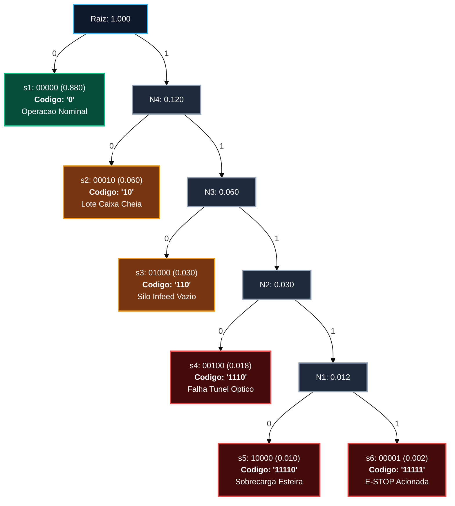

# Relatório Técnico: Compressão de Telemetria e Otimização de Banda no SCADA-Core via Algoritmo de Huffman

**Otimização de Barramentos Industriais e Transmissão Determinística em Célula de Manufatura Flexível (FMS)**

### Informações do Projeto

| Parâmetro | Detalhe |
| :--- | :--- |
| **Unidade Industrial** | Célula de Manufatura Flexível e Triagem Automática de Peças (FMS) |
| **Setores Abrangidos** | Setor 100 (Alimentação), Setor 200 (Inspeção/Triagem) e Setor 300 (Loteamento/Supervisão) |
| **Aplicação** | Compressão de Telemetria Contínua em Barramentos SCADA (Modbus-RTU, OPC-UA, MQTT/IIoT) |
| **Método Formulado** | Codificação de Huffman (Árvore Binária de Prefixos Ótimos / Teoria da Informação) |
| **Código do Projeto** | `ECAA08-MANUFATURA-FLEXIVEL` (SCADA-Core Manufatura Flexível) |

---

## 1. Contextualização e Objetivo de Engenharia de Automação

Na automação de processos industriais contínuos e discretos, a supervisão em tempo real da **Célula de Manufatura Flexível e Triagem Automática de Peças (FMS)** exige que o sistema **SCADA-Core** faça a varredura cíclica (*polling*) ou receba transmissões espontâneas (*event-driven*) de todos os postos de trabalho dos Setores 100, 200 e 300. As amostragens periódicas ocorrem em taxas de varredura (*scan rates*) elevadas, tipicamente entre $10\text{ ms}$ e $50\text{ ms}$, transmitindo o estado operacional, grandezas físicas e intertravamentos de segurança funcional.

Em arquiteturas convencionais de automação sem compressão, o estado lógico dos instrumentos e atuadores é encapsulado em palavras binárias de tamanho fixo (*bitmasks*). Considerando os 5 instrumentos e alarmes críticos monitorados pelo laço de intertravamento da célula:
* `TH-101`: Alarme de Sobrecarga Térmica / Falha no Motor da Esteira Principal `M-101` (Setor 100)
* `LS-101`: Chave de Nível Baixo / Silo de Tarugos Vazio no Infeed (Setor 100)
* `ZS-200`: Inconsistência Óptica / Desalinhamento de Peça no Túnel Dimensional e Cor (Setor 200)
* `FULL-300`: Intertravamento de Troca de Lote / Caixa Cheia com 10 peças nas Baias `CX-301..303` (Setor 300)
* `ESD-301`: Botão de Parada de Emergência (*E-STOP*) Acionado (`HS-301`, Setor 300)

O formato fixo impõe o envio de **5 bits por quadro de telemetria**, independentemente de o estado ser corriqueiro ou uma anomalia severa.

### O Desafio de Engenharia: Gargalos em Links Industriais Restritos
Quando a transmissão da telemetria precisa trafegar por:
1. **Redes Seriais RS-485 de Campo (Modbus-RTU):** operando em taxas conservadoras ($9600\text{ bps}$ ou $19200\text{ bps}$) para garantir imunidade a ruídos eletromagnéticos de inversores de frequência;
2. **Telemetria Sem Fio com AGVs e Remotas Móveis (Zigbee / LoRaWAN):** com limitações severas de largura de banda e restrições de ciclo de trabalho (*duty cycle* regulatório);
3. **Plataformas IIoT em Nuvem (MQTT / OPC-UA sobre 4G/5G Industrial):** tarifadas por volume trafegado de pacotes e suscetíveis a latências de enfileiramento;

o envio constante de palavras de 5 bits não comprimidas contendo repetidamente o estado `00000` (operação nominal) gera sobrecarga inútil do barramento. Como uma célula de manufatura flexível opera em regime estável e seguro durante cerca de $88\%$ a $90\%$ do tempo, a aplicação da **Codificação de Huffman** permite realizar a compressão estritamente sem perdas (*lossless*) dos dados no CLP antes do envio ao SCADA, priorizando códigos ultracurtos (1 ou 2 bits) para os estados de alta probabilidade e reservando palavras maiores para alarmes raros.

---

## 2. Modelo Probabilístico da Célula de Manufatura Flexível

O vetor de estado binário ISA-5.1 transmitido a cada ciclo de varredura é formalmente definido por:

$$\mathbf{x} = [x_{\text{TH-101}},\, x_{\text{LS-101}},\, x_{\text{ZS-200}},\, x_{\text{FULL-300}},\, x_{\text{ESD-301}}] \in \{0, 1\}^5$$

O alfabeto discreto de mensagens da FMS é composto pelos 6 estados operacionais mutuamente exclusivos $S = \{s_1, s_2, s_3, s_4, s_5, s_6\}$:

### Matriz de Probabilidades Operacionais da Planta

| Símbolo $s_i$ | Vetor Binário | Instrumentos em Nível Lógico 1 | Condição Operacional da Célula FMS | Probabilidade $P(s_i)$ | Frequência Relativa |
| :---: | :---: | :--- | :--- | :---: | :---: |
| $s_1$ | `00000` | Nenhum (Todos normais) | **Operação Nominal Estável:** Triagem ativa, esteira ligada, fluxo livre de peças | $0{,}880$ | $88{,}0\%$ |
| $s_2$ | `00010` | `FULL-300` (`US-301..303`) | **Intertravamento de Troca de Lote:** Caixa atingiu 10 peças; pausa momentânea de infeed | $0{,}060$ | $6{,}0\%$ |
| $s_3$ | `01000` | `LS-101` | **Nível Baixo no Silo:** Nível crítico de tarugos; solicitação de reabastecimento via AGV | $0{,}030$ | $3{,}0\%$ |
| $s_4$ | `00100` | `ZS-200` | **Inconsistência no Túnel Óptico:** Peça desalinhada ou erro transitório de leitura de cor | $0{,}018$ | $1{,}8\%$ |
| $s_5$ | `10000` | `TH-101` (`M-101`) | **Alarme de Sobrecarga Térmica:** Disparo do relé térmico / travamento mecânico da esteira | $0{,}010$ | $1{,}0\%$ |
| $s_6$ | `00001` | `ESD-301` (`HS-301`) | **Parada de Emergência (E-STOP):** Botão cogumelo acionado pelo operador | $0{,}002$ | $0{,}2\%$ |
| **Total** | — | — | **Espaço Amostral Completo** | $\mathbf{1{,}000}$ | $\mathbf{100{,}0\%}$ |

---

## 3. Construção Passo a Passo da Árvore Binária de Huffman

O algoritmo guloso de Huffman opera iterativamente sobre uma floresta de nós gerenciada por uma fila de prioridades (*Min-Heap*):
1. **Passo 1:** Os dois símbolos de menor probabilidade, $s_6$ (`00001`, $P=0{,}002$) e $s_5$ (`10000`, $P=0{,}010$), são extraídos do heap e mesclados em um novo nó intermediário $N_1$ com probabilidade acumulada:
   $$P(N_1) = 0{,}002 + 0{,}010 = 0{,}012$$
2. **Passo 2:** Extraem-se os dois menores elementos atuais: $N_1$ ($0{,}012$) e $s_4$ (`00100`, $P=0{,}018$). Eles são unidos no nó intermediário $N_2$ com probabilidade acumulada:
   $$P(N_2) = 0{,}012 + 0{,}018 = 0{,}030$$
3. **Passo 3:** Extraem-se os dois menores elementos atuais: $s_3$ (`01000`, $P=0{,}030$) e $N_2$ ($0{,}030$). Eles são unidos no nó intermediário $N_3$ com probabilidade acumulada:
   $$P(N_3) = 0{,}030 + 0{,}030 = 0{,}060$$
4. **Passo 4:** Extraem-se os dois menores elementos atuais: $s_2$ (`00010`, $P=0{,}060$) e $N_3$ ($0{,}060$). Eles são unidos no nó intermediário $N_4$ com probabilidade acumulada:
   $$P(N_4) = 0{,}060 + 0{,}060 = 0{,}120$$
5. **Passo 5:** Os dois últimos nós restantes no heap, $N_4$ ($0{,}120$) e o símbolo de alta frequência $s_1$ (`00000`, $P=0{,}880$), são unidos para formar a **Raiz da Árvore de Huffman**, atingindo o peso total unitário:
   $$P(\text{Raiz}) = 0{,}120 + 0{,}880 = 1{,}000$$

### Dicionário de Códigos Prefixados de Huffman

Adotando a convenção de atribuir o bit `0` à ramificação de maior probabilidade e `1` à ramificação de menor probabilidade em cada nó interno, sintetiza-se a tabela de codificação:

| Estado Original (Fixo) | Condição Operacional | Código de Huffman Gerado | Comprimento $l(s_i)$ | Economia por Amostra |
| :---: | :--- | :---: | :---: | :---: |
| `00000` | Operação Nominal Estável | `0` | **1 bit** | $-4\text{ bits}$ ($-80\%$) |
| `00010` | Intertravamento de Troca de Lote | `10` | **2 bits** | $-3\text{ bits}$ ($-60\%$) |
| `01000` | Nível Baixo no Silo Infeed | `110` | **3 bits** | $-2\text{ bits}$ ($-40\%$) |
| `00100` | Inconsistência no Túnel Óptico | `1110` | **4 bits** | $-1\text{ bit}$ ($-20\%$) |
| `10000` | Sobrecarga Térmica da Esteira | `11110` | **5 bits** | $0\text{ bits}$ ($0\%$) |
| `00001` | Parada de Emergência (E-STOP) | `11111` | **5 bits** | $0\text{ bits}$ ($0\%$) |

> [!NOTE]
> **Propriedade dos Códigos Livres de Prefixo (*Prefix-Free Codes*):**
> Nenhum código da tabela é prefixo de qualquer outro código. Essa característica matemática assegura que o servidor SCADA decodifique o fluxo de bits de forma instantânea e determinística no tempo de chegada de cada bit, sem requerer marcadores ou bytes separadores entre as mensagens.

---

## 4. Avaliação Teórica de Desempenho e Métricas de Informação de Shannon

### 4.1. Entropia Teórica da Fonte de Telemetria ($H(S)$)
A entropia de Shannon estabelece o limite físico fundamental para o número médio mínimo de bits por símbolo exigido para transmitir a informação sem perdas:

$$H(S) = -\sum_{i=1}^{6} P(s_i) \log_2 P(s_i)$$

Calculando termo a termo:
* $P(s_1) \log_2 P(s_1) = 0{,}880 \times \log_2(0{,}880) \approx -0{,}1623\text{ bits}$
* $P(s_2) \log_2 P(s_2) = 0{,}060 \times \log_2(0{,}060) \approx -0{,}2435\text{ bits}$
* $P(s_3) \log_2 P(s_3) = 0{,}030 \times \log_2(0{,}030) \approx -0{,}1518\text{ bits}$
* $P(s_4) \log_2 P(s_4) = 0{,}018 \times \log_2(0{,}018) \approx -0{,}1043\text{ bits}$
* $P(s_5) \log_2 P(s_5) = 0{,}010 \times \log_2(0{,}010) \approx -0{,}0664\text{ bits}$
* $P(s_6) \log_2 P(s_6) = 0{,}002 \times \log_2(0{,}002) \approx -0{,}0179\text{ bits}$

$$H(S) \approx 0{,}1623 + 0{,}2435 + 0{,}1518 + 0{,}1043 + 0{,}0664 + 0{,}0179 = \mathbf{0{,}7463\text{ bits/símbolo}}$$

### 4.2. Comprimento Médio da Palavra-Código ($L$)
O comprimento médio ponderado da palavra-código de Huffman é calculado pela esperança matemática do número de bits transmitidos:

$$L = \sum_{i=1}^{6} P(s_i) \cdot l(s_i)$$
$$L = (0{,}880 \times 1) + (0{,}060 \times 2) + (0{,}030 \times 3) + (0{,}018 \times 4) + (0{,}010 \times 5) + (0{,}002 \times 5)$$
$$L = 0{,}880 + 0{,}120 + 0{,}090 + 0{,}072 + 0{,}050 + 0{,}010 = \mathbf{1{,}2220\text{ bits/símbolo}}$$

### 4.3. Taxa de Redução de Volume e Economia de Banda
Comparando o comprimento médio $L = 1{,}2220\text{ bits/amostra}$ com o protocolo bruto de tamanho fixo ($L_{\text{fixo}} = 5\text{ bits/amostra}$):

$$\text{Economia de Banda} = \left( 1 - \frac{L}{L_{\text{fixo}}} \right) \times 100\% = \left( 1 - \frac{1{,}2220}{5} \right) \times 100\% = \mathbf{75{,}56\%}$$

### 4.4. Eficiência de Codificação de Shannon ($\eta$) e Redundância ($R$)
$$\eta = \frac{H(S)}{L} \times 100\% = \frac{0{,}7463}{1{,}2220} \times 100\% \approx \mathbf{61{,}07\%}$$
$$R = 1 - \eta = \mathbf{38{,}93\%}$$

---

## 5. Representação Esquemática da Árvore de Huffman

O diagrama em **Mermaid** abaixo ilustra a hierarquia binária da árvore gerada para a Célula de Manufatura Flexível. Cada folha terminal contém a probabilidade $P(s_i)$, a condição operacional e o código prefixado correspondente:



---

## 6. Protocolo de Enquadramento Industrial e Integração CLP/SCADA

### 6.1. Formato do Quadro de Transmissão Serial / TCP
Para evitar deslizamento de bits (*bit-slip*) e permitir a checagem de integridade em barramentos RS-485 ou soquetes Ethernet, as palavras de Huffman são empacotadas no quadro de telemetria industrial:

```
+--------------------+--------------------+--------------------+--------------------+--------------------+
|  Header (8 bits)   | Counter (8 bits)   | Length (8 bits)    |  Payload Huffman   |  CRC-16 (16 bits)  |
| 0xA5 (Start Frame) | Seq. 0x00 a 0xFF   | Num. Bits Validos  |   Bits Compactados |  Polinomio Modbus  |
+--------------------+--------------------+--------------------+--------------------+--------------------+
```

### 6.2. Algoritmo no Controlador Lógico Programável (CLP Siemens S7-1500)
A cada ciclo de varredura (*OB1* em $20\text{ ms}$):
1. O CLP lê as entradas digitais dos sensores dos Setores 100, 200 e 300;
2. Constrói o vetor de bits $\mathbf{x} \in \{0, 1\}^5$;
3. Indexa uma tabela estática pré-compilada em memória rápida (*lookup table* / array);
4. Concatena os bits codificados no buffer circular de saída da porta de comunicação serial/Ethernet.

### 6.3. Decodificação Determinística no Servidor SCADA
O servidor supervisório SCADA processa o fluxo de bits através do percurso na árvore binária:
1. Começa na raiz da árvore;
2. Se o próximo bit for `0`, desce para o nó filho esquerdo; se for `1`, desce para o nó filho direito;
3. Ao atingir uma folha, registra imediatamente o estado reconstruído e reinicia o ponteiro na raiz da árvore.
* **Complexidade Assintótica:** $\mathcal{O}(k)$, onde $k$ é a profundidade do símbolo na árvore ($1 \le k \le 5$). O pior caso consome apenas 5 operações condicionais elementares, viabilizando taxas superiores a centenas de milhares de mensagens decodificadas por segundo.

### 6.4. Tratamento de Falhas e Integridade SIS (Safety Instrumented System)
Em ambientes industriais com severa interferência eletromagnética (motores CA e solenoides pneumáticas), se ruídos na linha inverterem bits do payload:
* O receptor verifica o campo **CRC-16**. Havendo divergência de paridade, o pacote é imediatamente descartado;
* Caso um erro de bit desvie o ponteiro para um nó inexistente ou exceda o comprimento de payload declarado, o driver SCADA rejeita o quadro, gera a flag de diagnóstico de comunicação e preserva o último estado seguro comutado na tela da IHM.

---

## 7. Análise de Viabilidade Técnica e Decisão de Engenharia

| Métrica Operacional | Sem Compressão (Fixo) | Com Huffman SCADA | Benefício de Engenharia |
| :--- | :---: | :---: | :--- |
| **Comprimento Médio** | $5{,}00\text{ bits/amostra}$ | $1{,}22\text{ bits/amostra}$ | **Redução de $75{,}56\%$ no volume de bits** |
| **Volume em 10.000 Amostras** | $50.000\text{ bits}$ ($6{,}10\text{ KB}$) | $12.220\text{ bits}$ ($1{,}49\text{ KB}$) | Menos ocupação de memória em buffers e bancos de dados |
| **Tempo de Transmissão (9600 bps)** | $\approx 5{,}21\text{ s}$ | $\approx 1{,}27\text{ s}$ | Libera mais de $75\%$ da janela temporal para outros nós |
| **Sobrecarga de Processamento** | Nula | Mínima (tabela direta de busca) | Perfeitamente viável em microcontroladores e CLPs |
| **Fidelidade da Informação** | $100\%$ | $100\%$ (*Lossless*) | Reconstrução matemática idêntica garantida |

> [!TIP]
> **Recomendação de Aplicação na Manufatura Flexível:**
> A codificação de Huffman é recomendada primordialmente para enlaces de telemetria contínua com largura de banda restrita (rádios de AGVs no galpão, barramentos seriais RS-485 com múltiplos escravos e bancos de dados históricos de telemetria IIoT), reduzindo em mais de $75\%$ o consumo de armazenamento sem introduzir distorção metrológica nos sinais.

---

## 8. Referências Técnicas

1. HUFFMAN, D. A. **A Method for the Construction of Minimum-Redundancy Codes**. Proceedings of the IRE, v. 40, n. 9, p. 1098-1101, 1952.
2. SHANNON, C. E. **A Mathematical Theory of Communication**. Bell System Technical Journal, v. 27, p. 379-423, 623-656, 1948.
3. TANENBAUM, A. S.; WETHERALL, D. J. **Redes de Computadores**. 5. ed. São Paulo: Pearson, 2011.
4. KUPHALDT, T. R. **Lessons In Industrial Instrumentation**. Version 2.34. Bellingham: Open Source Educational Resource, 2021.
5. INTERNATIONAL ELECTROTECHNICAL COMMISSION. **IEC 61158: Industrial communication networks - Fieldbus specifications**. Geneva: IEC, 2019.
