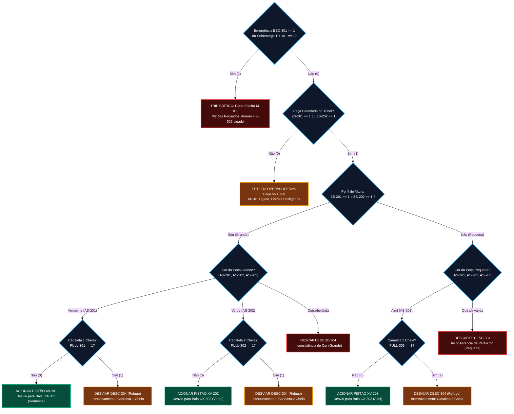

# Relatório Técnico: Implementação de Árvores Binárias na Célula de Manufatura Flexível (FMS)

**Árvores Binárias de Busca Auto-Balanceadas (AVL) para Indexação de Histórico SCADA e Árvores de Decisão (BDT) para Triagem e Intertravamento na Esteira**

### Informações do Projeto

| Parâmetro | Detalhe |
| :--- | :--- |
| **Unidade Industrial** | Célula de Manufatura Flexível e Triagem Automática de Peças (FMS) |
| **Setores Abrangidos** | Setor 100 (Alimentação), Setor 200 (Inspeção/Triagem) e Setor 300 (Loteamento/Supervisão SCADA) |
| **Aplicação** | Indexação de Eventos/Alarmes em Tempo Real e Classificação Lógica Determinística com Intertravamento |
| **Métodos Formulados** | Árvore Binária de Busca Auto-Balanceada (AVL) e Árvore Binária de Decisão (BDT) |
| **Código do Projeto** | `ECAA08-MANUFATURA-FLEXIVEL` (SCADA-Core Manufatura Flexível) |

---

## 1. Contextualização e Objetivo de Engenharia de Automação

Na automação da **Célula de Manufatura Flexível (FMS)**, a operação da esteira seletora de peças envolve fluxos contínuos de peças físicas sobre a esteira principal `M-101`, integrando inspeção dimensional óptica, identificação de cor, acionamento pneumático de alta velocidade e gerenciamento de capacidade nas baias de saída.

Dois desafios computacionais fundamentais emergem no projeto da arquitetura de controle e supervisão:

1. **Classificação e Intertravamento Determinístico em Tempo Real (Camada de Controle - CLP):**
   No posto de triagem do Setor 200 (`INSP-200`), cada peça transportada passa sob sensores de perfil/altura (`ZS-201`, `ZS-202`) e sensores ópticos de cor RGB (`AS-201`, `AS-202`, `AS-203`). A decisão sobre acionar o desviador pneumático 1 (`XV-201`), desviador 2 (`XV-202`), desviador 3 (`XV-203`) ou permitir o fluxo livre para descarte (`DESC-304`) precisa ser tomada dentro da janela de varredura (*scan cycle*) do CLP ($\le 10\text{ ms}$), considerando ainda os intertravamentos de segurança (botão de emergência `ESD-301`, sobrecarga térmica do motor `TH-101` e sinal de canaleta cheia `FULL-300`). Essa lógica é estruturada otimamente por uma **Árvore Binária de Decisão (BDT — *Binary Decision Tree*)**.

2. **Indexação e Recuperação de Alta Velocidade no Historiador de Processo (Camada SCADA-Core):**
   O servidor SCADA supervisiona eventos de campo em alta frequência: detecção de peças, confirmação de avanço dos cilindros pneumáticos, alarmes de nível baixo no silo (`LS-101`), eventos de canaleta cheia (`US-301..303`) e falhas de comunicação. Para auditoria operacional, emissão de laudos de rastreabilidade e análise de causa-raiz (*Root Cause Analysis* — RCA), o historiador deve suportar inserções contínuas e consultas temporais com garantia de latência logarítmica. A estrutura adotada para indexar essa série temporal em memória é uma **Árvore Binária de Busca Auto-Balanceada (AVL — *Adelson-Velsky & Landis*)**.

---

## 2. Árvore Binária de Decisão (BDT): Lógica de Triagem e Intertravamento

### 2.1. Formalização Matemática da BDT
A lógica de classificação e segurança da esteira é formalizada como uma árvore direcionada enraizada $T = (V, E)$, em que:
* $V = V_{\text{interno}} \cup V_{\text{folha}}$ representa os nós de decisão e estados de atuação.
* Cada nó interno $u \in V_{\text{interno}}$ contém um predicado booleano $P_u: \mathbf{s} \to \{0, 1\}$ avaliado sobre o vetor de instrumentação ISA-5.1:
  $$\mathbf{s} = [cmd_{\text{start}}, e_1, th_1, s_a, s_b, c_r, c_g, c_b, full_1, full_2, full_3]$$
* Cada nó folha $w \in V_{\text{folha}}$ define a ação de controle sobre os atuadores da célula:
  $$\mathbf{a} = [v_1, v_2, v_3, m_1, alm_1, \text{destino}]$$
  onde $v_1, v_2, v_3 \in \{0, 1\}$ representam os comandos dos pistões `XV-201`, `XV-202`, `XV-203`, $m_1 \in \{0, 1\}$ é o motor da esteira `M-101` e $alm_1 \in \{0, 1\}$ é a torre luminosa `HS-302`.
* $E$ representa as transições de ramificação $\{1 = \text{Sim / Verdadeiro}, 0 = \text{Não / Falso}\}$.

### 2.2. Avaliação por Curto-Circuito e Priorização de Segurança
A árvore é ordenada de modo descendente pela criticidade da condição operacional:
1. **Nível 0 (Raiz):** Intertravamento de Segurança Crítica (`ESD-301` acionado ou `TH-101` em sobrecarga térmica) $\implies$ Parada Imediata (*Trip* Total: $m_1 = 0$, todos os pistões recuados, $alm_1 = 1$).
2. **Nível 1:** Validação da Presença de Peça no Túnel (`ZS-201` $\lor$ `ZS-202`).
3. **Nível 2:** Classificação Dimensional (Altura/Perfil):
   * Peça Grande: $s_a \land s_b = 1$ (Ambos os feixes ópticos obstruídos).
   * Peça Pequena: $s_a \land \neg s_b = 1$ (Apenas o feixe inferior obstruído).
4. **Nível 3:** Discriminação Cromática (Sensores RGB):
   * Vermelha: $c_r = 1 \land c_g = 0 \land c_b = 0$.
   * Verde: $c_g = 1 \land c_r = 0 \land c_b = 0$.
   * Azul: $c_b = 1 \land c_r = 0 \land c_g = 0$.
5. **Nível 4:** Intertravamento de Capacidade da Baia de Destino:
   * Se a canaleta de destino correspondente estiver cheia ($full_k = 1$, sinal de 10 peças atingidas), o pistão desviador correspondente é inibido e a peça é encaminhada para descarte/retrabalho `DESC-304`, protegendo a esteira contra acúmulo físico e colisão mecânica.

### 2.3. Diagrama Mermaid da Árvore Binária de Decisão da Esteira



### 2.4. Garantia de Determinismo Temporal ($O(1)$)
Como a profundidade máxima da árvore é rigidamente delimitada em $h = 5$, o pior tempo de execução (*Worst-Case Execution Time* — WCET) no controlador é estritamente limitado:
$$\text{WCET} \le 5 \times t_{\text{comparação}} \ll 1\text{ µs}$$
Essa característica matemática cumpre com folga os requisitos normativos da **IEC 61131-3** e garante tempo de ciclo constante para a esteira em qualquer velocidade de avanço.

---

## 3. Árvore Binária de Busca Auto-Balanceada (AVL): Historiador SCADA-Core

### 3.1. Necessidade de Balanceamento Estrito
No sistema supervisório SCADA, eventos de automação são gerados com timestamps cronologicamente monótonos crescentes:
$$\tau_1 < \tau_2 < \dots < \tau_N$$
Se uma Árvore Binária de Busca (BST) convencional for alimentada com chaves em ordem estritamente crescente, a árvore degenera em uma lista simplesmente encadeada de altura $h = N$. Nesse cenário patológico:
* A busca e a inserção decaem de $O(\log_2 N)$ para $O(N)$.
* O Historiador SCADA perde o determinismo, gerando atrasos em telas de alarme e congelamento em tendências gráficas.

A **Árvore AVL** soluciona esse problema impondo a propriedade de balanceamento em todos os nós através de rotações estruturais $O(1)$ a cada nova inserção.

### 3.2. Estrutura do Nó na Memória Principal
Cada nó da árvore armazena o evento de automação:
$$N = \Big\langle \tau, \; BF, \; \text{Ponteiro-Esq}, \; \text{Ponteiro-Dir}, \; \mathbf{E}(\tau) \Big\rangle$$
Onde:
* $\tau \in \mathbb{N}$ é o *Timestamp* UNIX em milissegundos (chave de ordenação).
* $BF \in \{-1, 0, +1\}$ é o Fator de Balanceamento (*Balance Factor*).
* $\mathbf{E}(\tau)$ é o payload estruturado do evento:
  $$\mathbf{E}(\tau) = \left[ \text{Tipo-Evento}, \; \text{Tag-Sensor}, \; \text{Severidade}, \; \text{Setor}, \; \text{Valor-Lido} \right]$$

### 3.3. Propriedade Fundamental da Árvore AVL
Para todo nó $u$ na árvore, define-se a altura $h(u)$ como o maior número de arestas da raiz de sua subárvore até uma folha, com $h(\emptyset) = 0$. O fator de balanceamento é dado por:
$$BF(u) = h(u.\text{direita}) - h(u.\text{esquerda}) \in \{-1, \; 0, \; +1\}$$

Se após uma inserção $|BF(u)| \ge 2$, o nó sofre violação estrutural e é rebalanceado via uma das quatro rotações fundamentais:

| Desbalanceamento | Condição Lógica | Operação de Rotação | Custo Temporal |
| :---: | :---: | :--- | :---: |
| **LL (Left-Left)** | $BF(u) = -2$ e $BF(u.\text{esq}) \le 0$ | Rotação Simples à Direita (*Right Rotation*) | $\mathcal{O}(1)$ |
| **RR (Right-Right)** | $BF(u) = +2$ e $BF(u.\text{dir}) \ge 0$ | Rotação Simples à Esquerda (*Left Rotation*) | $\mathcal{O}(1)$ |
| **LR (Left-Right)** | $BF(u) = -2$ e $BF(u.\text{esq}) > 0$ | Rotação Dupla: Esquerda no filho, Direita em $u$ | $\mathcal{O}(1)$ |
| **RL (Right-Left)** | $BF(u) = +2$ e $BF(u.\text{dir}) < 0$ | Rotação Dupla: Direita no filho, Esquerda em $u$ | $\mathcal{O}(1)$ |

### 3.4. Diagrama Esquemático da Árvore AVL do Historiador SCADA

```
                       [τ = 17724500500 ms]  (BF = 0)
                          /                \
                         /                  \
        [τ = 17724500200 ms]             [τ = 17724500800 ms]  (BF = 0)
           (BF = +1)                         /              \
             /                              /                \
   [τ = 17724500100 ms]          [τ = 17724500650 ms]    [τ = 17724500950 ms]
```

### 3.5. Complexidade Assintótica de Operações

```
┌──────────────────────────────────────┬────────────────────────┬────────────────────────┐
│ Operação no Historiador SCADA        │ BST Degenerada (Pior)  │ Árvore AVL (Garantido) │
├──────────────────────────────────────┼────────────────────────┼────────────────────────┤
│ Inserir Registro de Evento           │ O(N)                   │ O(log₂ N)              │
│ Buscar Evento por Timestamp τ        │ O(N)                   │ O(log₂ N)              │
│ Consulta por Janela [τ_inicio, τ_fim]│ O(N)                   │ O(log₂ N + K)          │
│ Altura Máxima da Árvore              │ N                      │ ≤ 1.44 log₂ (N + 2)    │
└──────────────────────────────────────┴────────────────────────┴────────────────────────┘
```
*Onde $N$ é o número total de eventos em memória e $K$ é a quantidade de eventos contidos na janela temporal consultada.*

---

## 4. Algoritmo de Recuperação por Faixa Temporal (In-Order Range Query)

Para alimentar os gráficos de tendência e as tabelas de alarme da IHM em uma janela de auditoria $[\tau_{\text{inicio}}, \tau_{\text{fim}}]$, a árvore AVL executa uma busca podada em ordem (*Pruned In-Order Traversal*):

1. Se $u$ for nulo, encerra a chamada recursiva.
2. Se $u.\tau > \tau_{\text{inicio}}$, desce recursivamente na subárvore esquerda ($u.\text{esquerda}$).
3. Se $\tau_{\text{inicio}} \le u.\tau \le \tau_{\text{fim}}$, agrega o evento $\mathbf{E}(u.\tau)$ à lista de respostas.
4. Se $u.\tau < \tau_{\text{fim}}$, desce recursivamente na subárvore direita ($u.\text{direita}$).

Essa estratégia poda galhos inteiros que estejam estritamente fora do intervalo solicitado, assegurando que nenhum nó desnecessário seja percorrido.

---

## 5. Comparativo Técnico entre as Aplicações de Árvores na FMS

| Critério de Engenharia | Árvore Binária de Decisão (BDT) | Árvore AVL Auto-Balanceada |
| :--- | :--- | :--- |
| **Camada de Aplicação** | Controle em Tempo Real (Firmware CLP S7-1500) | Historiador e Banco em Memória (SCADA-Core) |
| **Objeto de Manipulação** | Sinais booleanos dos sensores (`ZS`, `AS`, `US`) | Séries temporais de alarmes e telemetria |
| **Chave de Navegação** | Expressão booleana de intertravamento | *Timestamp* UNIX $\tau$ em milissegundos |
| **Dinamismo da Estrutura** | Estática (compilada no projeto de controle) | Dinâmica (inserções contínuas de novos eventos) |
| **Garantia Temporal** | Determinismo estrito $O(1)$ ($h \le 5$) | Acesso determinístico $O(\log_2 N)$ |
| **Requisito Normativo** | IEC 61131-3 / Segurança Funcional IEC 61511 | Rastreabilidade e Auditoria Industrial |

> [!TIP]
> **Recomendação de Engenharia:**
> A utilização conjunta de BDT no CLP e AVL no SCADA atende de forma simétrica aos dois pilares da manufatura avançada: ação local rápida com resposta sub-milissegundo para os atuadores pneumáticos e inteligência global de análise de causa-raiz para engenharia de manutenção.

---

## 6. Referências Técnicas

1. ADELSON-VELSKY, G. M.; LANDIS, E. M. **An algorithm for the organization of information**. Proceedings of the USSR Academy of Sciences, v. 146, p. 263-266, 1962.
2. CORMEN, T. H.; LEISERSON, C. E.; RIVEST, R. L.; STEIN, C. **Algoritmos: Teoria e Prática**. 3. ed. Rio de Janeiro: Elsevier, 2012.
3. INTERNATIONAL ELECTROTECHNICAL COMMISSION. **IEC 61131-3: Programmable controllers - Part 3: Programming languages**. Geneva: IEC, 2013.
4. INTERNATIONAL ELECTROTECHNICAL COMMISSION. **IEC 61511: Functional safety - Safety instrumented systems for the process industry sector**. Geneva: IEC, 2016.
5. ISA-5.1-2009. **Instrumentation Symbols and Identification**. Research Triangle Park: International Society of Automation, 2009.
