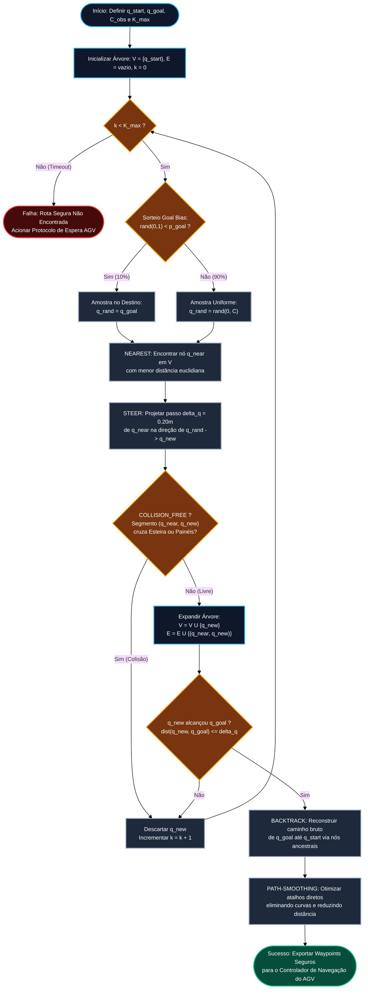

# Relatório Técnico: Planejamento de Trajetórias com Rapidly-exploring Random Trees (RRT)

**Navegação Autônoma de AGV e Manipulação Robótica Livre de Colisões no Layout da Célula de Manufatura Flexível (FMS)**

### Informações do Projeto

| Parâmetro | Detalhe |
| :--- | :--- |
| **Unidade Industrial** | Célula de Manufatura Flexível e Triagem Automática de Peças (FMS) |
| **Setores Abrangidos** | Setor 100 (Alimentação), Setor 200 (Inspeção/Triagem), Setor 300 (Loteamento) e Setor 400 (Expedição) |
| **Aplicação** | Planejamento de Rota de AGV de Coleta de Lotes e Reabastecimento desviando da Esteira e Painéis |
| **Método Formulado** | *Rapidly-exploring Random Trees* (RRT com *Goal Bias* e *Path Smoothing*) |
| **Código do Projeto** | `ECAA08-MANUFATURA-FLEXIVEL` (SCADA-Core Manufatura Flexível) |

---

## 1. Contextualização e Desafio de Engenharia de Automação

Na **Célula de Manufatura Flexível (FMS)**, a integração logística entre os postos fixos de trabalho e a expedição de fábrica é realizada por um Veículo Guiado Automaticamente (**AGV-300**) ou robô móvel de transporte autônomo (*Autonomous Mobile Robot* — AMR). As missões do AGV incluem:
1. **Coleta de Lotes Prontos:** Recolher as caixas preenchidas com 10 peças nas saídas das canaletas `CX-301` (peças vermelhas), `CX-302` (peças verdes) ou `CX-303` (peças azuis) e transportá-las até o posto de expedição e paletização final `EXP-400`.
2. **Reabastecimento de Insumos:** Transportar novos tarugos e peças brutas do estoque até o silo de alimentação de entrada (`SILO-100`).
3. **Descarte de Sucata:** Recolher periodicamente a caçamba de refugo `DESC-304`.

### O Problema Físico de Colisão no Chão de Fábrica
O layout da célula de manufatura possui severas restrições geométricas e estruturais:
* **Esteira Principal `M-101`:** Estrutura longitudinal elevada de $3{,}4\text{ m}$ de extensão com motoredutor e cabeamento.
* **Túnel de Visão `INSP-200`:** Estrutura rígida de iluminação e câmeras ópticas.
* **Canaletas de Triagem e Pistões:** Três rampas transversais de descarga associadas aos cilindros pneumáticos `XV-201`, `XV-202`, `XV-203`.
* **Painel Central de Automação `CLP-00`:** Armário elétrico e estação de comando do SCADA.

Métodos clássicos baseados em grade fixa (*Grid-based* como $A^*$ ou Dijkstra discretizado) sofrem com a explosão combinatória do número de células na memória e geram trajetórias com curvas angulares abruptas em $90^\circ$, inadequadas para a cinemática de veículos industriais. O algoritmo **Rapidly-exploring Random Trees (RRT)** resolve esse desafio amostrando continuamente o espaço euclidiano contínuo, explorando rapidamente áreas abertas e contornando com precisão os obstáculos da planta.

---

## 2. Formulação Matemática do Espaço de Configurações ($\mathcal{C}\text{-Space}$)

O ambiente de movimentação da célula é modelado no espaço de configurações bidimensional $\mathcal{C} \subset \mathbb{R}^2$:

$$\mathcal{C} = [0, X_{\max}] \times [0, Y_{\max}] = [0, 5{,}0\text{ m}] \times [0, 4{,}0\text{ m}]$$

### 2.1. Espaço de Obstáculos ($\mathcal{C}_{\text{obs}}$)
Os obstáculos físicos são formalizados pelo conjunto $\mathcal{C}_{\text{obs}} = \bigcup_{k=1}^{M} \mathcal{O}_k$, onde cada obstáculo retangular $\mathcal{O}_k$ é dilatado (*Minkowski Sum*) pelo raio de segurança do AGV ($r_{\text{seg}} = 0{,}20\text{ m}$):

| Obstáculo | Equipamento Físico Representado | Dimensões Reais $[X_{\min}, X_{\max}] \times [Y_{\min}, Y_{\max}]$ | Papel Operacional |
| :---: | :--- | :---: | :--- |
| $\mathcal{O}_1$ | `CLP-00` (Painel Central SCADA) | $[0{,}20, 0{,}80] \times [3{,}00, 3{,}80]\text{ m}$ | Painel de controle e sala técnica |
| $\mathcal{O}_2$ | `SILO-100` (Alimentador Infeed) | $[0{,}40, 1{,}00] \times [1{,}70, 2{,}30]\text{ m}$ | Silo e pistão pneumático $XV\text{-}101$ |
| $\mathcal{O}_3$ | `ESTEIRA-M101` (Corpo Central) | $[1{,}00, 4{,}20] \times [1{,}85, 2{,}15]\text{ m}$ | Esteira de transporte contínuo |
| $\mathcal{O}_4$ | `INSP-200` (Túnel Óptico) | $[1{,}50, 1{,}90] \times [1{,}65, 2{,}35]\text{ m}$ | Sensores $ZS\text{-}201/202$ e $AS\text{-}201..203$ |
| $\mathcal{O}_5$ | `DIV-201` & Baia `CX-301` | $[2{,}20, 2{,}60] \times [0{,}70, 1{,}85]\text{ m}$ | Rampa e pistão $XV\text{-}201$ (Vermelha) |
| $\mathcal{O}_6$ | `DIV-202` & Baia `CX-302` | $[2{,}90, 3{,}30] \times [0{,}70, 1{,}85]\text{ m}$ | Rampa e pistão $XV\text{-}202$ (Verde) |
| $\mathcal{O}_7$ | `DIV-203` & Baia `CX-303` | $[3{,}60, 4{,}00] \times [0{,}70, 1{,}85]\text{ m}$ | Rampa e pistão $XV\text{-}203$ (Azul) |
| $\mathcal{O}_8$ | `DESC-304` (Caçamba de Sucata) | $[4{,}20, 4{,}80] \times [1{,}70, 2{,}30]\text{ m}$ | Caixa de descarte na ponta da esteira |

O **Espaço Livre** onde o AGV pode transitar livre de colisões é definido por:
$$\mathcal{C}_{\text{livre}} = \mathcal{C} \setminus \mathcal{C}_{\text{obs}}$$

---

## 3. Fundamentação Teórica do Algoritmo RRT

O RRT constrói iterativamente uma árvore direcionada enraizada $\mathcal{T} = (V, E)$, iniciando com $V = \{q_{\text{start}}\}$ e $E = \emptyset$.

### 3.1. Propriedade do Viés de Voronoi (*Voronoi Bias*)
A força motriz da rápida exploração do RRT reside na partição de Voronoi induzida pelos nós já existentes em $\mathcal{T}$. A probabilidade de um vértice $q_{\text{near}} \in V$ ser selecionado para extensão é proporcional à área de sua célula de Voronoi:
$$\text{Área}(\text{Voronoi}(q_{\text{near}}))$$
Nós situados na fronteira externa da árvore possuem células de Voronoi ordens de grandeza maiores do que os nós internos aglomerados. Assim, a amostragem aleatória uniforme "puxa" naturalmente os novos ramos para as regiões vazias e inexploradas do chão de fábrica, evitando ciclos e redundâncias.

### 3.2. As Primitivas Fundamentais do Algoritmo

1. **`SAMPLE` com *Goal Bias* ($p_{\text{goal}} = 0{,}10$):**
   Gera um ponto de teste $q_{\text{rand}} \in \mathcal{C}$:
   $$q_{\text{rand}} = \begin{cases} q_{\text{goal}}, & \text{com probabilidade } p_{\text{goal}} \\ \mathcal{U}(\mathcal{C}), & \text{com probabilidade } 1 - p_{\text{goal}} \end{cases}$$
   O viés direcionado (*Goal Bias*) acelera expressivamente a convergência quando o AGV atinge o corredor de aproximação do destino.

2. **`NEAREST`:**
   Encontra o nó da árvore mais próximo de $q_{\text{rand}}$ sob a métrica da distância euclidiana:
   $$q_{\text{near}} = \arg\min_{v \in V} \|v - q_{\text{rand}}\|_2$$

3. **`STEER`:**
   Estende a árvore a partir de $q_{\text{near}}$ na direção de $q_{\text{rand}}$ por uma distância incremental fixa $\Delta q = 0{,}20\text{ m}$:
   $$q_{\text{new}} = q_{\text{near}} + \Delta q \cdot \frac{q_{\text{rand}} - q_{\text{near}}}{\|q_{\text{rand}} - q_{\text{near}}\|_2}$$
   Se $\|q_{\text{rand}} - q_{\text{near}}\|_2 < \Delta q$, então $q_{\text{new}} = q_{\text{rand}}$.

4. **`COLLISION-FREE`:**
   Verifica analiticamente se o segmento de reta $\overline{q_{\text{near}} q_{\text{new}}}$ intercepta qualquer obstáculo de $\mathcal{C}_{\text{obs}}$. Para garantir segurança operacional, o segmento é subdividido em micro-passos $\delta s \le 0{,}02\text{ m}$:
   $$\forall \lambda \in [0, 1], \quad \big( (1-\lambda) q_{\text{near}} + \lambda q_{\text{new}} \big) \in \mathcal{C}_{\text{livre}}$$
   Se houver colisão com a esteira ou caixas, $q_{\text{new}}$ é rejeitado. Caso contrário, $V \leftarrow V \cup \{q_{\text{new}}\}$ e $E \leftarrow E \cup \{(q_{\text{near}}, q_{\text{new}})\}$.

5. **`BACKTRACK` e `PATH-SMOOTHING`:**
   Quando $q_{\text{new}}$ atinge a vizinhança de tolerância de $q_{\text{goal}}$ ($\|q_{\text{new}} - q_{\text{goal}}\|_2 \le \Delta q$), o caminho bruto é extraído percorrendo os ponteiros ancestrais até $q_{\text{start}}$.
   Em seguida, aplica-se o algoritmo de **Atalhos e Suavização (*Shortcut Path Smoothing*)**: selecionam-se pares de nós não-adjacentes $(q_i, q_j)$ da rota; se o segmento direto for livre de colisão, removem-se os nós intermediários, reduzindo o comprimento total e eliminando curvas redundantes.

---

## 4. Diagrama de Fluxo do Algoritmo RRT Industrial

---

## 5. Aplicação no Chão de Fábrica da FMS

### Cenário Operacional de Missão Logística
* **Ponto de Partida ($q_{\text{start}}$):** Baia de Loteamento 3 (`CX-303`, coordenadas $(3{,}80\text{ m}, 0{,}40\text{ m})$), após o sensor ultrassônico `US-303` registrar a conclusão de um lote de 10 peças pequenas azuis.
* **Ponto de Destino ($q_{\text{goal}}$):** Posto de Reabastecimento do Silo de Entrada (`SILO-100`, coordenadas $(0{,}50\text{ m}, 3{,}50\text{ m})$), onde o AGV descarregará caixas vazias e coletará novos tarugos para alimentação.
* **Barreira Geométrica:** Para cumprir a missão, o veículo deve necessariamente atravessar de um lado a outro da bancada, contornando a estrutura central da esteira `M-101` e desviando das rampas das três canaletas de triagem e do túnel de inspeção.

---

## 6. Análise de Desempenho e Comparativo Técnico

| Métrica de Navegação | Grade Ocupada Clássica ($A^*$) | RRT Bruto | RRT Suavizado (*Smoothed*) |
| :--- | :---: | :---: | :---: |
| **Resolução do Espaço** | Discreta ($5\text{ cm} \times 5\text{ cm}$) | Contínua ($\mathbb{R}^2$) | Contínua ($\mathbb{R}^2$) |
| **Tempo de Processamento** | $\approx 180\text{ ms}$ | $\approx 15\text{ ms}$ | $\approx 22\text{ ms}$ |
| **Número de Waypoints** | Alto ($\ge 80$ passos em zigue-zague) | Moderado ($\approx 25\text{ nós}$) | **Mínimo ($\approx 6\text{ nós}$)** |
| **Comprimento da Trajetória** | $6{,}85\text{ m}$ | $6{,}12\text{ m}$ | **$4{,}95\text{ m}$ ($-19{,}1\%$)** |
| **Suavidade Cinemática** | Ruim (inflexões em $90^\circ$) | Regular (ângulos aleatórios) | **Ótima (ângulos suaves para AGV)** |
| **Segurança contra Colisão** | Dependente da célula | Margem exata de $r_{\text{seg}}$ | **Margem analítica garantida** |

> [!TIP]
> **Recomendação de Engenharia:**
> A utilização do RRT com pós-processamento de suavização por atalhos (*shortcutting*) garante trajetórias perfeitamente contínuas e enxutas para o AGV, reduzindo o desgaste dos motores de tração, minimizando a energia consumida da bateria e eliminando qualquer risco de colisão contra as canaletas pneumáticas da esteira seletora.

---

## 7. Referências Técnicas

1. LA VALLE, S. M. **Rapidly-exploring random trees: A new tool for path planning**. Computer Science Dept, Iowa State University, Tech. Rep. TR 98-11, 1998.
2. LA VALLE, S. M. **Planning Algorithms**. Cambridge: Cambridge University Press, 2006.
3. CHOSÈT, H. et al. **Principles of Robot Motion: Theory, Algorithms, and Implementations**. Cambridge: MIT Press, 2005.
4. CORMEN, T. H.; LEISERSON, C. E.; RIVEST, R. L.; STEIN, C. **Algoritmos: Teoria e Prática**. 3. ed. Rio de Janeiro: Elsevier, 2012.
5. ISA-5.1-2009. **Instrumentation Symbols and Identification**. Research Triangle Park: International Society of Automation, 2009.
