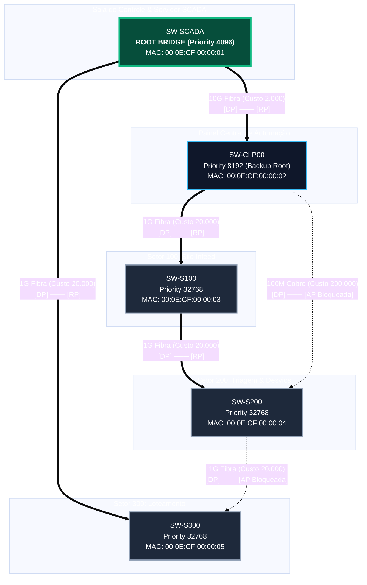

# Relatório Técnico: Protocolo de Árvore Geradora (STP / RSTP - IEEE 802.1w)

**Modelagem da Topologia em Anel Redundante da Rede Industrial SCADA, Prevenção de Tempestades de Broadcast e Reconvergência Rápida na Esteira Seletora (FMS)**

### Informações do Projeto

| Parâmetro | Detalhe |
| :--- | :--- |
| **Unidade Industrial** | Célula de Manufatura Flexível e Triagem Automática de Peças (FMS) |
| **Setores Abrangidos** | Setor 100 (Alimentação), Setor 200 (Inspeção/Triagem), Setor 300 (Loteamento) e Sala de Controle SCADA |
| **Aplicação** | Redundância de Camada 2 (L2) para Enlaces Ethernet Industrial (PROFINET / Modbus TCP) |
| **Método Formulado** | Protocolo de Árvore Geradora Rápida (*Rapid Spanning Tree Protocol* — RSTP / IEEE 802.1w) |
| **Código do Projeto** | `ECAA08-MANUFATURA-FLEXIVEL` (SCADA-Core Manufatura Flexível) |

---

## 1. Contextualização e Desafio de Redes na Automação Industrial

A operação contínua e segura da **Célula de Manufatura Flexível (FMS)** depende da comunicação em tempo real entre o Painel Central e CLP Siemens S7-1500 (`CLP-00`), o servidor supervisório `SCADA-Core` e as remotas de campo dos Setores 100, 200 e 300. 

### A Necessidade de Tolerância a Falhas Físicas
Em ambientes fabris, cabos de comunicação sofrem vibrações mecânicas da esteira `M-101`, interferências eletromagnéticas de inversores de frequência e risco de corte acidental durante manutenções. Uma interrupção no enlace do Setor 200 deixaria os desviadores pneumáticos `XV-201..203` sem comandos, provocando colisões e perda de produção.

Para garantir **alta disponibilidade ($> 99{,}99\%$)**, os switches industriais gerenciáveis são interconectados em **topologia física em anel redundante (*Ring Topology*)** fechando uma malha com o switch central da Sala de Controle.

### O Problema Físico dos Laços Fechados na Camada 2 (Ethernet)
Quadros Ethernet (IEEE 802.3) **não possuem campo TTL (*Time-To-Live*)** no seu cabeçalho. Como consequência, qualquer quadro em difusão (*broadcast*), como requisições de resolução de endereços ARP ou pacotes de descoberta PROFINET DCP, é replicado indefinidamente por todos os switches do anel. Esse fenômeno desencadeia:
1. **Tempestade de Broadcast (*Broadcast Storm*):** Consumo instantâneo de $100\%$ da largura de banda, saturando as portas dos switches.
2. **Instabilidade da Tabela de Endereços MAC (*MAC Table Flapping*):** O switch aprende o endereço de um transmissor simultaneamente por duas portas distintas, corrompendo a tabela de comutação.
3. **Travamento dos Controladores:** O CLP Siemens S7-1500 e as remotas de campo entram em sobrecarga de interrupção de rede, interrompendo o ciclo de varredura (*scan cycle*) e forçando a parada de emergência (*trip*) de toda a célula.

A solução canônica de engenharia consiste em implementar o **Protocolo de Árvore Geradora Rápida (RSTP — IEEE 802.1w)**, que desativa logicamente os enlaces redundantes criando uma **Árvore Geradora (*Spanning Tree*)** acíclica sobre o grafo físico.

---

## 2. Modelagem Formal em Teoria dos Grafos

A infraestrutura de switches da célula é formalizada por um grafo não-direcionado, conexo e valorado:

$$G = (V, E, w)$$

Onde:
* **$V$** é o conjunto de $n = |V| = 5$ switches industriais gerenciáveis instalados na planta:
  * $v_1$: `SW-SCADA` — Switch Central da Sala de Controle / Servidor SCADA-Core
  * $v_2$: `SW-CLP00` — Switch do Painel de Automação & CLP Siemens S7-1500
  * $v_3$: `SW-S100` — Switch da Remota de Campo do Setor 100 (Infeed & Esteira `M-101`)
  * $v_4$: `SW-S200` — Switch da Remota de Campo do Setor 200 (Túnel `INSP-200` & Desviadores)
  * $v_5$: `SW-S300` — Switch da Remota de Campo do Setor 300 (Baias `CX-301..303` & Descarte)
* **$E$** é o conjunto de $m = |E| = 6$ enlaces físicos industriais.
* **$w: E \to \mathbb{R}^+$** é a métrica de **Custo de Caminho (*Path Cost*)** padronizada pela norma **IEEE 802.1w**, inversamente proporcional à velocidade nominal do enlace:

| Meio Físico e Velocidade | Custo Padrão IEEE 802.1w | Aplicação na Manufatura Flexível |
| :--- | :---: | :--- |
| **$10\text{ Gbps}$** (Fibra Óptica Backbone) | $2.000$ | Enlace principal `SW-SCADA` $\leftrightarrow$ `SW-CLP00` |
| **$1\text{ Gbps}$** (Fibra Óptica Anel Industrial) | $20.000$ | Segmentos do anel intersetorial |
| **$100\text{ Mbps}$** (Cabo Par Trançado Blindado Cat6A) | $200.000$ | Enlace de backup secundário `SW-CLP00` $\leftrightarrow$ `SW-S200` |

### Número Ciclomático do Grafo
O número de ciclos independentes no grafo da rede da FMS é dado por:
$$\mu(G) = |E| - |V| + 1 = 6 - 5 + 1 = 2\text{ ciclos fundamentais}$$
Portanto, exatamente **2 portas físicas** devem ser bloqueadas logicamente pelo RSTP para transformar o grafo cíclico $G$ em uma Árvore Geradora $T = (V, E_T)$ contendo estritamente $|E_T| = |V| - 1 = 4$ arestas ativas.

---

## 3. Dinâmica do Algoritmo RSTP (IEEE 802.1w)

### 3.1. Identificador de Bridge (Bridge ID — BID)
Cada switch possui um identificador único composto por uma prioridade configurável e seu endereço MAC físico:
$$\text{BID} = (\text{Bridge-Priority}, \; \text{MAC-Address})$$
Na engenharia de redes da planta, a eleição não pode ocorrer de forma estocástica. Configuramos as prioridades para impor determinismo:
* `SW-SCADA`: $\text{Prioridade} = 4096$ (Root Bridge Primário)
* `SW-CLP00`: $\text{Prioridade} = 8192$ (Root Bridge Secundário / Backup)
* `SW-S100`, `SW-S200`, `SW-S300`: $\text{Prioridade} = 32768$ (Switches de Acesso de Campo)

O switch com o **menor valor de BID** é formalmente eleito como o **Root Bridge** da rede.

### 3.2. Classificação dos Papéis de Porta (*Port Roles*)
A partir do Root Bridge, os switches trocam mensagens BPDU (*Bridge Protocol Data Units*) e classificam cada uma de suas portas:
1. **Root Port (RP):** A porta com menor custo acumulado de caminho (*Root Path Cost*) em direção ao Root Bridge. Cada switch não-raiz possui exatamente uma RP (em estado *Forwarding*).
2. **Designated Port (DP):** A porta responsável por encaminhar tráfego em um determinado segmento de rede. Todas as portas ativas do Root Bridge são Designated Ports (em estado *Forwarding*).
3. **Alternate Port (AP):** Uma porta redundante que oferece um caminho alternativo para a raiz, mas que fecharia um ciclo. Essa porta é imediatamente colocada no estado **Discarding (Bloqueada)**, mantida em escuta contínua de BPDUs para comutação ultrarrápida.

### 3.3. Tabela Comparativa: STP Clássico (802.1D) vs. RSTP (802.1w)

| Critério de Engenharia | STP Tradicional (IEEE 802.1D) | RSTP Rápido (IEEE 802.1w) | Impacto no SCADA da Esteira |
| :--- | :---: | :---: | :--- |
| **Tempo de Convergência** | $30\text{ s}$ a $50\text{ s}$ | **$< 50\text{ ms}$ a $200\text{ ms}$** | No STP, a esteira pararia por timeout de watchdog ($1\text{ s}$). No RSTP, a falha é imperceptível ao CLP. |
| **Estados de Operação** | 5 estados (*Disabled, Blocking, Listening, Learning, Forwarding*) | 3 estados (*Discarding, Learning, Forwarding*) | Elimina temporizadores rígidos de *Forward Delay* ($2 \times 15\text{ s}$) via handshake *Proposal/Agreement*. |
| **Papéis de Redundância** | *Non-Designated* | **Alternate Port (AP)** e **Backup Port (BP)** | A porta Alternate possui caminho de backup pré-calculado, assumindo o tráfego instantaneamente. |
| **Mecanismo de Detecção** | Timeout passivo de Max Age ($20\text{ s}$) | Queda do enlace físico (*Link Down*) imediata | Reação na ordem de milissegundos assim que a fibra óptica for rompida. |

---

## 4. Diagrama Mermaid da Topologia em Anel e Árvore Geradora

O diagrama abaixo ilustra a rede da célula. Os **enlaces contínuos em destaque** representam os caminhos ativos da Árvore Geradora ($T$), enquanto as **linhas tracejadas em vermelho** representam as portas Alternate em estado *Discarding* bloqueando loops:

---

## 5. Simulação de Falha Física de Enlace (*Link Failure*) e Reconvergência

Considere uma ocorrência crítica de chão de fábrica: **o rompimento da fibra óptica principal entre o Painel Central (`SW-CLP00`) e a Sala de Controle (`SW-SCADA`)**:

### Sequência Cronológica de Reconvergência RSTP:
1. **Detecção Fisiomecânica ($t = 0\text{ ms}$):** Os transmissores ópticos de `SW-SCADA` e `SW-CLP00` detectam perda de portadora (*Loss of Signal* — LOS) na porta física. O enlace é imediatamente marcado como inoperante (*Link Down*).
2. **Propagação de BPDU de Alteração de Topologia (TC-BPDU) ($t \approx 5\text{ ms}$):** Os switches vizinhos geram mensagens BPDUs de renegociação rápida através do handshake *Proposal/Agreement*.
3. **Desbloqueio da Porta Alternate ($t \approx 15\text{ ms}$):** A porta do switch `SW-S300` conectada a `SW-S200`, que estava em estado *Discarding*, comuta diretamente para o estado **Forwarding** sem passar pelos temporizadores de atraso do protocolo antigo.
4. **Nova Topologia em Árvore Formada ($t < 30\text{ ms}$):** O tráfego do CLP e das remotas agora escoa em sentido anti-horário:
   $$\text{SW-CLP00} \longrightarrow \text{SW-S100} \longrightarrow \text{SW-S200} \longrightarrow \text{SW-S300} \longrightarrow \text{SW-SCADA}$$
5. **Estabilidade de Processo:** Como o tempo de reconvergência total ($\le 30\text{ ms}$) é significativamente inferior ao tempo de *watchdog* de falha de conexão do CLP Siemens ($100\text{ ms}$ a $500\text{ ms}$), nenhum alarme espúrio de interrupção é gerado na esteira seletora e o fluxo de peças continua ininterrupto.

---

## 6. Recursos Avançados de Proteção e Segurança de Rede Industrial

Para assegurar imunidade contra erros humanos de cabeamento e ataques cibernéticos na esteira seletora:
* **PortFast / Edge Port:** Habilitado exclusivamente nas portas onde estão conectados os transmissores ópticos, CLP, leitores RFID e IHMs. A porta passa imediatamente para *Forwarding* ao ser conectada, sem enviar notificações desnecessárias de alteração de topologia.
* **BPDU Guard:** Ativado em todas as *Edge Ports*. Se um operador acidentalmente conectar um cabo em laço entre duas portas de uma remota de campo ou plugar um switch não autorizado, o switch desativa a interface (*err-disabled*) em milissegundos, isolando o setor antes de afetar o anel principal.
* **Root Guard:** Configurado nas portas de distribuição de `SW-SCADA` e `SW-CLP00` para garantir que nenhum dispositivo externo possa anunciar prioridade inferior e sequestrar o papel de Root Bridge da esteira seletora.

---

## 7. Referências Técnicas

1. INSTITUTE OF ELECTRICAL AND ELECTRONICS ENGINEERS. **IEEE Std 802.1w: Rapid Reconfiguration of Spanning Tree**. New York: IEEE, 2001.
2. INSTITUTE OF ELECTRICAL AND ELECTRONICS ENGINEERS. **IEEE Std 802.1D: Media Access Control (MAC) Bridges**. New York: IEEE, 2004.
3. TANENBAUM, A. S.; WETHERALL, D. J. **Redes de Computadores**. 5. ed. São Paulo: Pearson, 2011.
4. CORMEN, T. H.; LEISERSON, C. E.; RIVEST, R. L.; STEIN, C. **Algoritmos: Teoria e Prática**. 3. ed. Rio de Janeiro: Elsevier, 2012.
5. PROFINET INTERNATIONAL. **PROFINET Design Guideline: Network Topology and Media Redundancy**. Karlsruhe: PI, 2021.
