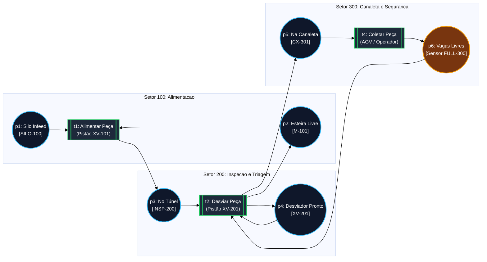
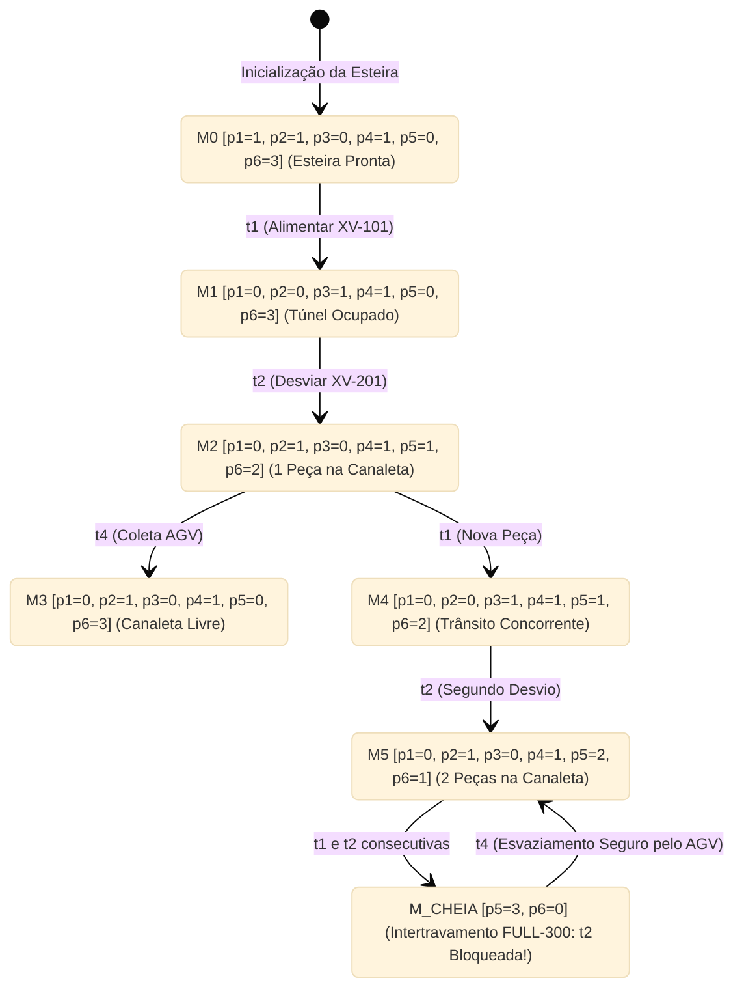

# Relatório Técnico: Modelagem e Análise Formal da Esteira Seletora com Redes de Petri

**Construção da Árvore de Atingibilidade e Árvore de Cobertura (Algoritmo de Karp-Miller), Análise de Limitação, Prevenção de Transbordo de Canaleta e Ausência de Deadlocks na Célula de Manufatura Flexível (FMS)**

### Informações do Projeto

| Parâmetro | Detalhe |
| :--- | :--- |
| **Unidade Industrial** | Célula de Manufatura Flexível e Triagem Automática de Peças (FMS) |
| **Setores Abrangidos** | Setor 100 (Alimentação), Setor 200 (Inspeção/Triagem) e Setor 300 (Loteamento/Canaletas) |
| **Aplicação** | Modelagem da Dinâmica de Estados Discretos da Esteira e Verificação de Segurança Funcional |
| **Métodos Formulados** | Redes de Petri Marcadas (RdP), Árvore de Cobertura ($\omega$) e Árvore de Atingibilidade Finita |
| **Código do Projeto** | `ECAA08-MANUFATURA-FLEXIVEL` (SCADA-Core Manufatura Flexível) |

---

## 1. Contextualização e Objetivo de Engenharia de Automação

Na automação de processos discretos, a **Célula de Manufatura Flexível (FMS)** opera através da coordenação sequencial, concorrente e assíncrona de atuadores eletromecânicos e pneumáticos:
1. O pistão de alimentação `XV-101` insere tarugos brutos a partir do silo (`SILO-100`) sobre a esteira principal `M-101`.
2. A peça transita sob o túnel óptico `INSP-200` (`ZS-201/202` e `AS-201..203`) onde é inspecionada.
3. Ao atingir o posto de desvio, o pistão pneumático `XV-201` avança e empurra a peça para a canaleta de saída correspondente (`CX-301`).
4. As peças escoam por gravidade na canaleta até que o operador ou o veículo autônomo `AGV-300` recolha o lote completo.

### O Desafio de Engenharia: Travamentos (*Deadlocks*) e Transbordo de Peças
Projetar essa lógica diretamente no CLP em linguagem Ladder ou Diagrama de Blocos Funcionais (FBD) sem uma validação matemática prévia expõe a planta a dois riscos graves:
* **Transbordo Físico de Canaleta (*Chute Overflow*):** Se o infeed continuar alimentando peças mais rápido do que a capacidade de recolhimento na canaleta e o sensor `FULL-300` falhar ou não estiver intertravado, peças cairão fora da bancada, danificando os mecanismos.
* **Travamento de Processo (*Deadlock*):** Se um cilindro pneumático aguardar a liberação de espaço na canaleta enquanto a esteira estiver bloqueada impedindo o escoamento, o sistema atinge um estado terminal sem transições habilitadas, paralisando a célula.

As **Redes de Petri (RdP)** oferecem uma modelagem algébrica e matricial formal capaz de comprovar, antes do comissionamento em campo, que a esteira é estritamente **livre de deadlocks** e que os **limites físicos de capacidade** são rigorosamente respeitados.

---

## 2. Definição Formal da Rede de Petri da Esteira Seletora

Uma Rede de Petri marcada é definida pela quíntupla matemática:

$$N = (P, T, Pre, Post, M_0)$$

Onde:
* **$P = \{p_1, p_2, p_3, p_4, p_5, p_6\}$:** Conjunto finito de **Lugares**, representando condições de estado dos equipamentos, disponibilidade de peças e capacidade de armazenamento.
* **$T = \{t_1, t_2, t_3, t_4, t_5\}$:** Conjunto finito de **Transições** ($P \cap T = \emptyset$), representando os eventos discretos de avanço de pistões, sensoriamento e escoamento.
* **$Pre: P \times T \to \mathbb{N}$:** Matriz de pré-incidência (arcos que entram nas transições; pré-requisitos para disparo).
* **$Post: P \times T \to \mathbb{N}$:** Matriz de pós-incidência (arcos que saem das transições; efeitos gerados).
* **$M_0: P \to \mathbb{N}$:** Vetor de **Marcação Inicial**, indicando o número de fichas (*tokens*) em cada lugar no estado inicial $k = 0$.

### 2.1. Mapeamento Físico dos Lugares e Transições ISA-5.1

| Lugar | Tag / Equipamento | Descrição Física na Esteira Seletora | Interpretação das Fichas (*Tokens*) |
| :---: | :--- | :--- | :--- |
| **$p_1$** | `SILO-100` | Silo de Infeed de Peças | $k$ fichas = peças brutas disponíveis para alimentação |
| **$p_2$** | `ESTEIRA-M101` | Vaga Livre na Esteira Principal | $1$ ficha = trecho de infeed desobstruído (anti-colisão entre peças) |
| **$p_3$** | `INSP-200` | Peça em Trânsito / Inspeção | $1$ ficha = peça no túnel óptico sob $ZS\text{-}201/202$ e $AS\text{-}201..203$ |
| **$p_4$** | `XV-201` | Pistão Desviador Pneumático em Repouso | $1$ ficha = atuador recuado e pronto para empurrar |
| **$p_5$** | `CX-301` | Peças Acumuladas na Canaleta de Saída | $k$ fichas = peças estocadas na canaleta aguardando coleta |
| **$p_6$** | `CAP-301` | Vagas Disponíveis na Canaleta (Sensor `FULL-300`) | $k$ fichas = capacidade livre restante (Lugar Complementar) |

| Transição | Evento Físico / Ação de Controle | Pré-requisitos ($Pre$) | Consequências ($Post$) |
| :---: | :--- | :--- | :--- |
| **$t_1$** | **Alimentar Peça na Esteira:** Pistão $XV\text{-}101$ avança e insere peça | $p_1$ ($1$), $p_2$ ($1$) | $p_3$ ($1$) |
| **$t_2$** | **Acionar Desviador Pneumático:** Pistão $XV\text{-}201$ empurra peça para canaleta | $p_3$ ($1$), $p_4$ ($1$), $p_6$ ($1$) | $p_2$ ($1$), $p_5$ ($1$) |
| **$t_3$** | **Recuar Pistão Desviador:** Cilindro $XV\text{-}201$ retorna ao repouso | $p_5$ ($1$) transitório | $p_4$ ($1$) |
| **$t_4$** | **Coletar Peça da Canaleta:** Operador ou AGV retira peça de $CX\text{-}301$ | $p_5$ ($1$) | $p_6$ ($1$) |
| **$t_5$** | **Reabastecer Silo:** Chegada de novo lote de tarugos em $SILO\text{-}100$ | $\emptyset$ (Fonte) | $p_1$ ($1$) |

> [!NOTE]
> Na modelagem síncrona dos atuadores industriais, a transição $t_2$ encapsula o ciclo de extensão e recuo seguro do cilindro de simples/dupla ação com sensores de fim de curso magnéticos, liberando simultaneamente a esteira ($p_2$), depositando a peça na canaleta ($p_5$) e restituindo o pistão ao repouso ($p_4$).

### 2.2. Equação Fundamental de Estado e Matriz de Incidência
Uma transição $t_j \in T$ está **habilitada** em uma marcação $M$ se, e somente se:
$$M(p_i) \ge Pre(p_i, t_j), \quad \forall p_i \in P$$

Ao disparar $t_j$, a marcação evolui deterministicamente para $M'$ pela **Equação Fundamental de Estado**:
$$M' = M + C \cdot \vec{e}_j$$
onde $C = Post - Pre$ é a **Matriz de Incidência** ($|P| \times |T|$) e $\vec{e}_j$ é o vetor canônico correspondente à transição disparada.

---

## 3. Parte A: Análise de Sistema Aberto e Árvore de Cobertura (O Símbolo $\omega$)

Para evidenciar o perigo de um projeto sem sensor de capacidade de canaleta, analisamos inicialmente o **sistema aberto**, suprimindo o lugar de controle $p_6$ ($Pre(p_6, t_2) = 0$). O vetor de estado é dado por:
$$M = [M(p_1), \; M(p_2), \; M(p_3), \; M(p_4), \; M(p_5)]^T$$

Com a marcação inicial:
$$M_0 = [1, \; 1, \; 0, \; 1, \; 0]^T$$
*(1 peça no silo, esteira livre, sem peça no túnel, desviador pronto, canaleta vazia).*

Se o silo for continuamente realimentado via $t_5$, o ciclo de alimentação e desvio $t_1 \to t_2$ se repete indefinidamente:
$$[1, 1, 0, 1, 0] \xrightarrow{t_1} [0, 0, 1, 1, 0] \xrightarrow{t_2} [0, 1, 0, 1, 1] \xrightarrow{t_5} [1, 1, 0, 1, 1] \xrightarrow{t_1 t_2 t_5} [1, 1, 0, 1, 2] \dots \to \infty$$

### 3.1. O Algoritmo de Karp-Miller
Como o número de estados é infinito, a Árvore de Atingibilidade convencional não converge. O **Algoritmo de Karp-Miller** introduz o símbolo **$\omega$ (ômega)** para manter a árvore estritamente finita:
> **Regra de Cobertura ($\omega$):** Seja $M'$ uma nova marcação gerada. Se existir um nó ancestral $M$ no ramo da raiz até $M'$ tal que $M' \ge M$ (componente a componente) e $M' \neq M$, então para cada coordenada $p_i$ onde $M'(p_i) > M(p_i)$, faz-se:
> $$M'(p_i) \leftarrow \omega$$
> onde $\omega$ representa um número arbitrariamente grande de fichas ($\omega \pm c = \omega$).

Ao aplicar o algoritmo na esteira aberta, a coordenada $p_5$ cresce estritamente em relação à raiz:
$$M_3 = [1, 1, 0, 1, 1]^T > M_0 = [1, 1, 0, 1, 0]^T \implies M_3 = [1, 1, 0, 1, \omega]^T$$

A presença de **$\omega$** no lugar $p_5$ emite o **diagnóstico formal de engenharia**: *a canaleta $CX\text{-}301$ é ilimitada e sofrerá transbordo físico se a taxa de alimentação da esteira for superior à taxa de coleta pelo operador/AGV*.

---

## 4. Parte B: Correção Estrutural via Lugar Complementar e Árvore de Atingibilidade Finita

Para garantir operação industrial segura, introduz-se o **Lugar Complementar $p_6$ (`CAP-301`)**, representando as vagas livres da canaleta delimitadas pelo sensor ultrassônico `US-301` / `FULL-300`, com capacidade nominal $K = 3$ peças:
$$M_0(p_6) = 3$$

### 4.1. Garantia pelo Invariante de Lugar (P-Invariant)
O vetor de pesos $y = [0, 0, 0, 0, 1, 1]^T$ satisfaz a equação algébrica de conservação:
$$C^T \cdot y = \mathbf{0}$$
Isso estabelece que, para **qualquer marcação atingível $M \in R(N, M_0)$**, vale rigorosamente o invariante linear:
$$M(p_5) + M(p_6) = M_0(p_5) + M_0(p_6) = 0 + 3 = 3$$

Dessa forma:
$$M(p_5) \le 3, \quad \forall M \in R(N, M_0)$$
O símbolo $\omega$ é **completamente eliminado**, transformando o sistema em uma Rede de Petri **$3$-limitada**.

### 4.2. Construção Passo a Passo da Árvore de Atingibilidade
O vetor completo é $M = [p_1, p_2, p_3, p_4, p_5, p_6]^T$:

1. **Raiz $M_0 = [1, 1, 0, 1, 0, 3]^T$:**
   * Apenas $t_1$ e $t_5$ podem disparar. Disparando $t_1$:
     $$M_1 = [0, 0, 1, 1, 0, 3]^T \quad (\text{Peça no Túnel } INSP\text{-}200)$$
2. **Nó $M_1 = [0, 0, 1, 1, 0, 3]^T$:**
   * $t_2$ está habilitada ($M_1(p_3)=1, M_1(p_4)=1, M_1(p_6)=3 \ge 1$). Disparando $t_2$:
     $$M_2 = [0, 1, 0, 1, 1, 2]^T \quad (\text{Peça na canaleta, 1 vaga consumida})$$
3. **Nó $M_2 = [0, 1, 0, 1, 1, 2]^T$:**
   * Habilita $t_4$ (Coleta da peça pelo operador/AGV) e $t_5$ (Reabastecimento do silo).
   * Disparando $t_4$: $M_3 = [0, 1, 0, 1, 0, 3]^T$ (Canaleta esvaziada, vaga restituída).
   * Se o infeed continuar alimentando até atingir $M(p_5) = 3$ e $M(p_6) = 0$:
     $$M_{\text{cheia}} = [0, 1, 0, 1, 3, 0]^T$$
     Nesse estado, $t_2$ fica **rigorosamente desabilitada**, impedindo que novas peças sejam descarregadas na canaleta cheia, mantendo a esteira parada ou desviando para descarte sem transbordo.
   * Disparando $t_4$ em $M_{\text{cheia}}$, $p_6$ volta a receber uma ficha ($M(p_6) = 1$) e o ciclo se desbloqueia normalmente.

---

## 5. Diagrama Mermaid da Rede de Petri e da Árvore de Atingibilidade

### 5.1. Topologia da Rede de Petri com Intertravamento de Canaleta

### 5.2. Grafo de Atingibilidade (Transições de Estado da Esteira)

---

## 6. Auditoria Formal de Propriedades Comportamentais

A partir da Árvore de Atingibilidade completa, provam-se formalmente as seguintes propriedades:

1. **Ausência de Bloqueios (*Deadlock-Freedom*):**
   Para toda marcação $M \in R(N, M_0)$, existe pelo menos uma transição $t \in T$ tal que $t$ está habilitada em $M$. Não existem nós folhas terminais sem sucessores. O sistema nunca trava.
2. **Vivacidade Estrita (*Liveness* Nível L4 / Quase-Vivas):**
   É sempre possível, a partir de qualquer estado da esteira, encontrar uma sequência de disparos que reabilite qualquer transição do processo.
3. **Limitação e Segurança (*k-Boundedness* e *Safeness*):**
   * Os lugares da esteira e atuadores ($p_2, p_3, p_4$) são **$1$-limitados (*Safe*)**: é fisicamente impossível haver duas peças sobrepostas na mesma posição ou o pistão disparar duas vezes simultaneamente.
   * A canaleta de saída ($p_5$) é estritamente **$3$-limitada**: o sensor `FULL-300` impede transbordo físico.
4. **Reversibilidade (*Reversibility*):**
   A marcação de repouso inicial $M_0$ é sempre reatingível a partir de qualquer estado operacional, permitindo partidas e paradas controladas da célula sem resíduos em trânsito.

---

## 7. Referências Técnicas

1. MURATA, T. **Petri Nets: Properties, Analysis and Applications**. Proceedings of the IEEE, v. 77, n. 4, p. 541-580, 1989.
2. KARP, R. M.; MILLER, R. E. **Parallel program schemata**. Journal of Computer and System Sciences, v. 3, n. 2, p. 147-195, 1969.
3. CASSANDRAS, C. G.; LAFORTUNE, S. **Introduction to Discrete Event Systems**. 2. ed. New York: Springer, 2008.
4. SILVA, M. **Las Redes de Petri: en la Automática y la Informática**. Madri: AC, 1985.
5. ISA-5.1-2009. **Instrumentation Symbols and Identification**. Research Triangle Park: International Society of Automation, 2009.
