# Relatório Técnico: Árvores de Comportamento (Behavior Trees) na Supervisão da Célula de Manufatura Flexível

**Orquestração Reativa, Preempção de Segurança (`HS-301`), Gestão de Lotes (`CX-301..303`) e Despacho do `AGV-300` via Arquitetura Modular**

### Informações do Projeto

| Parâmetro | Detalhe |
| :--- | :--- |
| **Unidade Industrial** | Célula de Manufatura Flexível e Triagem Automática de Peças (FMS) |
| **Setores Abrangidos** | Setor 100 (Alimentação), Setor 200 (Inspeção/Triagem), Setor 300 (Loteamento/Segurança) e Setor 400 (`EXP-400`) |
| **Aplicação** | Controle Supervisório Reativo da Esteira Seletora e Coordenação de Missões do `AGV-300` |
| **Método Formulado** | Árvore de Comportamento (*Behavior Tree* — BT) com Padrão *Blackboard* |
| **Código do Projeto** | `ECAA08-MANUFATURA-FLEXIVEL` (SCADA-Core Manufatura Flexível) |

---

## 1. Contextualização e Desafio de Engenharia de Automação

Nos estágios anteriores deste projeto, modelamos a lógica booleana de intertravamento (Etapa 1), as rotas topológicas da planta (Etapa 2) e a verificação formal de ausência de *deadlocks* e transbordo em canaletas via Redes de Petri (Aula 24). Na etapa de implementação do software supervisório (`SCADA-Core`) e da lógica de coordenação de alto nível entre o CLP (`CLP-00`) e o veículo autônomo (`AGV-300`), surge um desafio clássico de engenharia de software industrial: **como estruturar o comportamento reativo de múltiplos subsistemas concorrentes sem cair na explosão combinatória de estados?**

### Limitações das Máquinas de Estados Finitos (FSM) Tradicionais
Em sistemas baseados exclusivamente em FSMs (*Finite State Machines*):
1. **Acoplamento Rígido de Transições:** Cada novo requisito (ex.: adicionar detecção de inconsistência óptica no túnel `INSP-200` ou preempção imediata quando uma caixa `CX-301..303` atinge 10 peças) exige adicionar arestas de transição saindo de *quase todos* os estados existentes.
2. **Dificuldade de Preempção Segura:** Se o operador acionar o botão de emergência `HS-301` durante uma missão de coleta do `AGV-300` ou durante o avanço do pistão `XV-201`, a FSM precisa prever explicitamente essa transição em cada sub-estado.
3. **Baixa Reusabilidade:** Sub-rotinas de segurança ou de reabastecimento do silo (`SILO-100`) ficam presas ao contexto específico de onde foram chamadas.

As **Árvores de Comportamento (Behavior Trees — BTs)** resolvem esse gargalo ao substituir transições explícitas entre estados por uma **hierarquia modular e reativa de tarefas**, avaliada periodicamente a cada ciclo de varredura (*scan/tick*) do sistema supervisório.

---

## 2. Fundamentação Teórica das Árvores de Comportamento

Uma Árvore de Comportamento é uma árvore enraizada direcionada $T = (V, E)$, onde a execução inicia no **Nó Raiz (*Root*)** por meio de um sinal periódico chamado ***Tick*** (alinhado ao ciclo de varredura do SCADA/CLP).

### 2.1. Estados de Retorno de um Nó
Ao receber um *tick*, todo nó $v \in V$ executa sua lógica e retorna imediatamente um de três estados discretos:
* **`SUCCESS` (Sucesso):** A condição foi satisfeita ou a ação foi concluída com êxito.
* **`FAILURE` (Falha):** A condição é falsa ou a ação não pôde ser executada/completada.
* **`RUNNING` (Em Execução):** A ação demanda múltiplos ciclos de varredura para concluir (ex.: deslocamento do `AGV-300` até `CX-301` ou transporte até `EXP-400`), mantendo o controle reativo aberto a preempções de maior prioridade no próximo *tick*.

### 2.2. Taxonomia dos Nós de Controle e Execução

| Categoria | Tipo de Nó | Notação | Semântica Operacional |
| :--- | :--- | :---: | :--- |
| **Controle** | **Sequence** (Sequência) | `->` | Executa os filhos da esquerda para a direita. Retorna `FAILURE` ou `RUNNING` assim que um filho retornar esses estados; retorna `SUCCESS` apenas se **todos** os filhos retornarem `SUCCESS` (equivalente lógico ao `AND` sequencial). |
| **Controle** | **Selector / Fallback** (Seletor) | `?` | Executa os filhos por ordem de prioridade (esquerda para direita). Retorna `SUCCESS` ou `RUNNING` no **primeiro** filho que não falhar; retorna `FAILURE` somente se todos falharem (equivalente lógico ao `OR` priorizado). |
| **Decorador** | **Inverter** (Inversor) | `!` | Possui 1 único filho: inverte `SUCCESS` $\leftrightarrow$ `FAILURE` e preserva `RUNNING`. |
| **Folha** | **Condition** (Condição) | Oval | Avalia instantaneamente uma variável do *Blackboard* (ex.: `HS-301 == 1`), retornando `SUCCESS` ou `FAILURE` (nunca `RUNNING`). |
| **Folha** | **Action** (Ação) | Retângulo | Envia comandos aos atuadores (`M-101`, `XV-101`, `XV-201..203`, `HS-302`, `AGV-300`) e atualiza o *Blackboard*. |

---

## 3. Arquitetura Aplicada à Célula de Manufatura Flexível (FMS)

### 3.1. Padrão *Blackboard* Mapeado para Tags ISA-5.1
Para desacoplar os nós da árvore dos drivers de comunicação industrial (PROFINET / Modbus TCP), todos os dados de processo residem em uma memória compartilhada centralizada chamada ***Blackboard***, espelhando exatamente as tags definidas na Etapa 1:

* **Segurança e Diagnóstico (Setor 300):**
  * `HS-301` ($e_1$): Parada de emergência (E-STOP).
  * `HS-302` ($a_1$): Sinaleiro de alarme/alerta geral.
  * `consistencia_insp`: Verificação de coerência dos sensores do túnel `INSP-200` (ex.: dois sensores de cor `AS-201..203` ativos simultaneamente indicam falha de leitura).
* **Alimentação e Transporte (Setor 100):**
  * `HS-101` ($cmd_{start}$): Comando de partida do sistema.
  * `LS-101` ($l_{silo}$): Chave de nível baixo (silo vazio).
  * `ZS-101` ($s_{feed}$): Presença de peça na saída do alimentador.
  * `XV-101` ($v_{feed}$): Pistão pneumático de alimentação.
  * `M-101` ($m_1$): Motor da esteira principal.
* **Inspeção e Triagem (Setor 200):**
  * `ZS-201` ($s_a$), `ZS-202` ($s_b$): Sensores ópticos de formato.
  * `AS-201` ($c_r$), `AS-202` ($c_g$), `AS-203` ($c_b$): Detectores de cor (Vermelho, Verde, Azul).
  * `XV-201`, `XV-202`, `XV-203` ($v_1, v_2, v_3$): Braços desviadores pneumáticos.
* **Loteamento e Logística (Setores 300 e 400):**
  * `US-301`, `US-302`, `US-303`: Contadores de peças nas caixas `CX-301`, `CX-302`, `CX-303` (capacidade nominal = $10$ peças por caixa).
  * `M-301`, `M-302`, `M-303`: Motores das esteiras secundárias.
  * `AGV-300`: Estado e progresso da missão de coleta para `EXP-400` ou reabastecimento de `SILO-100`.

### 3.2. Hierarquia de Prioridades da Árvore de Comportamento

A raiz da árvore é um nó **`Selector` (`?`)**, garantindo que condições críticas de segurança sempre tenham precedência absoluta sobre a produção normal:

1. **Ramo 1 — Segurança Crítica & Diagnóstico (Prioridade Máxima):**
   * Se `HS-301 == 1` (E-STOP) **OU** falha de consistência em `INSP-200` $\rightarrow$ Desliga `M-101` e `M-301..303`, recua `XV-101` e `XV-201..203`, aciona sinaleiro `HS-302`.
2. **Ramo 2 — Controle de Capacidade e Coleta de Lote (`AGV-300`):**
   * Se alguma caixa (`CX-301`, `CX-302` ou `CX-303`) atingir $10$ peças $\rightarrow$ Bloqueia avanço de `XV-101` (prevenção de transbordo) e despacha `AGV-300` para recolher a caixa cheia e levá-la até `EXP-400` (retorna `RUNNING` durante o trajeto; ao concluir, zera o contador da respectiva caixa).
3. **Ramo 3 — Gestão de Silo Vazio (`LS-101`):**
   * Se `LS-101 == 1` $\rightarrow$ Pausa `XV-101`, sinaliza alerta em `HS-302` e solicita reabastecimento de `SILO-100` pelo `AGV-300`.
4. **Ramo 4 — Ciclo Nominal de Produção e Triagem:**
   * Verifica `HS-101 == 1` (Sistema habilitado) $\rightarrow$ Liga `M-101` e `M-301..303` $\rightarrow$ Alimenta peça via `XV-101` $\rightarrow$ Inspeciona no túnel `INSP-200` $\rightarrow$ Aciona `XV-201` (Vermelha), `XV-202` (Verde), `XV-203` (Azul) ou envia para `DESC-304` (Refugo/Indefinida) $\rightarrow$ Atualiza contagem em `US-301..303`.

---

## 4. Diagrama Estrutural da Árvore de Comportamento (Mermaid)

```mermaid
%%{init: {'theme': 'base', 'themeVariables': {'fontSize': '13px', 'fontFamily': 'arial'}}}%%
flowchart TD
    ROOT["? Selector Raiz (Scan SCADA)"]
    
    SEQ_SAFE["-> Seq: Intertravamento Segurança"]
    SEL_FAULT["? Condição de Falha"]
    C_ESTOP(["HS-301 == 1 (E-STOP)?"])
    C_SENS(["Falha Coerência INSP-200?"])
    A_SAFE["Ação: Parar M-101/M-30x, Recuar XV-x, Ligar HS-302"]

    SEQ_LOT["-> Seq: Gestão de Caixa Cheia"]
    C_FULL(["Alguma CX-30x >= 10 peças?"])
    A_PAUSE_FEED["Ação: Bloquear XV-101"]
    A_AGV_COL["Ação: AGV-300 Coletar -> EXP-400 [RUNNING]"]

    SEQ_SILO["-> Seq: Silo Vazio"]
    C_SILO(["LS-101 == 1 (Silo Vazio)?"])
    A_AGV_SUP["Ação: AGV-300 Reabastecer SILO-100"]

    SEQ_PROD["-> Seq: Produção Nominal"]
    C_START(["HS-101 == 1 (START)?"])
    A_RUN["Ação: Ligar M-101 & Alimentar XV-101"]
    A_INSP["Ação: Inspecionar INSP-200 (ZS/AS)"]
    A_SORT["Ação: Triar XV-201/202/203 ou DESC-304"]

    ROOT --> SEQ_SAFE
    ROOT --> SEQ_LOT
    ROOT --> SEQ_SILO
    ROOT --> SEQ_PROD

    SEQ_SAFE --> SEL_FAULT
    SEQ_SAFE --> A_SAFE
    SEL_FAULT --> C_ESTOP
    SEL_FAULT --> C_SENS

    SEQ_LOT --> C_FULL
    SEQ_LOT --> A_PAUSE_FEED
    SEQ_LOT --> A_AGV_COL

    SEQ_SILO --> C_SILO
    SEQ_SILO --> A_AGV_SUP

    SEQ_PROD --> C_START
    SEQ_PROD --> A_RUN
    SEQ_PROD --> A_INSP
    SEQ_PROD --> A_SORT

    style ROOT fill:#e2e8f0,stroke:#334155,stroke-width:2px
    style SEQ_SAFE fill:#fee2e2,stroke:#dc2626,stroke-width:2px
    style SEQ_LOT fill:#fef3c7,stroke:#d97706,stroke-width:2px
    style SEQ_SILO fill:#ffedd5,stroke:#ea580c,stroke-width:2px
    style SEQ_PROD fill:#dcfce7,stroke:#16a34a,stroke-width:2px
```

---

## 5. Rastreamento de Execução (*Tick Trace*) e Preempção

A propriedade mais valiosa de uma Árvore de Comportamento em sistemas SCADA é a **reavaliação completa a partir da raiz a cada *tick***:

| Cenário Operacional | Caminho Avaliado no *Tick* | Retorno da Raiz | Efeito nos Atuadores |
| :--- | :--- | :---: | :--- |
| **Produção Normal** | Ramo 1 (`FAILURE`) $\to$ Ramo 2 (`FAILURE`) $\to$ Ramo 3 (`FAILURE`) $\to$ Ramo 4 (`SUCCESS`) | `SUCCESS` | `M-101 = 1`, peça triada para `CX-301/302/303`. |
| **Caixa `CX-301` com 10 peças** | Ramo 1 (`FAILURE`) $\to$ Ramo 2 (`RUNNING`) | `RUNNING` | `XV-101 = 0`, `AGV-300` em trânsito para `EXP-400`. |
| **E-STOP `HS-301` durante missão do AGV** | Ramo 1 (`SUCCESS`) | `SUCCESS` | Preempção imediata: `M-101 = 0`, `M-30x = 0`, `HS-302 = 1`, `AGV-300` parado. |

---

## 6. Conclusões de Engenharia de Automação

1. **Preempção Determinística de Segurança:** Diferentemente de máquinas de estados acopladas, a colocação do ramo de intertravamento (`HS-301` e coerência de `INSP-200`) como primeiro filho do `Selector` raiz garante que nenhuma missão `RUNNING` do `AGV-300` ou ciclo de pistão impeça a parada imediata da célula em caso de emergência.
2. **Escalabilidade Modular:** Novos comportamentos (como manutenção preventiva ou inspeção por amostragem) podem ser inseridos como novos ramos na árvore sem alterar a lógica interna dos ramos de produção ou segurança já validados.
3. **Alinhamento Direto com CLP/SCADA:** O ciclo de *tick* da Árvore de Comportamento espelha nativamente o *Scan Cycle* determinístico de CLPs industriais (`CLP-00`), facilitando a rastreabilidade de falhas no *Blackboard* de tags.
