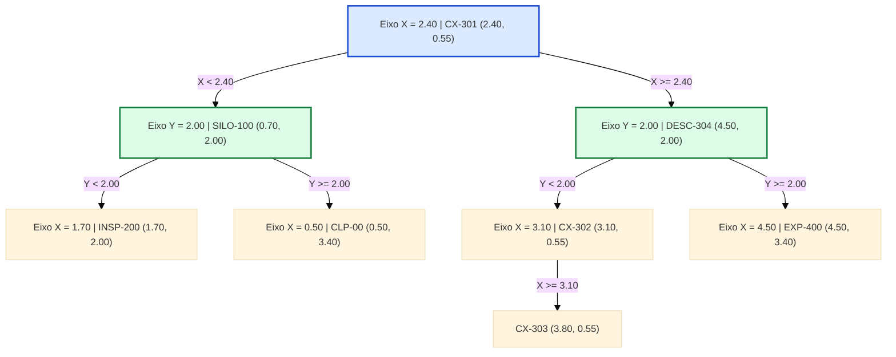

# Relatório Técnico: KD-Trees (Árvores $k$-Dimensionais) na Célula de Manufatura Flexível

**Indexação Espacial 2D para Aceleração da Primitiva `NEAREST` do `AGV-300` (RRT) e Classificação Multidimensional RGB no Túnel `INSP-200`**

### Informações do Projeto

| Parâmetro | Detalhe |
| :--- | :--- |
| **Unidade Industrial** | Célula de Manufatura Flexível e Triagem Automática de Peças (FMS) |
| **Setores Abrangidos** | Setor 100 (`SILO-100`), Setor 200 (`INSP-200`), Setor 300 (`CX-301..303`, `AGV-300`) e Setor 400 (`EXP-400`) |
| **Aplicação** | Busca de Vizinho Mais Próximo (*Nearest Neighbor*) e Busca por Alcance (*Range Search*) em $\mathbb{R}^2$ e $\mathbb{R}^3$ |
| **Método Formulado** | Árvore $k$-Dimensional (**KD-Tree**) com Particionamento por Mediana e Poda *Branch-and-Bound* |
| **Código do Projeto** | `ECAA08-MANUFATURA-FLEXIVEL` (SCADA-Core Manufatura Flexível) |

---

## 1. Contextualização e Gargalos Computacionais na FMS

Na **Célula de Manufatura Flexível (FMS)**, dois problemas críticos de tempo real exigem consultas geométricas rápidas em espaços contínuos multidimensionais:

1. **Aceleração do Planejamento RRT do `AGV-300` (Conexão com a Aula 22):**
   Na Aula 22, o espaço de trabalho da célula foi modelado em $\mathcal{C} = [0, 5{,}0\text{ m}] \times [0, 4{,}0\text{ m}]$ com $8$ obstáculos físicos (`CLP-00`, `SILO-100`, `ESTEIRA-M101`, `INSP-200`, `DIV-201/CX-301`, `DIV-202/CX-302`, `DIV-203/CX-303` e `DESC-304`). A primitiva `NEAREST` do RRT executava uma varredura linear $O(N)$ sobre todos os vértices da árvore a cada iteração. Para árvores densas com milhares de *waypoints* dinâmicos, o custo total escala para $O(N^2)$, comprometendo o tempo de resposta de replanejamento no controlador embarcado.
2. **Classificação Óptica Multidimensional no Túnel `INSP-200` (Setor 200):**
   Os detectores de cor (`AS-201`, `AS-202`, `AS-203`) e formato (`ZS-201`, `ZS-202`) operam sobre leituras contínuas de sensores RGB $(R, G, B) \in [0, 255]^3$ antes da discretização binária para o CLP. Classificar rapidamente uma peça ruidosa contra um banco calibrado de amostras ($k$-NN) para acionar `XV-201`, `XV-202`, `XV-203` ou rejeitar para `DESC-304` exige estrutura de indexação espacial sublinear.

A **KD-Tree (*k-Dimensional Tree*)** resolve ambos os problemas particionando recursivamente o espaço $\mathbb{R}^k$ por hiperplanos ortogonais aos eixos coordenados, reduzindo a complexidade média de busca de $O(N)$ para **$O(\log N)$**.

---

## 2. Formulação Matemática da KD-Tree

Uma KD-Tree é uma árvore binária de busca generalizada para pontos em $\mathbb{R}^k$:

### 2.1. Construção Balanceada por Mediana
Dado um conjunto $P \subset \mathbb{R}^k$ de $N$ pontos na profundidade $d \ge 0$:
1. Seleciona-se o eixo de corte (*splitting axis*) de forma cíclica:
   $$\text{axis} = d \bmod k$$
2. Ordenam-se os pontos pela coordenada $\text{axis}$ e escolhe-se a **mediana** $p_m$ como pivô do nó atual.
3. O hiperplano ortogonal $H = \{x \in \mathbb{R}^k \mid x_{\text{axis}} = p_{m,\text{axis}}\}$ divide o subespaço em dois semi-espaços:
   * Subárvore esquerda: $\{p \in P \mid p_{\text{axis}} < p_{m,\text{axis}}\}$
   * Subárvore direita: $\{p \in P \mid p_{\text{axis}} \ge p_{m,\text{axis}}\}$

A construção balanceada garante altura $h = \lfloor \log_2 N \rfloor + 1$.

### 2.2. Busca de Vizinho Mais Próximo (*Nearest Neighbor Search — NNS*) com Poda
Para encontrar o ponto $p^* \in P$ mais próximo de uma consulta $q \in \mathbb{R}^k$ sob métrica euclidiana $d(q, p) = \|q - p\|_2$:
1. **Descida Gulosa:** Navega-se até a folha correspondente à região de $q$, mantendo o melhor candidato atual $p_{\text{best}}$ e o menor raio $r_{\text{best}} = \|q - p_{\text{best}}\|_2$.
2. **Retrocesso (*Backtracking*) com Critério de Poda:** Ao retornar por um nó ancestral $p_m$ com eixo de corte $a = d \bmod k$, calcula-se a distância ortogonal de $q$ ao hiperplano de corte:
   $$\Delta_{\perp} = |q_a - p_{m,a}|$$
   * **Regra de Poda (*Branch-and-Bound*):** Se $\Delta_{\perp} \ge r_{\text{best}}$, a hiperesfera centrada em $q$ com raio $r_{\text{best}}$ **não intercepta** o semi-espaço oposto; portanto, toda a subárvore oposta é **descartada sem ser visitada**.

### 2.3. Busca por Alcance (*Range Search*)
Dado um hiper-retângulo ortogonal $B = [l_1, u_1] \times \dots \times [l_k, u_k]$ (ex.: zona de segurança ao redor de `INSP-200` ou `M-101`), a busca visita a subárvore esquerda apenas se $l_{\text{axis}} \le p_{m,\text{axis}}$ e a direita apenas se $u_{\text{axis}} \ge p_{m,\text{axis}}$.

---

## 3. Aplicação à Planta FMS: Layout 2D ($\mathcal{C}$-Space) e Espaço RGB 3D

### 3.1. Pontos de Interesse e Estações no Layout 2D ($\mathcal{C} = [0, 5{,}0\text{ m}] \times [0, 4{,}0\text{ m}]$)
Considerando as dimensões físicas documentadas na Aula 22, os centros e pontos de parada do `AGV-300` nas estações da célula formam o conjunto base de indexação $k=2$:

| Estação / Ponto | Coordenada $(X, Y)$ [m] | Função Operacional na FMS |
| :--- | :---: | :--- |
| `CLP-00` | $(0{,}50,\; 3{,}40)$ | Painel Central de Automação & SCADA |
| `SILO-100` | $(0{,}70,\; 2{,}00)$ | Ponto de reabastecimento de tarugos (`XV-101`) |
| `INSP-200` | $(1{,}70,\; 2{,}00)$ | Túnel óptico de visão (`ZS-201/202`, `AS-201..203`) |
| `CX-301` | $(2{,}40,\; 0{,}55)$ | Baia de coleta Vermelha (`DIV-201` / `US-301`) |
| `CX-302` | $(3{,}10,\; 0{,}55)$ | Baia de coleta Verde (`DIV-202` / `US-302`) |
| `CX-303` | $(3{,}80,\; 0{,}55)$ | Baia de coleta Azul (`DIV-203` / `US-303`) |
| `DESC-304` | $(4{,}50,\; 2{,}00)$ | Caçamba de descarte/refugo |
| `EXP-400` | $(4{,}50,\; 3{,}40)$ | Posto de expedição e paletização final |

---

## 4. Diagrama Estrutural da KD-Tree 2D das Estações FMS (Mermaid)

---

## 5. Análise de Complexidade e Limitações (*Curse of Dimensionality*)

| Operação | Busca Linear (Força Bruta) | KD-Tree (Caso Médio, $N \gg 2^k$) | KD-Tree (Pior Caso) |
| :--- | :---: | :---: | :---: |
| **Construção** | $O(1)$ | $O(N \log N)$ | $O(N \log N)$ |
| **Inserção Dinâmica** | $O(1)$ | $O(\log N)$ | $O(N)$ |
| **Vizinho Mais Próximo (NNS)** | $O(N)$ | **$O(\log N)$** | $O(N)$ |
| **Busca por Alcance (*Range*)** | $O(N)$ | $O(N^{1 - 1/k} + m)$ | $O(N)$ |

> [!IMPORTANT]
> **Maldição da Dimensionalidade (*Curse of Dimensionality*):** A eficiência de poda da KD-Tree se mantém excelente para baixas dimensões ($k \in \{2, 3, 4\}$, exatamente o caso da navegação 2D do `AGV-300` e da visão RGB 3D do `INSP-200`). Quando $k > 20$ e $N$ não cresce exponencialmente ($N \lesssim 2^k$), a hiperesfera de busca intercepta quase todos os hiperplanos, degradando a busca para $O(N)$.

---

## 6. Conclusões de Engenharia de Automação

1. **Aceleração Direta do Planejamento RRT (`AGV-300`):** A substituição da busca linear na primitiva `NEAREST` por uma KD-Tree 2D reduz drasticamente o número de avaliações de distância euclidiana no $\mathcal{C}$-Space $[0, 5{,}0] \times [0, 4{,}0]\text{ m}$, viabilizando replanejamento em tempo real no controlador do AGV.
2. **Robustez na Classificação Óptica (`INSP-200`):** Em espaço 3D $(R, G, B)$, a busca $k$-NN via KD-Tree permite classificar peças sob variações de iluminação industrial com baixa latência, garantindo o acionamento pontual dos desviadores `XV-201..203`.
3. **Equivalência Exata Garantida:** A poda *branch-and-bound* descarta apenas regiões geometricamente impossíveis de conter solução melhor, preservando **100% de exatidão matemática** em relação à força bruta.
