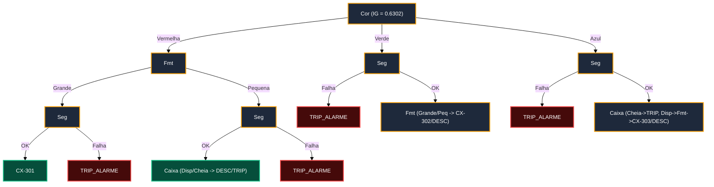
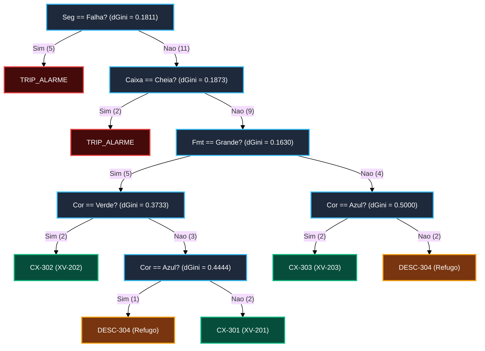

# Relatório Técnico: Árvores de Decisão — Algoritmos Clássicos de Construção de Árvore (ID3, C4.5 e CART)

**Classificação Inteligente de Rotas, Intertravamento e Supressão Hierárquica de Alarmes em Célula de Manufatura Flexível (FMS)**

### Informações do Projeto

| Parâmetro | Detalhe |
| :--- | :--- |
| **Unidade Industrial** | Célula de Manufatura Flexível e Triagem Automática de Peças (FMS) |
| **Setores Abrangidos** | Setor 100 (Alimentação), Setor 200 (Inspeção/Triagem) e Setor 300 (Loteamento/Segurança) |
| **Aplicação** | Indução de Árvores de Decisão para Roteamento, Intertravamento e Supressão de Alarmes SCADA |
| **Métodos Formulados** | **ID3** (Ganho de Informação), **C4.5** (Razão de Ganho / Poda) e **CART** (Impureza de Gini / Binária) |
| **Código do Projeto** | `ECAA08-MANUFATURA-FLEXIVEL` (SCADA-Core Manufatura Flexível) |

---

## 1. Contextualização e Objetivo de Engenharia de Controle e Automação

Ao longo da evolução do projeto **SCADA-Core Manufatura Flexível**, diferentes estruturas matemáticas foram empregadas para supervisionar e controlar a planta:
1. **Módulo 1 (Aulas 02 a 06 — Lógica Formal):** Os sinais discretos de campo da norma ISA-5.1 (`LS-101`, `ZS-101`, `ZS-201/202`, `AS-201..203`, `US-301..303`, `HS-301/302`) foram convertidos em proposições booleanas, e as equações de acionamento dos pistões desviadores (`XV-201..203`) e permissivos da esteira (`M-101`) foram minimizadas via Formas Normais e Quine-McCluskey (Aula 05).
2. **Módulo 2 (Aulas 11 a 18 — Grafos):** O escoamento físico de peças do `SILO-100` até as caixas `CX-301..303` e descarte `DESC-304` foi modelado como um dígrafo ponderado, permitindo roteamento dinâmico via BFS/DFS e Dijkstra.
3. **Módulo 3 (Aulas 19 e 20 — Árvores):** A topologia de cabeamento e ar comprimido foi otimizada via MST (Kruskal/Prim), e a telemetria foi comprimida com base na **Entropia de Shannon** (Huffman).

Entretanto, em sistemas supervisórios SCADA modernos operando sob grande volume de histórico (*Historian*), surgem dois desafios fundamentais que não são resolvidos de forma adaptativa por tabelas-verdade estáticas escritas manualmente:
* **Extração Automática de Regras de Decisão (Data-Driven Logic):** Dado um banco histórico de ciclos de operação da célula FMS (combinando sensores discretos e variáveis analógicas contínuas), como induzir automaticamente a estrutura de decisão mais compacta e determinística possível para reduzir a profundidade de avaliação no ciclo de varredura (*scan cycle*) do CLP?
* **Mitigação de Inundação de Alarmes (*Alarm Flood Mitigation* — Norma ISA-18.2):** Quando ocorre uma falha primária em um equipamento (como queda na linha de ar comprimido de $6\text{ bar}$ ou travamento mecânico do motor `M-101`), múltiplos sensores secundários disparam em cascata (`FC_p1..3`, timeouts no túnel `INSP-200`, acúmulo no alimentador `ZS-101`). Uma **Árvore de Decisão** bem construída isola hierarquicamente a **causa raiz** nos nós próximos à raiz, suprimindo alarmes secundários redundantes na IHM do operador.

Este relatório formaliza e aplica os três algoritmos clássicos de construção de árvores de decisão — **ID3**, **C4.5** e **CART** — diretamente sobre a planta de manufatura flexível.

---

## 2. Fundamentação Matemática dos Algoritmos Clássicos (TDIDT)

Os algoritmos clássicos seguem o paradigma guloso **TDIDT (*Top-Down Induction of Decision Trees*)**, derivado do algoritmo de Hunt: a cada nó, partindo do conjunto completo de treinamento $D$, escolhe-se o atributo (e eventual ponto de corte) que melhor particiona $D$ em subconjuntos cada vez mais **puros** quanto à classe-alvo, repetindo o processo recursivamente até atingir nós folha ou critérios de parada/poda.

### 2.1. Algoritmo ID3 (*Iterative Dichotomiser 3* — Quinlan, 1986)

O **ID3** opera sobre atributos categóricos/discretos e utiliza a **Entropia de Shannon** (já introduzida na Aula 20) para medir a incerteza ou desordem de um conjunto de dados $D$ com $C$ classes e proporções $p_k = \frac{|D_k|}{|D|}$:

$$H(D) = -\sum_{k=1}^{C} p_k \log_2(p_k) \quad [\text{bits}]$$

Ao particionar $D$ segundo um atributo discreto $A$ que assume valores $v \in \text{Valores}(A)$, a **Entropia Condicional** ponderada resultante é:

$$H(D \mid A) = \sum_{v \in \text{Valores}(A)} \frac{|D_v|}{|D|} H(D_v)$$

O critério de seleção do ID3 é a maximização do **Ganho de Informação (*Information Gain — IG*)**:

$$IG(D, A) = H(D) - H(D \mid A)$$

> [!WARNING]
> **Viés de Alta Cardinalidade do ID3:**
> Como $IG(D, A)$ não penaliza o número de partições geradas, o ID3 favorece artificialmente atributos com muitos valores distintos (ex.: códigos de lote, IDs de sensores ou múltiplas cores/faixas), fragmentando o conjunto de dados e duplicando testes de segurança em múltiplas subárvores.

---

### 2.2. Algoritmo C4.5 (Quinlan, 1993)

O **C4.5** estende o ID3 para corrigir o viés de cardinalidade, suportar atributos numéricos contínuos e realizar pós-poda contra ruído:

1. **Informação de Divisão (*Split Information*) e Razão de Ganho (*Gain Ratio*):**
   Mede a entropia intrínseca da própria partição gerada pelo atributo $A$:
   $$SplitInfo(D, A) = -\sum_{v \in \text{Valores}(A)} \frac{|D_v|}{|D|} \log_2\left(\frac{|D_v|}{|D|}\right)$$
   $$GR(D, A) = \frac{IG(D, A)}{SplitInfo(D, A)}$$
2. **Discretização Ótima de Atributos Contínuos:**
   Para uma variável contínua $X$ (como `Pressao_Ar_bar` ou `Corrente_M101_A`), ordenam-se os valores observados $x_1 \le x_2 \le \dots \le x_n$ e avaliam-se os pontos médios candidatos $t_j = \frac{x_j + x_{j+1}}{2}$ onde há mudança de classe, criando a divisão binária $X \le t$ versus $X > t$. Conforme Quinlan (1993), escolhe-se o limiar $t^*$ que maximiza $IG(D, X \le t^*)$ e calcula-se $GR(D, X \le t^*)$ para comparação justa com os demais atributos.
3. **Pós-Poda (*Pruning*):**
   Substitui subárvores que modelam ruído amostral por folhas majoritárias quando o erro estimado na validação ou erro pessimista não piora (*Reduced-Error Pruning* / *Pessimistic Error Pruning*).

---

### 2.3. Algoritmo CART (*Classification and Regression Trees* — Breiman et al., 1984)

O **CART** impõe uma restrição estrutural rigorosa: **toda divisão gera exatamente dois ramos (árvore estritamente binária)**, seja para atributos contínuos ($X \le t$ vs. $X > t$), seja para atributos categóricos ($A \in S$ vs. $A \notin S$). Na classificação, o CART minimiza a **Impureza de Gini**:

$$Gini(D) = 1 - \sum_{k=1}^{C} p_k^2$$

Para uma bipartição binária que divide $D$ em $D_E$ (ramo esquerdo) e $D_D$ (ramo direito), a impureza ponderada e a **Redução de Impureza de Gini** são:

$$Gini_{\text{split}}(D, A) = \frac{|D_E|}{|D|} Gini(D_E) + \frac{|D_D|}{|D|} Gini(D_D)$$

$$\Delta Gini(D, A) = Gini(D) - Gini_{\text{split}}(D, A)$$

Para evitar *overfitting* em séries com ruído eletromagnético industrial, o CART utiliza **Poda de Custo-Complexidade (*Cost-Complexity Pruning*)**, minimizando a função regularizada:

$$R_\alpha(T) = R(T) + \alpha \cdot |\tilde{T}|$$

onde $R(T)$ é a taxa de erro de classificação da árvore $T$, $|\tilde{T}|$ é o número de folhas terminais e $\alpha \ge 0$ é o parâmetro de penalização estrutural.

---

### 2.4. Quadro Comparativo Teórico

| Critério Técnico | ID3 (1986) | C4.5 (1993) | CART (1984) |
| :--- | :--- | :--- | :--- |
| **Métrica de Pureza** | Entropia de Shannon ($H$) | Entropia de Shannon ($H$) | Impureza de Gini ($Gini$) |
| **Critério de Seleção** | Ganho de Informação ($IG$) | Razão de Ganho ($GR = IG/SplitInfo$) | Redução de Gini ($\Delta Gini$) |
| **Topologia Gerada** | Multi-ramo ($k$-ária) | Multi-ramo (discreto) + Binária (contínuo) | **Estritamente Binária** |
| **Atributos Contínuos** | Não suporta nativamente | Suporta via busca de limiar ótimo $t^*$ | Suporta via busca de limiar ótimo $t^*$ |
| **Mecanismo de Poda** | Não possui nativamente | Pós-poda Pessimista / *Reduced-Error* | Poda de Custo-Complexidade ($R_\alpha$) |
| **Complexidade de Indução** | $\mathcal{O}(m \cdot n \cdot d)$ | $\mathcal{O}(m \cdot n \log n)$ | $\mathcal{O}(m \cdot n \log n)$ |
| **Aderência a CLP (IEC 61131-3)** | Requer estruturas `CASE OF` | Híbrido `CASE` / `IF` | **Mapeamento 1:1 para blocos `IF / ELSE`** |

*(Nota: $m$ = número de atributos, $n$ = número de amostras, $d$ = profundidade da árvore).*

---

## 3. Estudo de Caso 1: Roteamento e Intertravamento da FMS (Rastreamento Completo)

### 3.1. Modelagem das Variáveis de Entrada e Saída da Planta

Utilizando diretamente as definições de campo da Parte 1 e Parte 2:
* **`Seg` (Integridade de Segurança & Sensores):** `OK` quando `HS-301` ($e_1=0$), sem sobrecarga `TH-101`, sem contradição geométrica ($\neg(\overline{s_a} \land s_b)$) e sem ambiguidade RGB; `Falha` caso contrário.
* **`Caixa` (Capacidade das Baias `US-301..303`):** `Disp` quando a caixa destino possui $< 10$ peças; `Cheia` quando atingiu o lote de $10$ peças (`FULL-300`).
* **`Fmt` (Formato via `ZS-201` e `ZS-202`):** `Grande` ($s_a \land s_b$) ou `Pequena` ($s_a \land \neg s_b$).
* **`Cor` (Cor RGB via `AS-201..203`):** `Vermelha` ($c_r$), `Verde` ($c_g$) ou `Azul` ($c_b$).

**Classes-alvo (`Acao_SCADA`):**
* `CX-301`: Avança pistão `XV-201` (Peça Grande Vermelha);
* `CX-302`: Avança pistão `XV-202` (Peça Grande Verde);
* `CX-303`: Avança pistão `XV-203` (Peça Pequena Azul);
* `DESC-304`: Nenhum pistão acionado; segue pela esteira `M-101` para a calha de sucata/refugo;
* `TRIP_ALARME`: Bloqueia alimentação `XV-101`, interrompe ciclo e aciona sinaleiro `HS-302` ($a_1=1$).

### 3.2. Conjunto Histórico de Treinamento ($N = 16$ Ciclos Auditáveis)

| ID | `Seg` | `Caixa` | `Fmt` | `Cor` | `Acao_SCADA` (Classe) | Justificativa Física na Planta |
| :---: | :---: | :---: | :---: | :---: | :---: | :--- |
| **01–02** | `OK` | `Disp` | `Grande` | `Vermelha` | `CX-301` (2x) | Rota nominal via `DIV-201` (`XV-201`) |
| **03–04** | `OK` | `Disp` | `Grande` | `Verde` | `CX-302` (2x) | Rota nominal via `DIV-202` (`XV-202`) |
| **05–06** | `OK` | `Disp` | `Pequena` | `Azul` | `CX-303` (2x) | Rota nominal via `DIV-203` (`XV-203`) |
| **07** | `OK` | `Disp` | `Pequena` | `Vermelha` | `DESC-304` | Fora de especificação $\rightarrow$ refugo |
| **08** | `OK` | `Disp` | `Pequena` | `Verde` | `DESC-304` | Fora de especificação $\rightarrow$ refugo |
| **09** | `OK` | `Disp` | `Grande` | `Azul` | `DESC-304` | Fora de especificação $\rightarrow$ refugo |
| **10** | `OK` | `Cheia` | `Pequena` | `Vermelha` | `TRIP_ALARME` | Intertravamento `FULL-300` (troca de lote) |
| **11** | `OK` | `Cheia` | `Pequena` | `Azul` | `TRIP_ALARME` | Intertravamento `FULL-300` (troca de lote) |
| **12** | `Falha` | `Disp` | `Grande` | `Vermelha` | `TRIP_ALARME` | Falha de segurança / contradição sensorial |
| **13** | `Falha` | `Disp` | `Grande` | `Verde` | `TRIP_ALARME` | Falha de segurança / contradição sensorial |
| **14** | `Falha` | `Disp` | `Pequena` | `Azul` | `TRIP_ALARME` | Falha de segurança / contradição sensorial |
| **15** | `Falha` | `Disp` | `Pequena` | `Vermelha` | `TRIP_ALARME` | Falha de segurança / contradição sensorial |
| **16** | `Falha` | `Cheia` | `Grande` | `Azul` | `TRIP_ALARME` | Falha simultânea de segurança e lote cheio |

### 3.3. Cálculo Analítico no Nó Raiz ($N = 16$)

Distribuição das classes na raiz: $(2, 2, 2, 3, 7)$ para (`CX-301`, `CX-302`, `CX-303`, `DESC-304`, `TRIP_ALARME`).

1. **Entropia de Shannon na Raiz:**
   $$H(D) = -3 \cdot \left(\frac{2}{16}\log_2\frac{2}{16}\right) - \frac{3}{16}\log_2\frac{3}{16} - \frac{7}{16}\log_2\frac{7}{16} = \mathbf{2{,}0996\text{ bits}}$$

2. **Impureza de Gini na Raiz:**
   $$Gini(D) = 1 - \left[\left(\frac{2}{16}\right)^2 + \left(\frac{2}{16}\right)^2 + \left(\frac{2}{16}\right)^2 + \left(\frac{3}{16}\right)^2 + \left(\frac{7}{16}\right)^2\right] = 1 - \frac{70}{256} = \mathbf{0{,}7266}$$

3. **Avaliação Comparativa de Todos os Atributos na Raiz:**

| Atributo | Partições ($v$) | $H(D \mid A)$ | $IG(D, A)$ **[ID3]** | $SplitInfo(D, A)$ | $GR(D, A)$ **[C4.5]** | Melhor Corte Binário **[CART]** | $Gini_{\text{split}}$ | $\Delta Gini$ **[CART]** |
| :--- | :--- | :---: | :---: | :---: | :---: | :--- | :---: | :---: |
| **`Seg`** | `OK` (11), `Falha` (5) | $1{,}5812$ | $0{,}5184$ | $0{,}8960$ | **`0,5786`** | `Seg == Falha` vs `OK` | $0{,}5455$ | **`0,1811`** |
| **`Caixa`** | `Disp` (13), `Cheia` (3) | $1{,}8344$ | $0{,}2652$ | $0{,}6962$ | $0{,}3809$ | `Caixa == Cheia` vs `Disp` | $0{,}6346$ | $0{,}0919$ |
| **`Fmt`** | `Grande` (8), `Pequena` (8) | $1{,}7028$ | $0{,}3968$ | $1{,}0000$ | $0{,}3968$ | `Fmt == Grande` vs `Pequena` | $0{,}6719$ | $0{,}0547$ |
| **`Cor`** | `Verm` (6), `Verd` (4), `Azul` (6) | $1{,}4694$ | **`0,6302`** | $1{,}5613$ | $0{,}4037$ | `Cor == Verde` vs `{Verm, Azul}` | $0{,}6563$ | $0{,}0703$ |

> [!IMPORTANT]
> **Divergência Clássica Observada na Raiz da Planta FMS:**
> * O **ID3** escolhe **`Cor`** na raiz ($IG = 0{,}6302$) por causa da fragmentação em 3 subconjuntos ($SplitInfo = 1{,}5613\text{ bits}$), adiando a verificação de segurança `Seg` e duplicando checagens de emergência/alarme dentro de cada subárvore de cor!
> * O **C4.5** ($GR = 0{,}5786$) e o **CART** ($\Delta Gini = 0{,}1811$) selecionam **`Seg`** na raiz, reproduzindo exatamente o princípio de engenharia de sistemas instrumentados de segurança (**SIS**): verificar primeiro se há emergência ou falha sensorial antes de prosseguir para loteamento e triagem.

### 3.4. Expansão Subsequente para C4.5 e CART

Seguindo a árvore **C4.5** a partir da raiz `Seg`:
* **Ramo `Seg = Falha` ($n = 5$):** Todas as $5$ amostras são `TRIP_ALARME` $\implies$ $H = 0 \implies$ **Folha Pura `TRIP_ALARME`**.
* **Ramo `Seg = OK` ($n = 11$, $H = 2{,}2999$, $Gini = 0{,}7934$):**
  * `Caixa`: $IG = 0{,}6840$, $SplitInfo = 0{,}6840 \implies GR = \mathbf{1{,}0000}$ ($\Delta Gini = \mathbf{0{,}1873}$) $\rightarrow$ **Vence `Caixa`!**
  * `Cor`: $IG = 0{,}9585$, $SplitInfo = 1{,}5726 \implies GR = 0{,}6095$ ($\Delta Gini_{\text{Verde}} = 0{,}1267$).
  * `Fmt`: $IG = 0{,}5618$, $SplitInfo = 0{,}9940 \implies GR = 0{,}5651$ ($\Delta Gini = 0{,}1085$).
* **Ramo `Seg = OK` $\land$ `Caixa = Cheia` ($n = 2$):** **Folha Pura `TRIP_ALARME`**.
* **Ramo `Seg = OK` $\land$ `Caixa = Disp` ($n = 9$, $H = 1{,}9749$, $Gini = 0{,}7407$):**
  * `Fmt`: $IG = 0{,}6850$, $SplitInfo = 0{,}9911 \implies GR = \mathbf{0{,}6911}$ ($\Delta Gini = \mathbf{0{,}1630}$) $\rightarrow$ **Vence `Fmt`!**
  * `Cor`: $IG = 1{,}0566$, $SplitInfo = 1{,}5850 \implies GR = 0{,}6667$ ($\Delta Gini = 0{,}1481$).
* **Nível 4 — Folhas Finais:**
  * Para `Fmt = Grande` ($n=5$): **C4.5** ramifica em `Cor` ($GR=1{,}0$) $\rightarrow$ `Vermelha: CX-301`, `Verde: CX-302`, `Azul: DESC-304`. Já o **CART** realiza duas bipartições binárias (em empate de $\Delta Gini = 0{,}3733$ entre `Verde` e `Vermelha`, o desempate lexicográfico escolhe `Cor == Verde`): `Cor == Verde` $\rightarrow$ `CX-302` ($Gini=0$); senão, `Cor == Azul` $\rightarrow$ `DESC-304` vs. `CX-301`.
  * Para `Fmt = Pequena` ($n=4$): **C4.5** gera 3 ramos (`Vermelha: DESC-304`, `Verde: DESC-304`, `Azul: CX-303`), enquanto o **CART** descobre a divisão ótima única `Cor == Azul` ($\Delta Gini = 0{,}5000$, $Gini_{\text{split}} = 0{,}0000$), agrupando automaticamente peças vermelhas e verdes pequenas na folha `DESC-304`!

### 3.5. Representação Esquemática Comparativa (Mermaid)

#### Árvore Induzida pelo ID3 (Viés de Alta Cardinalidade na Raiz)



#### Árvore Induzida pelo CART (Hierarquia Estrita de Segurança + Cortes Binários)



---

## 4. Estudo de Caso 2: Telemetria Contínua, Poda e Supressão Hierárquica de Alarmes

Em operação real com instrumentação analógica e discreta integrada no SCADA-Core, o controlador monitora simultaneamente:
* `Pressao_Ar_bar` ($\mathbb{R}^+$): Pressão do manifold pneumático (nominal $6{,}0\text{ bar}$; falha abaixo de $\approx 4{,}3\text{ bar}$);
* `Corrente_M101_A` ($\mathbb{R}^+$): Corrente RMS do motor da esteira principal `M-101` (nominal $2{,}4\text{ A}$; sobrecarga térmica `TH-101` acima de $\approx 4{,}2\text{ A}$);
* `Tempo_Inspecao_ms` ($\mathbb{R}^+$): Tempo de permanência da peça no túnel `INSP-200` (nominal $320\text{ ms}$; atolamento mecânico acima de $\approx 600\text{ ms}$);
* `ESD_301` ($\{0, 1\}$): Botão cogumelo de emergência `HS-301`;
* `LS_101` ($\{0, 1\}$): Chave de nível baixo no `SILO-100`.

### 4.1. O Fenômeno da Inundação de Alarmes (*Alarm Flood*)
Quando ocorre uma **queda na pressão pneumática** (`Pressao_Ar_bar < 4.3 bar`), o pistão `XV-101` e os desviadores `XV-201..203` perdem força de atuação. Consequentemente, as chaves fim de curso `FC_p1`, `FC_p2` e `FC_p3` falham em comutar dentro da janela de *timeout*, disparando **4 a 5 alarmes secundários simultâneos** na tela do operador.

Aplicando o algoritmo **CART contínuo com Poda (*Reduced-Error Pruning* / controle de `max_depth`)** sobre um histórico de $N = 360$ ciclos com ruído de leitura 4–20 mA:
1. O algoritmo descobre automaticamente os limiares físicos exatos próximos de `Pressao_Ar_bar <= 4.30`, `Corrente_M101_A > 4.20` e `Tempo_Inspecao_ms > 600.0`;
2. A árvore classifica cada evento na **Causa Raiz Única** (`NORMAL`, `E_STOP`, `SOBRECARGA_M101`, `BAIXA_PRESSAO_AR`, `ATOLAMENTO_INSP`, `SILO_VAZIO`), suprimindo os alarmes derivados na IHM;
3. **Efeito da Poda:** Árvores sem restrição de profundidade ($depth > 6$) memorizam ruído gaussiano dos transdutores analógicos (*overfitting*), reduzindo a acurácia no conjunto de validação e aumentando a latência de varredura. A pós-poda reduz drasticamente o número de nós mantendo ou elevando a acurácia de generalização.

---

## 5. Tradução Determinística para CLP (IEC 61131-3 — Structured Text)

Uma das maiores vantagens do **CART** na engenharia de controle é que sua estrutura estritamente binária converte-se diretamente em código **Texto Estruturado (ST)** auditável para o CLP Siemens S7-1500, com complexidade de pior caso $\mathcal{O}(d)$ (onde $d \le 5$ comparações por ciclo de *scan*):

```iecst
(* Bloco FB_Decisao_Triagem_FMS gerado a partir da Árvore CART *)
IF (Seg_Falha = TRUE) THEN
    Acao_SCADA := TRIP_ALARME;  (* Ativa HS-302, bloqueia XV-101 *)
ELSIF (Caixa_Cheia = TRUE) THEN
    Acao_SCADA := TRIP_ALARME;  (* Intertravamento FULL-300: troca de lote *)
ELSIF (Fmt_Grande = TRUE) THEN
    IF (Cor = 'Verde') THEN
        Acao_SCADA := 'CX-302';   (* Avanca XV-202 *)
    ELSIF (Cor = 'Azul') THEN
        Acao_SCADA := 'DESC-304'; (* Descarte / Refugo *)
    ELSE
        Acao_SCADA := 'CX-301';   (* Avanca XV-201 - Vermelha *)
    END_IF;
ELSE
    IF (Cor_Azul = TRUE) THEN
        Acao_SCADA := CX_303;   (* Avanca XV-203 *)
    ELSE
        Acao_SCADA := DESC_304; (* Agrupamento binario CART: Vermelha/Verde *)
    END_IF;
END_IF;
```

---

## 6. Entregável Computacional da Aula 27

A implementação completa do zero (*from scratch*) em Python orientado a objetos dos algoritmos **ID3**, **C4.5** (com Razão de Ganho, discretização contínua e pós-poda) e **CART** (com Impureza de Gini, divisões binárias e gerador automático de código ST), acompanhada de tabelas comparativas, gráficos de poda/fronteira de decisão e asserções de verificação formal, encontra-se no notebook:

* [`Aula 27 - Arvores de Decisao - Algoritmos Classicos de Construcao de Arvore.ipynb`](./Aula%2027%20-%20Arvores%20de%20Decisao%20-%20Algoritmos%20Classicos%20de%20Construcao%20de%20Arvore.ipynb)

---

## 7. Referências Técnicas

1. QUINLAN, J. R. **Induction of Decision Trees**. *Machine Learning*, v. 1, n. 1, p. 81-106, 1986. (Algoritmo ID3).
2. QUINLAN, J. R. **C4.5: Programs for Machine Learning**. San Mateo: Morgan Kaufmann Publishers, 1993.
3. BREIMAN, L.; FRIEDMAN, J. H.; OLSHEN, R. A.; STONE, C. J. **Classification and Regression Trees**. Belmont: Wadsworth International Group, 1984. (Algoritmo CART).
4. MITCHELL, T. M. **Machine Learning**. New York: McGraw-Hill, 1997. (Capítulo 3: Decision Tree Learning).
5. INTERNATIONAL SOCIETY OF AUTOMATION. **ANSI/ISA-18.2-2016: Management of Alarm Systems for the Process Industries**. Research Triangle Park: ISA, 2016.
6. INTERNATIONAL ELECTROTECHNICAL COMMISSION. **IEC 61131-3: Programmable controllers — Programming languages**. Geneva: IEC, 2013.
